# Bun3.Gameplay 구조 지도

- 기준: `Bun3.Gameplay` 0.14.0 · `Bun3.Gameplay.Authoring` 0.3.0
- 다이어그램만 위에서부터 순서대로 보면 패키지가 무엇을 하는지, 무엇으로 만들었는지, 무엇을 중요하게 지켰는지 잡히도록 구성했다.
- 결정의 근거와 경위는 스펙이 정본이다 — [프레임워크](../superpowers/specs/2026-08-10-gameplay-framework-design.md) ·
  [속성·효과](../superpowers/specs/2026-08-17-gameplay-slice2-attributes-effects-design.md) ·
  [어빌리티·유닛·월드](../superpowers/specs/2026-08-20-gameplay-slice3-ability-unit-world-design.md)

**색 범례**

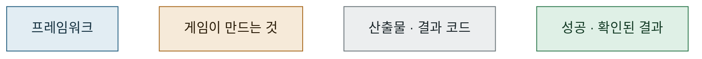

## 1. 무엇을 하는 패키지인가

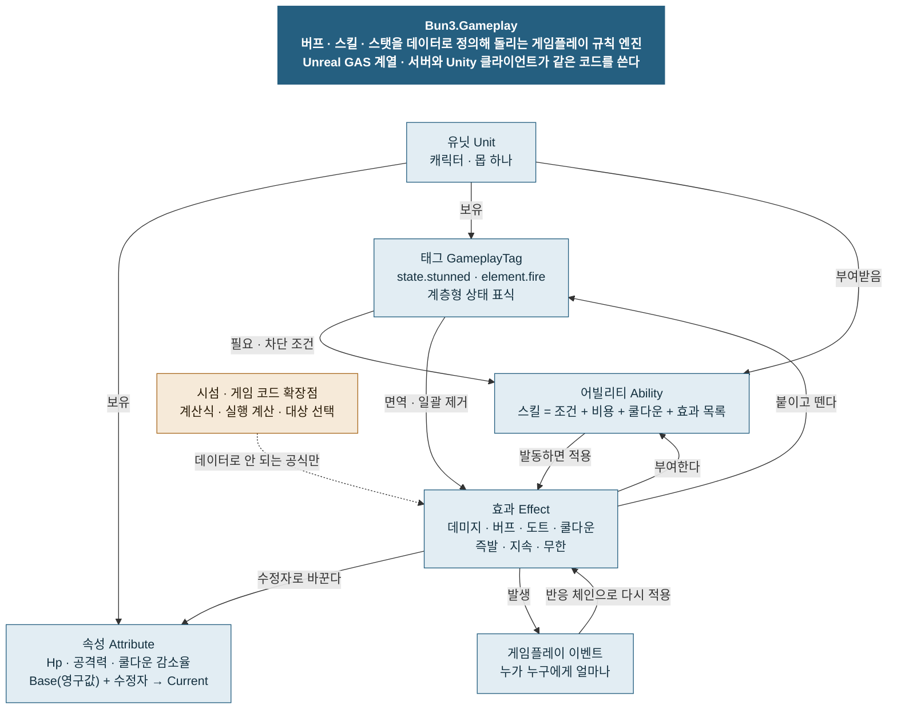

## 2. 예: 가시 갑옷 — 코드 0줄로 만든 피해 반사

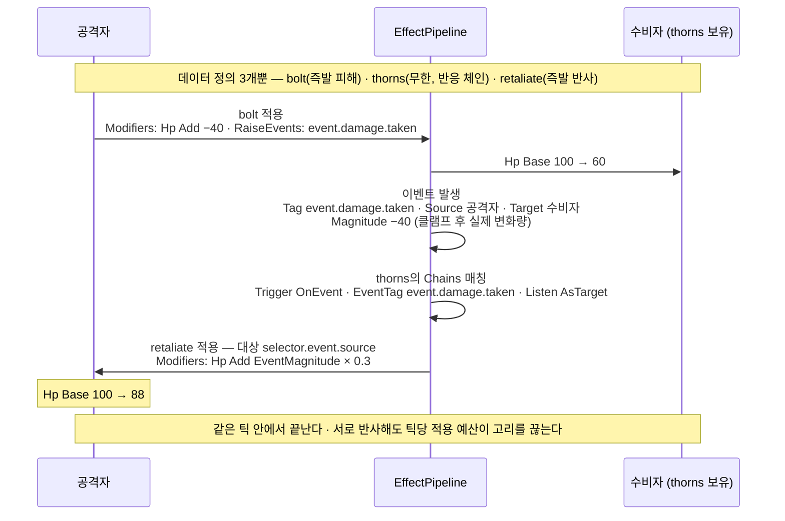

## 3. 중요하게 지킨 것

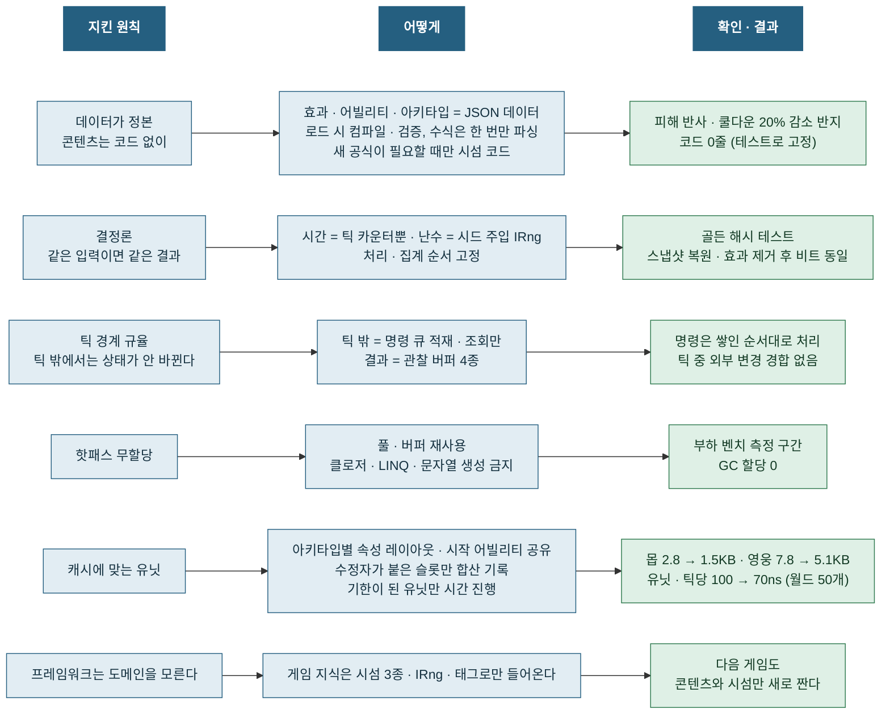

수치는 i7-13700K에서 현실 인구 벤치(영웅 + 몹 웨이브)를 번갈아 3회 돌린 최솟값이다.

## 4. 패키지와 기술 스택

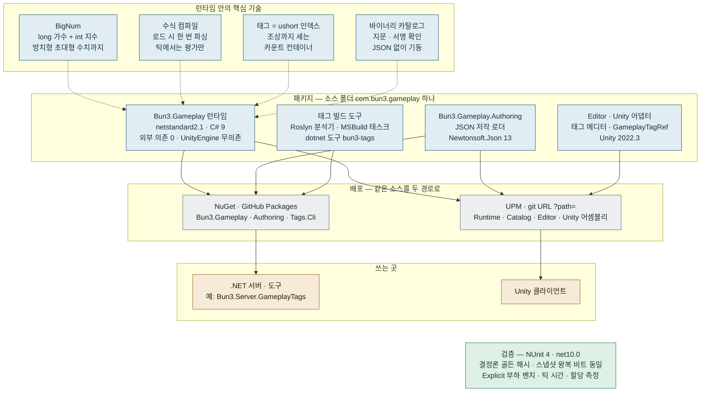

## 5. 콘텐츠 파이프라인 — 저작부터 실행까지

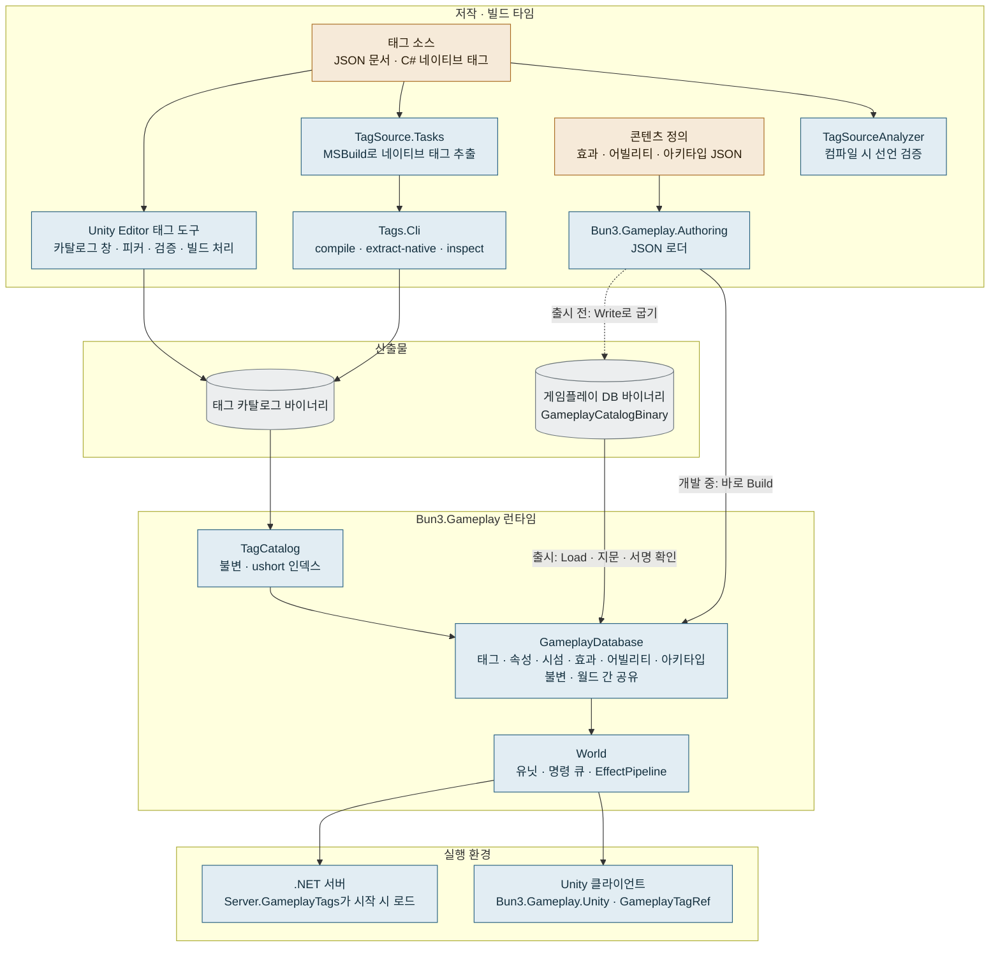

## 6. 기동 순서 — 코드로 월드 하나 띄우기

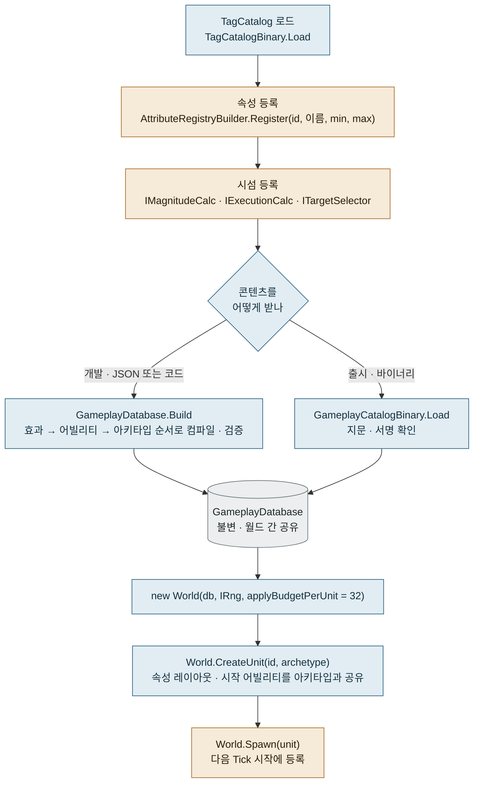

## 7. 게임과의 경계 — 누가 무엇을 만드나

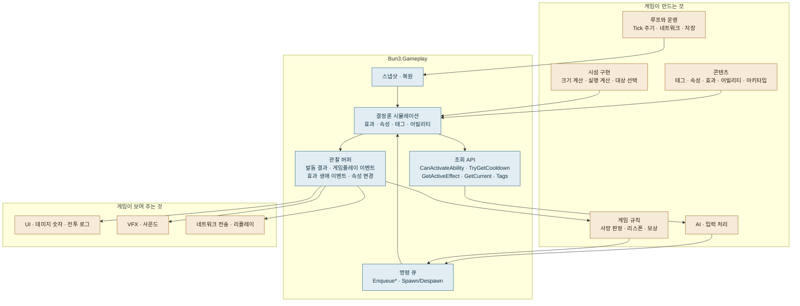

## 8. 한 틱의 흐름

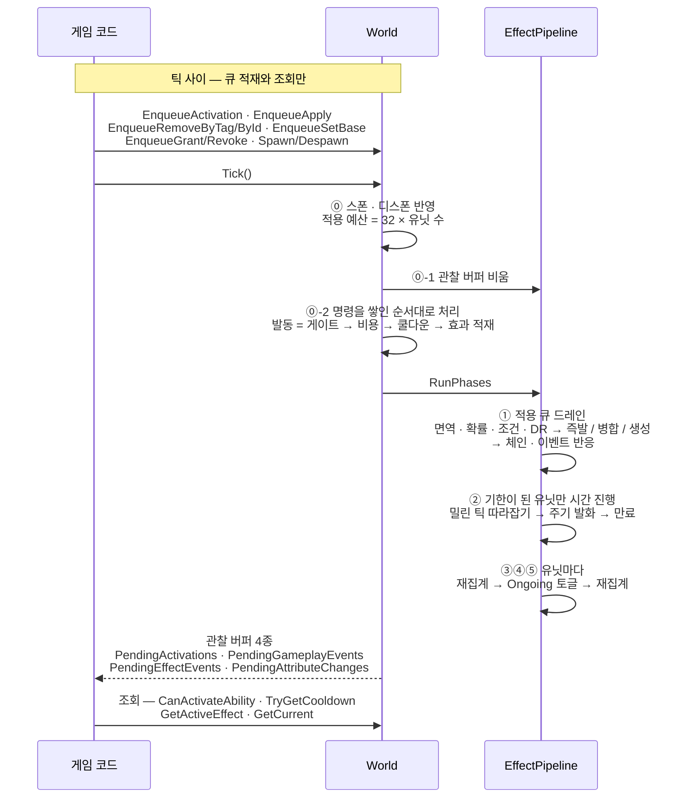

## 9. 어빌리티 발동 게이트

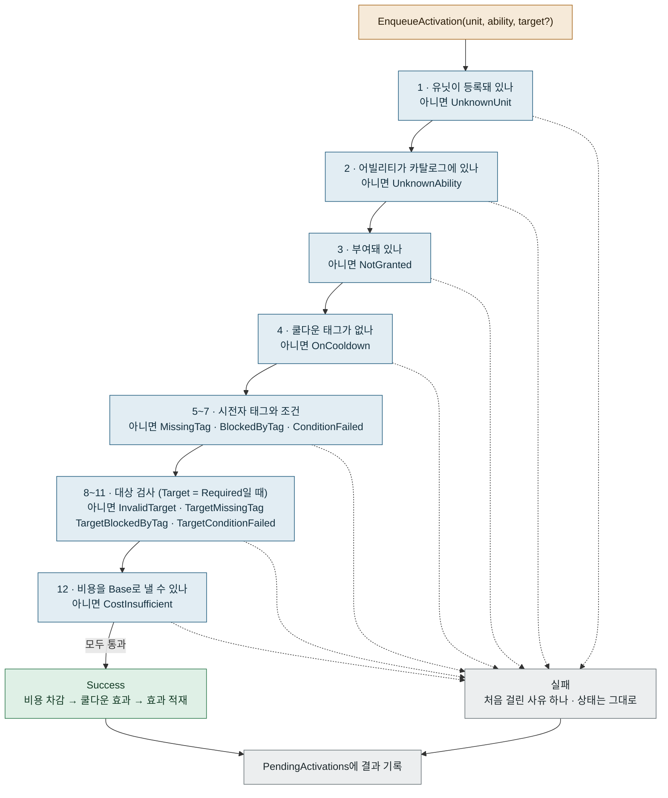

## 10. 효과의 생애

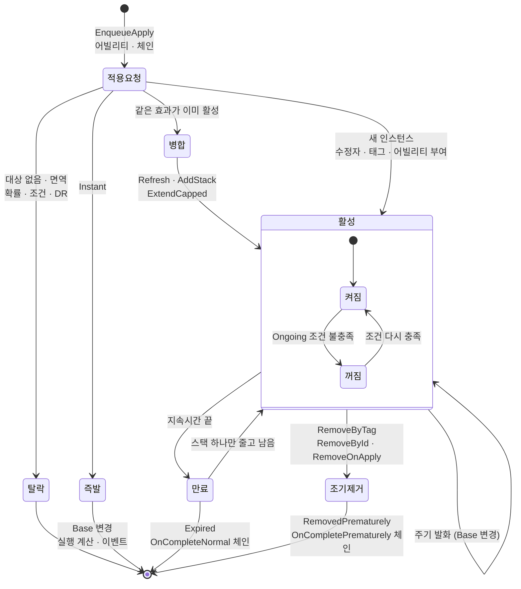

## 11. 시간은 필요할 때만 흐른다

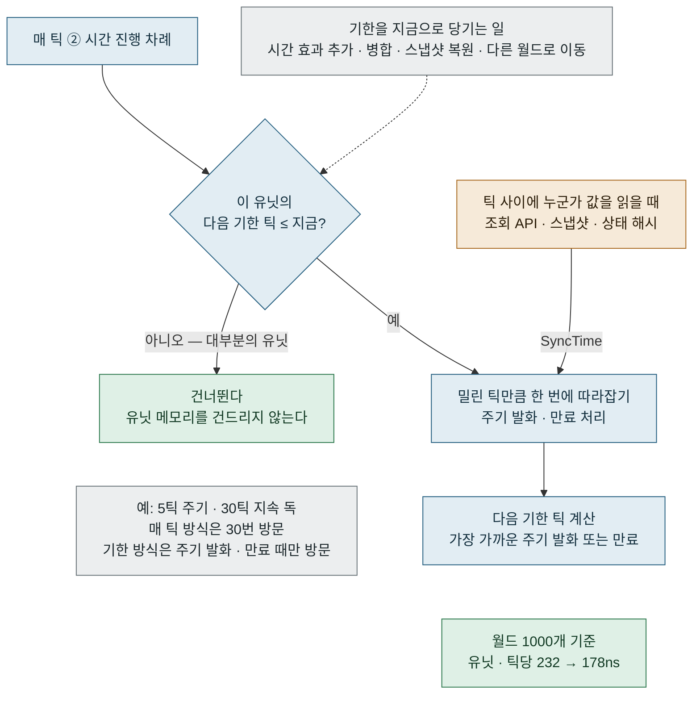

## 12. 유닛 한 개의 구조

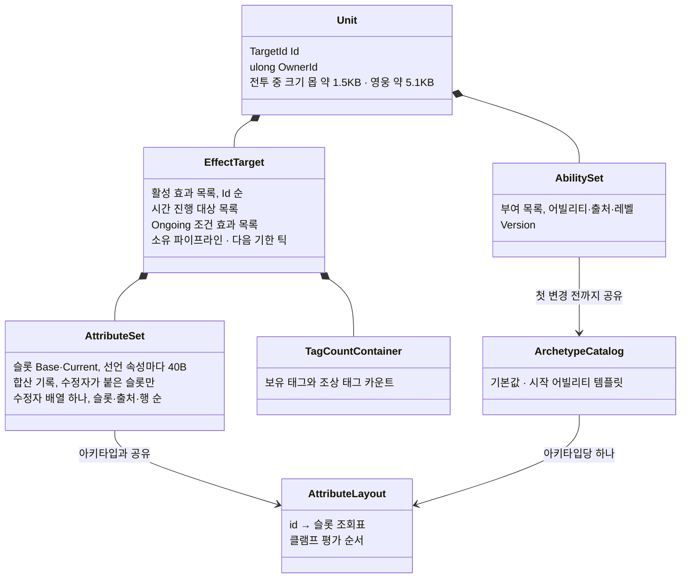
