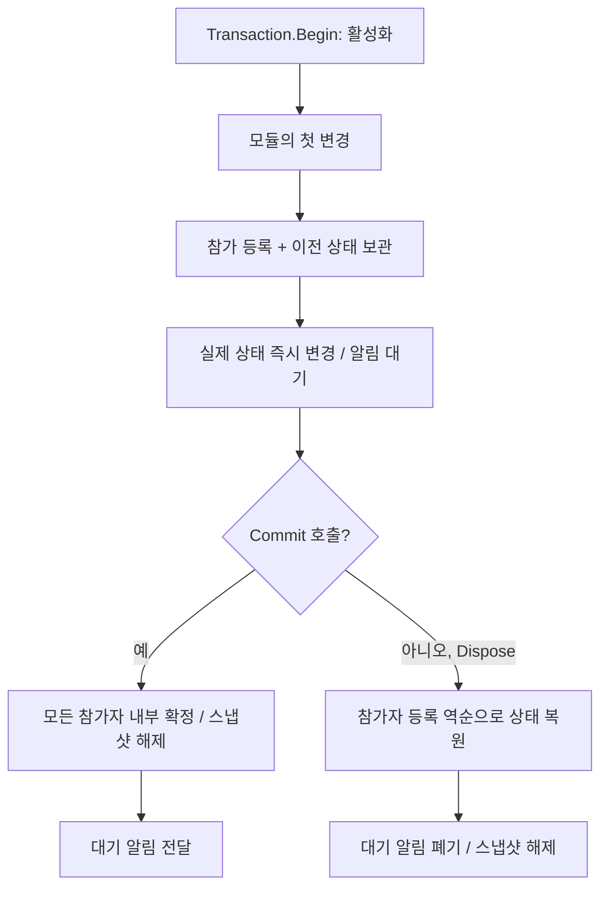

# Items와 Achievements의 롤백 구조

현재 `ItemInstance<TState>`에는 기존 opaque 상태의 명시적 복사 scope와 [생성 옵션 상태](generated-option-state.md)의 자동 추적이라는 두 계약이 있다. 아래 `BeginStateChange()`와 `snapshotState` 예제는 opaque 상태용이다. 생성 상태는 생성된 프로퍼티와 `TrackedList<T>`를 직접 수정하며 활성 `Transaction`에서 변경마다 역순 Undo를 기록한다. 한 인스턴스의 수명 동안 두 방식을 섞을 수 없다. null·opaque 루트로 교체해도 이미 사용한 방식의 제한은 유지된다. 인벤토리 첫 참가 시 두 사전의 얕은 복사는 두 방식 모두에 남는다.

두 모듈의 변경은 **호출 즉시 실제 객체에 적용**된다. `Transaction`은 변경을 임시 영역에 모아 나중에 실행하는 기능이 아니다. 변경 전 상태를 보관했다가, `Commit()` 없이 scope를 닫으면 되돌리는 기능이다.

## 1. Transaction은 선택 사항이다

```csharp
var inventory = new ItemInventory<ItemState>(
    itemCatalog,
    instanceIdIssuer: IssueInstanceId,
    stateFactory: CreateItemState);

var achievements = new AchievementManager<AchievementDefinition>(achievementCatalog);
```

`transaction`을 생략하면 일반 지급·소모·진행·보상 수령을 그대로 사용할 수 있다. 알림은 작업 직후 전달되고 롤백 전용 보관 객체는 만들어지지 않는다. `BeginStateChange()`와 `MarkChanged()`도 사용할 수 있으며, 롤백하지 않으므로 `snapshotState`는 필요 없다.

공유 `Transaction`을 연결했어도 `Begin()`을 호출하지 않은 구간은 같은 경로로 동작한다. 변경 API를 호출하지 않은 빈 트랜잭션도 모듈의 보관 객체를 생성하지 않는다. 기본 기능용 컬렉션, Core 패키지 의존성, 알림 전달 버퍼까지 제거한다는 뜻은 아니다.

`inventory.BeginTransaction()`은 단일 인벤토리의 작업들을 모아 사전 검증하는 `InventoryTransaction` 빌더다. 여러 모듈을 묶는 `Bun3.Server.Core.Transaction`과 별개이며 독립적으로 사용할 수 있다.

## 2. 여러 호출을 함께 되돌리는 사용법

참여할 두 모듈에 **동일한 Transaction 객체**를 주입한다. 아래 예제의 `CloneState`는 5절과 같은 독립 복사 함수다.

```csharp
var transaction = new Bun3.Server.Core.Transaction();
var inventory = new ItemInventory<ItemState>(
    itemCatalog, IssueInstanceId, CreateItemState,
    transaction: transaction,
    snapshotState: CloneState);
var achievements = new AchievementManager<AchievementDefinition>(
    achievementCatalog, transaction: transaction);
```

예를 들어 이미 완료된 업적의 수령 처리와 아이템 지급을 묶는다.

```csharp
bool TryClaimReward(AchievementId achievement, ItemId reward)
{
    using (var scope = transaction.Begin())
    {
        if (!achievements.TryClaim(achievement))
            return false;

        if (inventory.TryAdd(reward, 1) != InventoryError.None)
            return false;

        scope.Commit();
        return true;
    }
}
```

지급이 실패해 중간에 반환하면 `Dispose()`가 실행되어 앞서 증가한 업적 수령 횟수도 복원된다. `TryAdd`가 실패 값을 반환하는 것 자체가 전체 롤백을 일으키지는 않는다. 호출자가 `Commit()`을 생략하고 scope를 닫아야 한다. 두 모듈에 Transaction을 연결하지 않으면 나중 호출의 실패가 앞선 호출을 되돌리지 않는다.

## 3. 언제, 무엇을 보관하는가



| 보관 대상 | 보관 시점 | 보관 내용 |
|---|---|---|
| 인벤토리 목록 | 해당 인벤토리의 첫 변경 직전 | 인스턴스 ID → 객체 참조 사전 전체의 얕은 복사 |
| 재생 기준 | 위와 같음 | 아이템별 재생 기준 시각 사전 전체 |
| 아이템 한 개의 필드 | 해당 인스턴스의 첫 변경 직전 | 수량, 플래그, 만료 시각, 신규/변경 표시, 최초 State |
| opaque 가변 State | 해당 인스턴스의 첫 `BeginStateChange()` 직전 | 보관된 최초 State의 독립 복사본 |
| 생성 State | 해당 필드·자식·목록의 실제 변경 직전 | 타입별 이전 값과 소유권·목록 역연산을 순서대로 기록 |
| 저장용 변경 추적 | 인벤토리 참가 시 | 제거 목록의 원래 길이, `HasChanges`의 원래 값 |
| 업적 | 해당 ID의 첫 변경 직전 | `AchievementState` 구조체 값 전체 |
| 알림 | 변경 시 | dirty 여부, 아이템 변경 알림, 업적 완료 알림, 자동 로그 첨부 |

사전의 얕은 복사는 목록만 고정한다. 원본과 복사본은 같은 `ItemInstance`를 가리키므로, 수량 같은 객체 내부 필드는 별도로 보관해야 한다. 동일 인스턴스나 업적을 여러 번 바꿔도 최초 값은 한 번만 보관한다.

롤백 전용 보관 객체와 컬렉션은 활성 트랜잭션의 캡처 경로에 처음 들어갈 때 생성한다. 같은 진행도를 다시 설정하는 `SetProgress`처럼 최종 값이 변하지 않는 일부 변경 API도 캡처할 수 있다. 이후에는 내용을 비우고 용량을 재사용한다. 따라서 미사용 비용을 줄이지만, 이미 사용한 객체가 확보한 최대 용량을 매번 반납하는 정책은 아니다.

## 4. 롤백과 커밋의 정확한 순서

`Commit()` 없이 scope를 닫으면 Core가 등록된 참가자를 역순으로 호출한다. 예제처럼 업적이 먼저 변경되고 인벤토리가 다음에 변경되었다면 인벤토리부터 복원한다. 오류를 반환해 인벤토리가 전혀 변경되지 않았다면 업적만 참가했을 수 있다.

인벤토리는 다음 순서로 복원한다.

1. 트랜잭션 참가 표시와 대기 알림을 해제한다.
2. 인스턴스 사전을 보관한 목록으로 되돌린다. 새로 생성된 아이템은 목록에서 빠지고, 제거된 아이템은 돌아온다.
3. 아이템 종류별 보조 인덱스를 복원된 목록에서 재구성하고 재생 기준도 되돌린다.
4. 생성 상태 journal의 항목을 전체 역순으로 복원한 뒤 변경 인스턴스의 기존 필드·opaque 상태를 보관 역순으로 복원한다. 복원용 내부 메서드를 사용하므로 setter 알림이나 추가 캡처를 일으키지 않는다.
5. 복원된 목록에 있는 객체의 소유자를 다시 연결하고, 트랜잭션에서 새로 만든 객체는 인벤토리에서 분리한다.
6. 제거 목록을 원래 길이로 줄이고 `HasChanges`를 복원한다. 스냅샷의 객체 참조는 비운다.

업적은 변경한 ID마다 보관했던 구조체를 다시 써 넣는다. 진행도·완료 횟수·수령 횟수·완료 시각·활성 상태가 함께 복원된다. 대기 로그/완료 알림을 버리고 캡처 표시와 보관 목록을 비운다.

`Commit()`은 이미 적용된 상태를 유지한다. 먼저 모든 참가자의 `OnCommit()`으로 스냅샷을 해제하고 알림을 고정한다. 그 다음 `OnCommitted()`가 알림을 전달한다. **커밋 알림에서 발생한 예외는 확정된 상태를 롤백하지 않는다.** 일반 변경의 콜백 재진입은 지원하지만, 완료 처리 도중 새로운 `Transaction.Begin()`은 허용하지 않는다.

## 5. TState: 값 교체와 가변 편집

### 값 교체

이전 상태와 그 내부 데이터를 더 이상 변경하지 않는다면 새 값을 대입하면 된다. 이전 값을 그대로 보관하므로 복사 함수가 필요 없다. `record`나 `readonly struct`라도 내부에 가변 리스트가 있으면 자동으로 불변이 되지는 않는다.

```csharp
item.State = replacement;
```

대입만 사용한 트랜잭션의 롤백은 원래 상태 값을 복원한다. 클래스라면 이전 객체 참조를 복원한다.

### 가변 편집

이 절은 opaque `TState`의 계약이다. 생성 상태는 scope 없이 생성된 프로퍼티를 직접 변경한다.

```csharp
sealed class ItemState
{
    public int Level;
    public List<int> Options = new List<int>();
}

static ItemState CloneState(ItemState state)
{
    return new ItemState
    {
        Level = state.Level,
        Options = new List<int>(state.Options)
    };
}

using (var transactionScope = transaction.Begin())
{
    using (var edit = item.BeginStateChange())
    {
        edit.State.Level = 5;
        edit.State.Options.Add(30);
    }
    // Dispose without Commit restores the original values.
}
```

첫 편집 scope는 현재 State가 아니라 **처음 보관한 State**를 복사한다. 앞서 State를 다른 객체로 교체했더라도, 그리고 교체 전후 객체가 같은 리스트를 공유하더라도 최초 상태를 보호한다. 반복 편집은 이 복사본을 다시 만들거나 덮어쓰지 않는다. 복사 함수가 예외를 던지면 편집 scope를 반환하지 않으며 성공한 복사로 표시하지 않는다.

예를 들어 최초 값이 `Level=1, Options=[10]`이고, 같은 리스트를 가진 새 State를 대입한 다음 `30`을 추가했다면 롤백 후 `item.State`는 `Level=1, Options=[10]`이다. `ItemInstance` 객체는 유지되지만 가변 편집 경로의 `State` 참조는 바뀔 수 있다. 외부 변수에 보관해 둔 옛 리스트까지 제자리 복원하지는 않으므로, 롤백 후에는 `item.State`를 다시 읽는다.

복사 함수는 상태가 소유하는 모든 가변 하위 데이터를 독립적으로 복사해야 한다. 원본 변경이나 인벤토리 재진입을 하면 안 된다. 서로 다른 아이템의 가변 하위 데이터 공유와 scope 밖 직접 수정은 지원 범위 밖이며, 프레임워크가 임의 객체 그래프를 자동 검사하지 않는다. 이미 인벤토리에서 제거되어 소유자가 없는 객체의 편집도 인벤토리가 추적하지 않는다. 편집 scope는 트랜잭션 scope가 닫히기 전에 종료해야 한다.

## 6. 복원 범위와 비용

- 한 플레이어의 직렬화된 실행 권한 안에서 메모리 상태를 복원한다. 임시·오프라인 플레이어도 같은 권한 계약을 사용한다. 중첩 트랜잭션, DB 트랜잭션, 프로세스 장애 복구, 여러 스레드의 격리는 메모리 Transaction 자체가 제공하지 않는다. 다인 DB 작업의 rollback 확인 실패와 재로드는 [플레이어 작업과 영속 저장](player-operations-and-persistence.md)의 별도 계약을 따른다.
- 모듈이 자동 첨부하는 로그와 알림은 커밋까지 미루지만, 게임이 직접 실행한 외부 요청이나 로그는 되돌리지 않는다.
- 발급한 인스턴스 ID는 회수하지 않는다. 롤백 후 ID에 빈 구간이 생길 수 있다.
- 저장 변경 추출(`DrainChanges`)·초기 데이터 로딩은 활성 트랜잭션 밖에서 한다.
- 인벤토리에 아이템 `N`개, 재생 기준 `R`개, 변경 인스턴스 `K`개가 있다면 목록 보관은 `O(N + R)`, 필드 보관은 `O(K)`다. opaque 가변 State의 깊은 복사 비용은 별도다. 생성 상태의 Undo는 기록한 실제 변경 수에 비례하며 옵션 깊은 복사를 하지 않는다. 업적은 변경된 ID만 값으로 보관한다.

구현: [Items](../server/src/Bun3.Server.Items/ItemInventory.Transaction.cs), [Achievements](../server/src/Bun3.Server.Achievements/AchievementManager.Transaction.cs), [Core](../server/src/Bun3.Server.Core/Transaction.cs). 계약: [상태 롤백 설계](superpowers/specs/2026-09-29-outgame-state-rollback-design.md).
