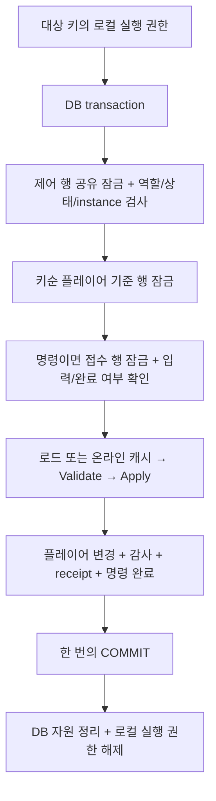

# 서버와 Admin 사이의 수정 권한 인계

`Bun3.Server.Players` 0.7.0, `Bun3.Server.Hosting` 0.8.0에서 플레이어별 DB `version` 없이 저장하는 방식을 선택할 수 있다. 기존 `PlayerStore<TPlayer>`의 버전 검사는 유지되며, 새 방식은 `OwnedPlayerStore<TPlayer>`를 사용한다.

**서버 운영 중에는 미접속 플레이어까지 서버가 수정하고, 정상 종료·점검 인계가 끝나면 Admin 실행기가 DB에서 새로 읽어 수정한다.** ping 실패나 heartbeat 만료로 직접 수정 권한을 넘기지 않는다.

## 구성과 책임

| 타입 | 역할 |
|---|---|
| `PlayerWriteAuthority` | DB 제어 행으로 수정 권한 확인·전환 |
| `PlayerWriteAuthorityStore` | 제어 행 잠금, 전환 감사, 수동 복구 검사 SQL |
| `OwnedPlayerStore<TPlayer>` | 권한 확인 뒤 플레이어 행을 잠그고 version 없이 읽기·저장 |
| `PlayerCommandQueue` | 인증된 Admin 명령의 영속 접수와 상태 조회 |
| `PlayerCommandCatalog<TPlayer>` | 명령 종류·입력 스키마별 게임 작업 복원 |
| `PlayerCommandDispatcher<TPlayer>` | 현재 registry에서 명령 실행·결과 확인 |
| `PlayerServerLifecycle<TPlayer>` | 기동·진입 개방·종료·권한 반납 |

게임은 인증·권한 정책, 명령의 게임 규칙, DB 스키마와 SQL, State의 컬럼/JSON/protobuf 매핑을 제공한다. ItemInventory/AchievementManager 및 메모리 Transaction 사용 여부는 이 선택과 독립적이다.

소유 범위는 하나의 registry가 맡는 플레이어 집합이다. 하나의 작업은 같은 소유 범위와 같은 관계형 DB에서 끝나야 한다. 다른 서버도 수정하는 클랜 같은 공유 객체나 여러 DB의 공동 커밋에는 별도 계약이 필요하다.

## version 대신 필요한 정보

플레이어 테이블에는 version이 없어도 되지만, 범위별 제어 행은 필요하다. 실제 이름·열 구성은 어댑터가 정한다.

```sql
CREATE TABLE write_authority (
    scope_key text PRIMARY KEY,
    state integer NOT NULL,
    instance_id uuid NULL,
    transition_id uuid NOT NULL,
    transition_fingerprint bytea NOT NULL
);
CREATE TABLE players (
    scope_key text NOT NULL,
    key text PRIMARY KEY,
    gold bigint NOT NULL
);
```

설치·마이그레이션 단계에서 `Offline`, `instance_id = NULL`, 새 전환 UUID, 32바이트 초기 fingerprint로 제어 행을 만든다. 최초 fingerprint는 실제 전환 요청의 fingerprint가 아니므로 32바이트 0으로 초기화할 수 있다. 실행 중 제어 행이 없으면 권한을 거절한다. 플레이어 기준 행도 미리 존재해야 하며 누락 플레이어를 자동 생성하지 않는다.

`instance_id`는 **서버 실행마다 새로 만드는 ID**다. 저장 횟수나 플레이어 version이 아니다. `transition_id`와 fingerprint는 응답이 유실된 상태 전환을 동일 입력으로 확인하는 데 사용한다.

| 상태 | 허용된 수정 주체 |
|---|---|
| `Offline` | Admin의 임시 로드·명령 실행 |
| `Starting(instance)` | 해당 서버의 초기화·로드 |
| `Online(instance)` | 해당 서버의 로그인·요청·tick·명령·저장 |
| `Draining(instance)` | 해당 서버에서 이미 입장한 작업과 최종 저장 |
| `RecoveryRequired` | 운영자 확인 복구 전까지 직접 수정 금지 |

## 저장과 잠금 순서



PostgreSQL 예제는 제어 행 조회에 `FOR SHARE`, 상태 전환에 `FOR UPDATE`를 사용한다. 서로 다른 플레이어 저장은 병렬로 진행하고 상태 전환은 진행 중인 저장이 끝나기를 기다린다. 잠금은 **실제 읽기·쓰기와 같은 연결·transaction**에서 획득한다. 사전 상태 조회만으로 쓰기를 허용하면 안 된다. [PostgreSQL 18 공식 잠금 문서](https://www.postgresql.org/docs/18/explicit-locking.html#LOCKING-ROWS)

`OwnedPlayerStore` 게임 매핑의 두 주요 SQL은 다음과 같다. 이 훅들 앞의 제어 행 보호는 프레임워크가 강제한다.

```sql
-- LockPlayerAsync: Authority.ScopeKey 안에 존재하는 기준 행을 잠근다.
SELECT key FROM players
WHERE scope_key = @scope AND key = @key FOR UPDATE;

-- WritePlayerAsync: 이미 권한과 기준 행 잠금을 확보했다.
UPDATE players SET gold = @gold
WHERE scope_key = @scope AND key = @key;
```

`LoadPlayerAsync`, `CaptureChanges`, receipt/audit 훅은 기존 버전 어댑터와 같다. 기준 행 존재 여부와 선택적 version을 별도로 표현하므로, version이 없다는 이유로 누락 플레이어를 존재한다고 취급하지 않는다.

컴파일되고 실제 PostgreSQL에서 실행한 매핑은 [제어 행·설치 예제](../server/tests/Bun3.Server.Tests/Helpers/PostgresAuthorityFixture.cs), [플레이어 저장](../server/tests/Bun3.Server.Tests/Helpers/PostgresOwnedPlayerStore.cs), [명령 접수·결과](../server/tests/Bun3.Server.Tests/Helpers/PostgresCommandStore.cs)에 있다. 테스트용 장애 주입 부분은 운영 어댑터에 복사하지 않는다.

매핑은 전달받은 연결/transaction만 사용하고 자체 commit이나 별도 저장 연결을 만들지 않는다. Queue 접수용 연결도 같은 물리 DB를 가리켜야 한다. 프레임워크는 역할·범위·접수 정보와 동일 실행 transaction 사용을 확인한다. DB 제공자에 독립적인 API만으로 두 팩토리가 같은 물리 DB를 가리키는지 시작 시 증명할 수는 없으므로 운영 매핑의 배포 검증에 포함한다. 잘못 연결되어 접수 행이 없으면 Apply 전에 실패한다.

## Admin 명령 접수

게임은 인증·권한 검사를 마친 관리자 ID로 envelope를 만든다. 참여자에는 변경 대상 플레이어만 넣으며 관리자를 가짜 플레이어로 로드하지 않는다.

```csharp
var payload = JsonSerializer.SerializeToUtf8Bytes(new { Amount = 7 });
using var sha = SHA256.Create();
var command = new PlayerCommandEnvelope(
    commandId, "players:shard-01",
    new PlayerOperationActor(PlayerOperationActorKind.Administrator, authenticatedAdminId),
    "grant-gold", 1, new[] { playerKey }, sha.ComputeHash(payload), payload);

var accepted = await queue.SubmitAsync(command);
var current = await queue.GetAsync(command.Id);
```

재시도에도 command ID와 입력 bytes를 유지한다. 같은 ID에 다른 관리자·범위·키·종류·스키마·fingerprint·payload를 보내면 `PlayerCommandConflictException`이다. 생성 시 입력 배열을 복사한다. **접수 성공과 게임 변경 성공은 다르다.**

| 상태 | 의미 |
|---|---|
| `Pending` | 영속 접수됨. 실행 가능한 주체/배포를 기다림 |
| `Committed` | 플레이어 변경과 결과가 함께 확정됨 |
| `Rejected` | 게임 Validate에서 거절. 플레이어 저장 없이 사유 확정 |
| `Failed` | 실행 rollback을 확인하고 실패를 영속 기록함 |
| `Unknown` | DB 결과 확인 중인 응답용 상태. terminal 값으로 저장하지 않음 |

카탈로그 등록 예시다. `GrantGoldOperation`은 게임 클래스이며 envelope의 ID·actor·kind·참여자·fingerprint를 `PlayerOperation` 생성자에 그대로 전달한다. Factory는 입력만 복원하고 상태 검증·변경은 `Validate`/`Apply`에서 수행한다.

```csharp
catalog.Register<GrantGoldResult>(
    "grant-gold", inputSchemaVersion: 1, supportsOffline: true,
    factory: envelope => new GrantGoldOperation(envelope));
```

`CommandId = OperationId`로 실행된다. Factory가 접수 identity를 바꾸면 Apply 전에 거절한다. 미등록 종류·스키마와 오프라인 실행 불가 명령은 Pending으로 남긴다. 카탈로그는 dispatcher 생성 시 고정된다. 전역 FIFO와 외부 알림의 정확히 한 번 전달은 보장하지 않는다.

worker는 카탈로그의 `GetSupportedInputs(offline)` 결과를 후보 조회에 전달한다. `PlayerCommandStore.FindPendingAsync` 매핑은 `supportedInputs`의 종류·버전 조건을 **LIMIT 이전**에 적용해야 한다. 그래야 오래된 미지원 명령이 배치를 계속 차지해 뒤의 정상 명령을 막지 않는다. null은 전체 종류 조회, 빈 목록은 실행 후보 없음이다.

일반 게임 RPC의 `OnPlayerOperation`은 `Player` actor와 인증된 플레이어 키를 강제한다. 같은 문자열 ID라도 `Administrator` actor를 게임 RPC로 실행할 수 없다.

## 서버와 Admin 호스트 등록

온라인 서버는 `OwnedPlayerStore`와 `AddPlayerCommands`를 조립한다. 아래 Game 타입과 Create 메서드는 게임의 조립 코드다.

```csharp
var binding = new PlayerWriteBinding(PlayerWriteRole.Server, Guid.NewGuid());
builder.Services.AddPlayerServer<GameSession, GamePlayer, GameRequest, GameResponse, GameUpdate>(
    store: sp => CreateGameOwnedStore(sp, binding), configure: ConfigurePlayerRpc);
builder.Services.AddPlayerCommands<GamePlayer>(
    store: CreateGameCommandStore, commands: RegisterGameCommands);
```

Online에서는 접속 중·유예 중인 플레이어는 캐시를 사용하고, 미접속 플레이어는 임시 로드한다. 로그인·패킷·tick·다인 작업은 같은 키의 로컬 실행 권한을 공유한다.

별도 Admin 프로세스는 다음처럼 등록한다. 두 호스트의 Create 메서드는 같은 DB와 동일한 게임 규칙을 사용한다.

```csharp
builder.Services.AddOfflinePlayerCommands<GamePlayer>(
    players: sp => CreateGameOwnedStore(sp,
        new PlayerWriteBinding(PlayerWriteRole.OfflineAdministrator, Guid.Empty)),
    commands: CreateGameCommandStore,
    configure: RegisterGameCommands,
    options: o =>
    {
        o.PollInterval = TimeSpan.FromSeconds(1);
        o.BatchSize = 32;
        o.MaxConcurrency = 4;
    });
```

Admin 실행기에는 세션·listener·tick·grace 캐시가 없다. DB에서 새로 읽고 작업 후 객체를 폐기한다. Offline 외 상태에서는 플레이어를 수정하지 않고 명령을 Pending으로 유지한다. 양쪽 worker가 같은 후보를 발견해도 실행 권한과 완료 여부를 DB 잠금 안에서 다시 확인한다.

## 종료·점검·재개

Hosting은 시작 시 Prepare → Activate → transport/tick/worker 시작, 종료 시 신규 명령 차단 → BeginDrain → tick/transport 중지 → worker 완료 → CompleteDrain 순서로 처리한다. 직접 조립하는 경우에는 초기화·통신 서비스의 수명을 다음 호출 사이에 배치한다.

```csharp
var lifecycle = new PlayerServerLifecycle<GamePlayer>(registry);
var prepared = await lifecycle.PrepareAsync();
// Require Committed before initialization; confirm Unknown with the same request.
await InitializeGameAsync();
var activated = await lifecycle.ActivateAsync();
// Require Committed before starting transport, ticking and command workers.

var draining = await lifecycle.BeginDrainAsync();
// Stop transport/ticks/worker intake and await those components.
var shutdown = await lifecycle.CompleteDrainAsync();
if (!shutdown.OfflineConfirmed)
    ReportShutdownFailure(shutdown.Drain, shutdown.Transition);
```

owned 서버 registry는 Activate가 확정되기 전 일반 진입을 받지 않는다. `StopAcceptingOperations`는 요청·posted work·로그인·명령·detach·sweep의 새 진입을 함께 닫는다. 이미 Apply한 작업은 저장과 결과 확인을 마친다.

`DrainAsync`는 입장한 작업·최종 저장·캐시 폐기·불명 DB 결과·정리 오류를 집계한다. `IsQuiescent`는 모두 정리되어야 true다. 버린 변경 메모리는 `DiscardedKeys`, 이전 writer 종료를 확인하지 못한 키는 `UnresolvedKeys`, 정리 훅/DB 자원 정리 실패는 `Errors`에서 확인한다. `RetireAllAsync`도 이 경로를 사용하지만 권한 반납 확인은 `OfflineConfirmed`로 한다.

`RetireAllAsync`는 아직 캐시에 들어오지 않은 로그인 로딩도 기다린다. 로딩이 끝나면 진입 차단을 다시 확인하고 임시 상태를 폐기한다. 호출자가 기다림을 취소하면 기존 API대로 `OperationCanceledException`을 전달하지만 진행 중인 저장 자체를 중단하지 않는다.

점검 공지나 로그인 차단만으로 직접 수정이 허용되지 않는다. 재개 시 **새 registry와 새 instance ID**를 만들며 닫힌 registry와 이전 캐시를 다시 활성화하지 않는다.

## DB 실패와 롤백

1. Apply가 메모리를 변경하고 저장 데이터를 준비한다.
2. 플레이어 변경·감사·receipt·명령 완료를 한 DB transaction에서 쓴다.
3. COMMIT 성공이면 Dirty/감사 완료 처리를 하고 결과를 반환한다.
4. rollback이 확인되면 참여자의 변경 메모리를 전부 버린다. 같은 객체를 종료 훅에서 다시 저장하지 않는다.
5. 명령 실패 표시는 기존 DB transaction을 정리한 뒤 새 transaction에서 기록한다. 로컬 키 권한과 바깥 admission은 계속 유지한다. 다른 worker가 그 사이 확정한 성공을 실패로 덮어쓰지 않는다.
6. commit 응답이 유실되면 메모리를 버린 뒤 제어 행·기준 행·명령 행을 다시 잠근다. 이전 writer 종료를 확인하고 command/receipt를 조회한다. 성공 기록이 있으면 저장 결과를 반환하고 Apply를 반복하지 않는다. 확인할 수 없으면 Unknown이다.

실패 응답만으로 DB에 적용되지 않았다고 판단하지 않는다. **확정 rollback**과 **commit 결과 불명**을 구분한다. 다음 세션은 실제 확정 DB 상태로 복구된다. 임시 메모리 복사본이나 변경 stack은 저장 실패 복구의 기준이 아니다. 게임 내부의 짧은 메모리 Transaction rollback은 별개로 사용할 수 있다.

진단은 scope/instance, operation/command ID, actor, 참여 키, 저장 시도, 단계, DB 결과를 연결한다. 입력 전문·인증 토큰은 자동 출력하지 않는다. 전환 감사는 제어 행과, 명령 성공 감사는 플레이어 변경과 같이 커밋한다.

## 비정상 종료 후 수동 복구

운영자가 이전 프로세스 종료와 자동 재기동 차단을 확인한 뒤 호출한다. 연결 실패만으로 호출하지 않는다.

```csharp
var confirmation = new PlayerWriteRecoveryConfirmation(
    confirmationId, oldInstanceId, authenticatedOperatorId,
    "Old process stopped; automatic restart disabled; recovery approved.");
var result = await authority.RecoverAsync(confirmation);
```

expected instance와 제어 행 배타 잠금을 확인한 뒤 `VerifyRecoveryAsync`로 command/receipt 일관성을 검사한다. RecoveryRequired 감사와 Offline 전환은 같은 복구 transaction에 기록된다. 확인 실패·다른 owner 발견 시 Offline을 발행하지 않는다. 같은 confirmation ID의 운영자·사유가 바뀌면 충돌한다.

## 기존 어댑터에서 이행

- `PlayerStore<TPlayer>`는 기존 `LockVersionAsync`/expectedVersion 갱신을 유지한다. version 검사를 끄는 옵션이나 가짜 고정 version을 넣지 않는다.
- Owned 방식으로 옮길 때에는 주기 저장·종료 저장·Admin·배치 등 모든 writer를 함께 전환한다. 무보호 직접 SQL writer와 혼용하지 않는다.
- 기존 receipt에 `actor_kind`를 추가하고 기존 행은 `Player = 0`, 새 Admin receipt는 `Administrator = 1`로 읽고 쓴다. [SQLite 이행 예제](../server/tests/Bun3.Server.Tests/Helpers/SqlitePlayerStore.cs)를 참고한다.
- blob 직렬화 schema version, Dirty 세대, 세션 세대는 DB 동시성용 version과 별개이며 제거하지 않는다.

## 검증과 재현

```powershell
powershell -NoProfile -File server/tests/Bun3.Server.Tests/run-postgres-tests.ps1
dotnet test server/tests/Bun3.Server.Tests -c Release --filter 'TestCategory!=PostgreSQL'
dotnet build Bun3.sln -c Release -warnaserror
```

스크립트는 PostgreSQL 18 컨테이너를 임시 데이터·무작위 loopback 포트로 실행하고, 자신이 만든 container ID와 label을 확인한 뒤 정리한다. 테스트 미발견·skip·DB 준비 실패를 성공으로 처리하지 않는다. 이미지 digest·서버 버전·TRX는 `server/artifacts/test-results/postgres/`에 남긴다.

이 환경에서는 Docker 가상화를 사용할 수 없어 컨테이너 실행은 검증하지 못했다. 공식 EDB의 PostgreSQL 18.6 바이너리로 인증된 임시 loopback DB를 실행해 같은 통합 테스트 12개를 검증했다. 실제 잠금 대기는 `pg_stat_activity.wait_event_type = 'Lock'`으로 관찰했다. DB 매핑 검증과 Docker 실행기 검증을 구분한다. [공식 Windows 바이너리 안내](https://www.postgresql.org/download/windows/)

최종 실행 결과는 일반 서버 테스트 **673/673**, 실제 PostgreSQL 테스트 **12/12**이며 실패·skip은 없다. 전체 솔루션 Release 빌드는 경고·오류 0이다. 독립 작업자 리뷰는 실행 한도로 수행하지 못했고 자체 리뷰와 위 검증을 수행했다.
