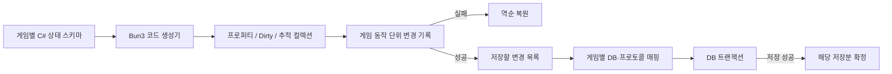

# 게임 상태 코드 생성과 DB 저장 방식 비교

- 조사일: 2026-09-29
- 목적: idlez, growninja, growdaemon의 실제 상태 변경·저장 흐름을 기준으로 NMF 도입과 Bun3의 방향을 판단한다.
- 방법: 로컬 작업 트리와 NMF 공식 문서·고정 커밋을 읽었다. 게임 서버·DB·Unity를 실행하거나 DB에 접속하지 않았다. ORM 통합 테스트와 성능 측정은 하지 않았다.
- 상태: 작성 당시 구현 전 권고였다. 이후 [승인된 구현 스펙](../superpowers/specs/2026-09-29-generated-option-state-design.md)과 [현재 사용 가이드](../generated-option-state.md)에 따라 첫 구현과 fixture 검증이 진행되었다. 이 문서의 세 게임 관찰과 당시 권고는 조사 시점 기록이다.

## 1. 권고

**C# 스키마에서 setter·Dirty·변경 기록·복원 코드를 생성하는 방향을 권한다. NMF 런타임을 Bun3의 기본 트랜잭션으로 채택하는 것은 권하지 않는다.**

세 프로젝트의 공통 요구는 이미 정해진 DB 행·프로토콜을 읽고 쓰면서, 작은 게임 동작에 포함된 필드와 컬렉션 변경을 추적하는 것이다. NMF는 생성 모델과 변경 기록을 제공하지만, 기본 모델 상속, 메타데이터, 이벤트 객체와 문자열 변환, 공유 실행 엔진까지 도입해야 한다. 이 판단은 아래의 소스 근거와 Bun3의 비활성 트랜잭션 비용·핫패스 할당 방침을 함께 적용한 결과다. NMF가 일반적으로 나쁜 라이브러리라는 평가가 아니다.

**DB 연동이 코드 생성을 막지는 않는다.** 생성된 public 프로퍼티는 일반 C# 프로퍼티이며 명시적인 SQL 파라미터나 DB 행으로 매핑할 수 있다. 기존 SimpleCRUD의 자동 매핑에 그대로 넣는 경우에는 상속 프로퍼티와 attribute를 검증해야 한다. 어떤 생성 방식을 택하든 중첩 protobuf 상태와 저장 확정 시점은 별도로 연결해야 한다.

## 2. 조사한 작업 트리

| 프로젝트 | 조사 경로·리비전 | 상태 |
|---|---|---|
| idlez-server | `E:/Projects/idlez-server`, `master`, `b39749fecdde973ea30875a7556990c6e09f888b` | 기존 수정 있음. 실제 서버와 공유 Commons를 읽음 |
| idlez 공유 Commons | `E:/Projects/idlez-server/Server/Commons`, `master`, `75cd882a6ea12191a86cae2eb64d968437eff94f` | 기존 untracked 파일 있음 |
| growninja | `E:/Projects/growninja`, `2026/✨/bonded-tomo`, `2aeb9ee5141faa60402392b335acad17d50f2e67` | 기존 수정 4개 유지 |
| growdaemon | `E:/Projects/growdaemon`, `master`, `24fb76dc437d015f8b71b43826ab98d7a7a6bfb3` | 기존 Client 설정 수정 2개 유지 |
| NMF | 공식 저장소 `6944496b0842987011adc067d69ad7855940d55f` | 해당 커밋의 구현만 평가 |

아래 로컬 링크의 줄 번호는 조사 시점 작업 트리 기준이다. 외부 게임의 코드·프로토콜·설정은 변경하지 않았다. idlez-client는 저장소 상태만 확인했으며 클라이언트 전체를 분석한 것은 아니다.

## 3. 세 프로젝트에서 확인한 공통점과 차이

| 항목 | idlez | growninja | growdaemon |
|---|---|---|---|
| DB 접근 | PostgreSQL + Dapper/SimpleCRUD | MySQL + Dapper/SimpleCRUD | MySQL + Dapper/SimpleCRUD |
| 게임에서 수정하는 객체 | DB 행 모델, `Model<T>` 상속 | DB 행 모델 | DB 행 모델 |
| 필드 Dirty | private 필드 + setter에서 자동 표시 | auto-property + 수동 표시 | auto-property + 수동 표시 |
| 중첩 아이템 옵션 | protobuf 객체를 JSON으로 저장 | protobuf 객체를 blob으로 저장 | protobuf 객체를 blob으로 저장 |
| 대표 저장 경계 | 플레이어 여러 모듈을 한 SQL 트랜잭션으로 저장 | 아이템 배치 저장에 SQL 트랜잭션, 전체 저장은 분리 | 대표 인벤토리 저장은 항목별 호출 |
| 게임 동작과 저장 관계 | 동작 후 주기/조건에 따라 저장 | 즉시 저장과 지연 저장 혼재 | 즉시 저장과 지연 저장 혼재 |

DB 의존성 근거: [idlez Server.csproj](/E:/Projects/idlez-server/Server/Server/Server.csproj:11), [growninja RemoteServer.csproj](/E:/Projects/growninja/RemoteServer/RemoteServer.csproj:46), [growdaemon RemoteServer.csproj](/E:/Projects/growdaemon/RemoteServer/RemoteServer.csproj:46).

### idlez: setter 생성이 현재 패턴과 가장 가깝다

`PlayerItemModel`은 `[Table]`이 붙은 `Model<PlayerItemModel>`이며 `level` setter에서 Dirty를 표시한다. 업적도 같은 형태다. 생성기로 이 반복 코드를 맡기는 것은 현재 클래스 사용법을 크게 바꾸지 않는다. [아이템 필드·Dirty](/E:/Projects/idlez-server/Server/Server/Models/PlayerItemModel.cs:51), [업적 상태](/E:/Projects/idlez-server/Server/Server/Models/PlayerAchievementModel.cs:30).

대표 강화 흐름은 재료 차감 → 장비 level 변경 → `ItemLevelUpEvent` → 업적 진행 변경 → 응답이다. 인벤토리와 업적을 함께 취소해야 할 이유가 실제 코드에 있다. [강화](/E:/Projects/idlez-server/Server/WorldServer/Managers/CashItemManager/LevelUpItem/CashItemManager.LevelUpItem.cs:27), [업적 이벤트 처리](/E:/Projects/idlez-server/Server/WorldServer/Managers/AchievementManager/AchievementManager.Events.cs:76).

DB 저장은 다른 시점이다. 일반 저장 주기는 30초이며 조건에 따라 앞당겨진다. `SaveAsync`는 아이템·업적·로그 등 여러 저장을 하나의 PostgreSQL 트랜잭션으로 묶고, 저장 실패 시 기본적으로 플레이어 종료 경로를 사용한다. 이미 처리한 게임 동작의 Undo scope를 다음 주기 저장까지 열어두는 구조는 현재 흐름과 맞지 않는다. [저장 주기](/E:/Projects/idlez-server/Server/WorldServer/WorldPlayer/WorldPlayer.Logic.cs:15), [플레이어 저장](/E:/Projects/idlez-server/Server/WorldServer/WorldPlayer/WorldPlayer.cs:81), [SQL 트랜잭션](/E:/Projects/idlez-server/Server/Server/Managers/DbManager.cs:100).

현재 개별 INSERT/UPDATE 뒤에 ID와 Dirty 상태를 변경하는 시점은 전체 DB COMMIT보다 앞선다. NMF나 새 생성기를 도입하더라도 저장 성공의 확인·실패 복구 정책은 따로 필요하다. [개별 모델 저장](/E:/Projects/idlez-server/Server/Server/Models/Model.cs:48), [저장 후 Dirty 해제](/E:/Projects/idlez-server/Server/Server/Models/PlayerItemModel.cs:281), [새 ID와 인벤토리 등록](/E:/Projects/idlez-server/Server/WorldServer/Managers/CashItemManager/CashItemManager.cs:299).

옵션은 `OptionScope`를 통해 protobuf 객체를 수정하고 저장 시 JSON으로 변환한다. `RepeatedField`와 자식 옵션의 필드 변경은 최상위 Level setter 생성만으로 추적되지 않는다. [옵션 scope·변환](/E:/Projects/idlez-server/Server/Server/Models/PlayerItemModel.cs:159), [옵션 생성 타입](/E:/Projects/idlez-server/Server/Commons/Types/Players/PlayerItem.cs:65), [옵션 변경 호출](/E:/Projects/idlez-server/Server/WorldServer/Managers/CashItemManager/RerollItemOption/CashItemManager.RerollItemOption.cs:26).

### growninja: 생성보다 먼저 저장·알림 경계를 정해야 한다

아이템은 자동 프로퍼티와 수동 Dirty 플래그를 가진 DB 행 모델이다. 업적의 `MarkAsChanged`는 설정에 따라 Dirty 표시 또는 ThreadPool 저장을 실행한다. 추적을 생성하면 표시 누락을 줄일 수 있지만, 비동기 저장 정책이 자동으로 바뀌지는 않는다. [아이템](/E:/Projects/growninja/Commons/Server/Models/PlayerItemModel.cs:27), [업적 저장 정책](/E:/Projects/growninja/Commons/Server/Models/PlayerAchievementModel.cs:219).

대표 보상 수령은 다음 순서다.

```text
업적 상태 변경 → 업적 DB Save
              → 아이템 지급 → 아이템 Save 또는 Dirty
              → 클라이언트 갱신 → 비동기 액션 로그 저장
```

메모리 Undo scope로 이 함수를 감싸도 이미 실행한 SQL이나 전송이 자동 취소되지는 않는다. 이는 NMF에만 해당하는 제한이 아니다. [보상 수령](/E:/Projects/growninja/Commons/Server/AchievementManager.cs:1712), [아이템 지급 저장·전송](/E:/Projects/growninja/Commons/Server/CashItemManager.AddItem.cs:1241).

`CashItemManager.Save()`에는 dirty 아이템들을 묶는 SQL 트랜잭션이 있지만 `WorldPlayer.Save()` 전체는 각 모듈의 저장을 차례로 호출한다. 어떤 범위를 원자적으로 저장할지 프레임워크 사용 계약에서 정해야 한다. [아이템 배치](/E:/Projects/growninja/Commons/Server/CashItemManager.cs:494), [전체 저장 호출](/E:/Projects/growninja/Commons/Server/WorldPlayer.cs:295).

옵션은 이미 별도의 protobuf 생성 코드이며 DB blob과 네트워크에서 함께 사용한다. NMF 상태를 사용하더라도 이 wire 형식과 필드 번호가 저절로 유지되는 것은 아니다. [protobuf 생성 타입](/E:/Projects/growninja/Commons/network.cs:1399), [메시지 변환](/E:/Projects/growninja/Commons/Server/Models/PlayerItemModel.cs:503).

### growdaemon: 비슷한 상태 구조지만 저장의 묶음 단위는 더 작다

`PlayerItemModel`의 level/exp/count는 auto-property이고 옵션은 protobuf byte 배열과 역직렬화한 객체를 함께 보관한다. `GetAll()`로 읽은 DB 행 객체를 인벤토리 사전에 그대로 넣는다. [아이템 모델](/E:/Projects/growdaemon/Commons/Server/Models/PlayerItemModel.cs:26), [로딩](/E:/Projects/growdaemon/Commons/Server/CashItemManager.cs:41).

`CashItemManager.Save()`는 각 항목의 `SaveIfDirty()`를 호출한다. 대표 업적 보상 경로도 업적 상태를 먼저 저장한 뒤 아이템을 지급한다. 이 경로에서는 growninja의 아이템 배치와 같은 공동 SQL 트랜잭션을 확인하지 못했다. 저장소 전체에 SQL 트랜잭션이 없다는 뜻은 아니다. [아이템 저장 루프](/E:/Projects/growdaemon/Commons/Server/CashItemManager.cs:199), [항목 저장](/E:/Projects/growdaemon/Commons/Server/Models/PlayerItemModel.cs:302), [보상 저장 후 지급](/E:/Projects/growdaemon/Commons/Server/AchievementManager.cs:1350).

`TItemOption`은 아이템 목록·자식 옵션·연결 아바타 등을 포함한다. 생성기를 선택할 때 scalar뿐 아니라 이 중첩 컬렉션의 변경 경로도 설계해야 한다. [옵션 스키마](/E:/Projects/growdaemon/network.proto:705), [옵션 저장과 네트워크 변환](/E:/Projects/growdaemon/Commons/Server/Models/PlayerItemModel.cs:235).

## 4. NMF를 DB에 붙일 수 있는가

### 가능한 연결 방식

NMF 생성 모델을 실행 중 상태로 사용하고, 저장할 컬럼·JSON·protobuf를 명시적으로 구성하면 DB 스키마를 유지할 수 있다. 기존 Dapper 모델을 DTO로 남겨 변환하는 것도 가능하다. 이는 소스 구조에 따른 설계 판단이며, 실제 NMF + Dapper 통합 실행을 검증했다는 뜻은 아니다.

기본 NMF 생성기는 `ModelElement` 상속과 `IModelElement` 구현을 사용한다. 기존 idlez `Model<T>`와 같은 클래스로 만들려면 상속 구성을 조정해야 한다. 생성 모델에는 Parent·Model·URI 등도 있으므로 SimpleCRUD의 자동 컬럼 선택을 그대로 신뢰해서는 안 된다. 명시적 projection을 쓰면 이 문제를 통제할 수 있다. [기본 상속 생성](https://github.com/NMFCode/NMF/blob/6944496b0842987011adc067d69ad7855940d55f/Transformations/Models.MetaTransformation/Meta/Class2Type.cs#L722-L728), [모델 기반 클래스](https://github.com/NMFCode/NMF/blob/6944496b0842987011adc067d69ad7855940d55f/Models/Models/ModelElement.cs).

일반 C# 생성기를 선택해도 DB·protobuf 변환이 전부 공짜가 되는 것은 아니다. 기존 타입에 직접 프로퍼티를 생성할 수 있는 경우는 연결 비용이 작지만, 추적되지 않는 protobuf 자식까지 지원하려면 추적 상태와 메시지 DTO 사이의 매핑 또는 별도 변경 인터페이스가 필요하다.

### 현재 요구에 맞지 않는 기본 동작

1. **기록하지 않는 구간에도 할당 경로가 있다.** 생성된 int setter는 값 변경마다 `new ValueChangedEventArgs(old, value)`를 호출한다. 이벤트 인수가 object이므로 값 타입 boxing 경로도 있다. `--no-events`는 개별 Changed/Changing 이벤트를 줄일 뿐 공통 이벤트 인자 생성은 제거하지 않는다. 이는 소스에서 확인한 사실이며 처리량이나 정확한 할당량을 측정한 결과는 아니다. [생성된 int setter](https://github.com/NMFCode/NMF/blob/6944496b0842987011adc067d69ad7855940d55f/Models/Models/Meta/TypedElement.cs#L147-L165), [이벤트 인수](https://github.com/NMFCode/NMF/blob/6944496b0842987011adc067d69ad7855940d55f/Expressions/Expressions/Public/ValueChangedEventArgs.cs#L8-L19), [생성기 분기](https://github.com/NMFCode/NMF/blob/6944496b0842987011adc067d69ad7855940d55f/Transformations/Models.MetaTransformation/Meta/Attribute2Property.cs#L114-L157).
2. **변경 이력을 직렬화 가능한 모델로 만든다.** scalar의 old/new 값은 변경 집합을 만들 때 Serialize하고 적용할 때 Parse한다. 이력 저장·재생에는 유용하지만 요청 안에서 이전 int 값을 되돌리는 용도에는 추가 처리다. [변경 집합 생성](https://github.com/NMFCode/NMF/blob/6944496b0842987011adc067d69ad7855940d55f/Models/Models/Changes/ModelChangeRecorder.cs#L905-L950), [적용](https://github.com/NMFCode/NMF/blob/6944496b0842987011adc067d69ad7855940d55f/Models/Models/Changes/ApplyChanges.cs#L46-L52).
3. **기본 ModelTransaction의 실행 엔진이 공유된다.** `ExecutionEngine.Current`는 static 필드이며 엔진은 하나의 TransactionActive와 변경 대기 목록을 가진다. ModelTransaction은 그 엔진을 잡아서 Begin/Commit/Rollback한다. 따라서 플레이어별 독립 트랜잭션으로 그대로 교체하는 것을 권할 근거가 없다. Recorder를 직접 세션별로 관리하는 대안은 있지만 자체 조정 코드가 다시 필요하다. NMF의 모든 사용 방식에서 동시 실행이 불가능하다는 주장은 아니다. [공유 엔진과 상태](https://github.com/NMFCode/NMF/blob/6944496b0842987011adc067d69ad7855940d55f/Expressions/Expressions/Execution/ExecutionEngine.cs#L12-L68), [ModelTransaction](https://github.com/NMFCode/NMF/blob/6944496b0842987011adc067d69ad7855940d55f/Models/Models/ModelTransaction.cs).
4. **DB 확정과 외부 알림은 별도다.** NMF Commit은 SQL transaction을 커밋하지 않는다. 일반 모델 이벤트도 setter에서 발생한다. 게임의 저장·패킷·로그를 언제 실행할지는 여전히 정해야 한다. [ModelTransaction.Commit](https://github.com/NMFCode/NMF/blob/6944496b0842987011adc067d69ad7855940d55f/Models/Models/ModelTransaction.cs#L33-L49), [모델 이벤트](https://github.com/NMFCode/NMF/blob/6944496b0842987011adc067d69ad7855940d55f/Models/Models/ModelElement.cs#L994-L1014).

NMF의 장점은 생성 모델·컬렉션 추적·변경 역전·직렬화·재생을 이미 제공한다는 것이다. 여러 root도 기록할 수 있다. 이 기능 전체가 필요하다면 직접 구현량을 줄일 수 있다. 다만 추적 범위를 벗어난 모델 변경과 collection reset의 제약이 있고, 이번 세 게임 흐름에서는 메타모델 변환이나 직렬화 가능한 모델 이력까지 필요한 근거를 찾지 못했다. [공식 변경 기록 문서](https://nmfcode.github.io/models/RecordingChanges.html).

## 5. 권하는 Bun3 구조

다음은 조사 당시의 구현 제안이다. 현재 구현의 지원 범위는 [생성 옵션 상태 사용 가이드](../generated-option-state.md)를 따른다.



- **게임별 C# 스키마:** 필드, 기본값, 게임 규칙, DB 컬럼·메시지 매핑을 정의한다. NMeta/Ecore로 상태 정의 전체를 이전하는 것을 기본으로 삼지 않는다.
- **프레임워크 코드 생성기:** setter의 이전 값 기록, Dirty 전파, 필드별 직접 복원 코드를 만든다. 기존 기반 클래스에 추가로 상속을 강제하지 않는 partial/interface 방식을 우선 검토한다.
- **추적 컬렉션:** 추가·삭제·교체·Clear를 기록하고 원소의 변경도 연결한다. 이미 생성된 protobuf 가변 객체를 그대로 노출하면서 모든 내부 변경을 자동 추적한다고 약속하지 않는다.
- **메모리 Transaction:** 플레이어별로 독립적이며 선택 사항이다. 활성일 때만 복구 정보를 보관하고 실패 시 상태·Dirty·미발행 알림을 되돌린다. 비활성 구간은 일반 상태 변경과 Dirty 표시를 수행한다.
- **저장 조정:** 공통적인 변경 수집·저장 대기 목록의 소유권·실패 재시도·저장 성공 확인은 프레임워크 책임으로 둔다. SQL과 컬럼·JSON·protobuf 매핑은 게임별 구현이다.

예상하는 게임 코드의 모양은 아래와 같다. `Tracked`는 설명용 후보 이름이며 현재 Bun3에 존재하는 attribute가 아니다.

```csharp
public partial class EquipmentState
{
    [Tracked]
    private int _level;

    [Tracked]
    private long _exp;
}
```

호출자는 생성된 `state.Level`과 `state.Exp`를 사용한다. 게임마다 이전 값을 Stack에 넣거나 Dirty를 직접 전파하는 코드를 반복하지 않는다. 생성기·컬렉션·기록기를 Bun3가 유지해야 한다는 비용은 남는다. 자체 생성기라는 이유만으로 구현량이나 버그가 적다고 가정하지 않는다.

현재 Bun3의 `DrainChanges`는 DB 저장 성공을 확인하는 기능이 아니다. 호출자가 전달받은 변경 버퍼를 저장 성공까지 보유해야 한다는 계약이며, Player는 저장 중 새 변경이 생기면 Dirty 버전을 유지한다. 새 저장 조정 기능을 설계할 때 이 수명을 명시해야 한다. [DrainChanges](../../server/src/Bun3.Server.Items/ItemInventory.Tracking.cs), [Player 저장 버전](../../server/src/Bun3.Server.Players/Player.cs).

## 6. 메모리 확정과 DB 확정의 수명

세 프로젝트에 비추어 두 가지 사용 정책을 구별해야 한다.

| 정책 | 메모리 변경 확정·응답 | DB 저장 실패 시 |
|---|---|---|
| 지연 저장 | 게임 동작 성공 시 짧은 Undo scope를 닫고 응답. 변경 목록을 이후 저장 | 이미 응답한 과거 동작을 무조건 Undo하지 않음. 저장 대기 목록을 보존·재시도하거나 플레이어 캐시를 폐기·재로딩하는 정책 |
| 저장 확인 후 완료 | 관련 행을 하나의 DB 트랜잭션으로 저장하고 성공을 확인한 뒤 동작 완료·외부 알림 | DB 실패가 확정된 경우 아직 완료하지 않은 메모리 변경을 취소. DB 커밋 결과가 불명확한 경우 별도의 확인·복구 정책 필요 |

idlez는 첫 번째 정책과 가깝다. growninja·growdaemon의 기존 중간 Save 호출은 동작을 함께 되돌릴 범위를 정할 때 정리해야 한다. 두 정책 모두 코드 생성 방식과 독립된 결정이다. 네트워크를 건너는 DB 저장과 C# 메모리를 한 번에 원자적으로 커밋한다고 약속하지 않는다.

Undo 기록은 **현재 게임 동작을 시작하기 전 상태**를 보관한다. Dirty/저장 대기 목록은 **마지막으로 DB 저장을 확인한 뒤의 변경**을 보관한다. 지연 저장에서는 시작 시점이 다르므로 두 목록을 하나의 Stack으로 합쳐 같은 시점에 지우면 안 된다.

## 7. 선택지와 다음 검증 범위

| 선택지 | 장점 | 비용·한계 | 권고 |
|---|---|---|---|
| 현 스냅샷 구조 유지 | 현재 구현·테스트 활용, 임의 TState 편집 지원 | 전체 컨테이너 보관·가변 상태 복사와 수동 scope 계약 유지 | 기존 코드는 조사 중 유지 |
| NMF 모델·런타임 도입 | 생성·변경 기록·역전·이력 직렬화 재사용 | 모델·프로토콜 매핑, 공유 엔진 조정, 기본 할당 정책 수용/수정 | 현재 기본 방향으로 권하지 않음 |
| C# 상태 코드 생성 + 변경 기록 + 기존 저장 방식 연결 | 세 프로젝트의 상태 작성 방식과 가까움, DB 선택과 분리, 비활성 비용 제어 | 생성기·추적 컬렉션·기록기를 Bun3가 구현·검증·관리 | 다음 설계의 권고 방향 |

첫 구현 검증은 장비 level/exp, 옵션 목록과 그 원소, 업적 수령과 아이템 지급 정도로 제한하는 것이 적절하다. 다음 결과가 관찰되어야 한다.

1. 트랜잭션 없이 읽기·변경·DB 로딩이 가능하고, 로딩으로 Dirty/Undo가 생기지 않는다.
2. 재료 차감·레벨 변경·업적 변경의 중간 실패가 기존 상태와 Dirty를 복원한다.
3. 옵션 Add/Remove/Clear 및 원소 필드 변경이 되돌아가며 기존 protobuf/JSON 저장 형식으로 변환된다.
4. 두 플레이어의 기록과 복원이 서로 영향을 주지 않는다.
5. DB 저장 실패 시 대기 변경이 사라지지 않고, 저장 중 새 변경이 이전 저장의 성공 확인으로 지워지지 않는다.
6. 비활성·활성 경로의 할당과 비용을 측정한다. 이번 소스 조사로 성능 우위를 주장하지 않는다.

이 검증 범위가 다음 설계의 입력이다. 외부 DB 연결, NMF 실제 통합, Unity/IL2CPP 호환성은 이번 조사에서 검증하지 않았다. 기존 구현과 계약은 [현재 롤백 가이드](../outgame-rollback.md)를 따른다.
