# 서버 구조와 실행 흐름 지도

> 2026-10-12 작업 트리의 구현 기준. 현재 브랜치의 미커밋 구현을 포함한다. 설계 제안이 아니라 코드에서 확인한 구조를 설명한다. `GamePlayer`, `GameStore`, 보상 지급 규칙, DB 테이블 이름은 게임에서 작성하는 예시다.

[확대·검색 가능한 HTML 보기](server-architecture.html) · [아이템/업적 롤백](outgame-rollback.md) · [생성 옵션 State](generated-option-state.md) · [공동 작업과 저장](player-operations-and-persistence.md) · [서버/Admin 수정 권한](player-write-authority.md)

그림의 화살표는 각 절에서 정의한 관계를 뜻한다. 전체 지도는 호출/데이터 흐름, 패키지 지도는 **참조하는 쪽 → 참조되는 쪽**, 객체 지도는 보유 관계다. 점선은 게임이 연결하거나 선택하는 관계다. class diagram의 마름모는 보유, 삼각형은 상속/구현이다. 그림마다 관계의 의미를 읽고 따라간다.

읽는 순서: **01 전체 → 03 객체 수명 → 07 아이템 → 09 생성 State → 10~13 메모리 롤백/업적 → 14~18 저장/공동 작업 → 19~21 권한/Admin → 22~25 운영과 코드 탐색**. 이미 저장 구조에 익숙하면 07~13부터 보면 된다.

## 01. 전체 서버: 어디에서 무엇을 하는가

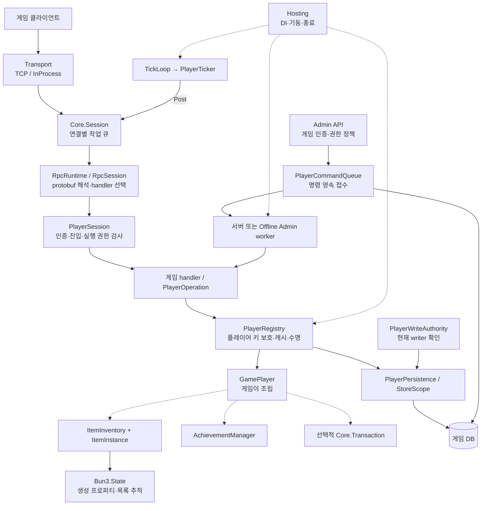

서버는 다음 책임을 겹쳐서 구성한다.

| 층 | 핵심 책임 | 게임이 넣는 내용 |
|---|---|---|
| Transport / Core | 연결, 패킷, 연결별 순차 실행, 종료 | 세션 타입·전송 설정 |
| Rpc / Auth | 메시지 해석·응답, 인증 제공자 인터페이스 | 로그인 요청·계정 키 매핑·접근 권한 |
| Players / Ticking | 계정별 객체, 동시 실행 제어, 재접속, 주기 저장 | Player 훅과 콘텐츠 처리 |
| Items / Achievements / State | 아이템·업적 변경, 변경 추적, 선택적 메모리 롤백 | 정의 데이터·아이템 상태 스키마·보상 규칙 |
| Persistence / Authority / Commands | DB 작업 범위, 중복 확인, 실패 폐기, writer 인계 | SQL·직렬화·명령 복원 |
| Hosting | 위 구성의 등록과 시작/종료 순서 | 구성 값·팩토리·외부 서비스 조립 |

**모든 RPC가 DB 트랜잭션을 여는 것은 아니다.** 일반 handler는 메모리를 바꾸고 Dirty로 표시한 뒤 저장 주기에 저장할 수 있다. `OnPlayerOperation`/`ExecuteAsync`는 참여자 변경과 성공 결과를 즉시 하나의 DB 트랜잭션으로 확정하는 별도 경로다.

근거: [Session](../server/src/Bun3.Server.Core/Session.cs), [PlayerSession](../server/src/Bun3.Server.Players/PlayerSession.cs), [Registry](../server/src/Bun3.Server.Players/PlayerRegistry.cs), [Hosting](../server/src/Bun3.Server.Hosting/PlayersServiceCollectionExtensions.cs).

## 02. 패키지 참조: 무엇을 독립적으로 쓸 수 있는가

화살표는 직접 프로젝트 참조이며, 실행 순서가 아니다. 첫 그림은 서버 실행 계층의 내부 참조를 보여 준다.

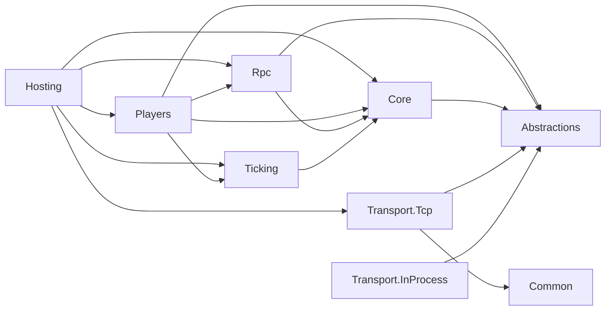

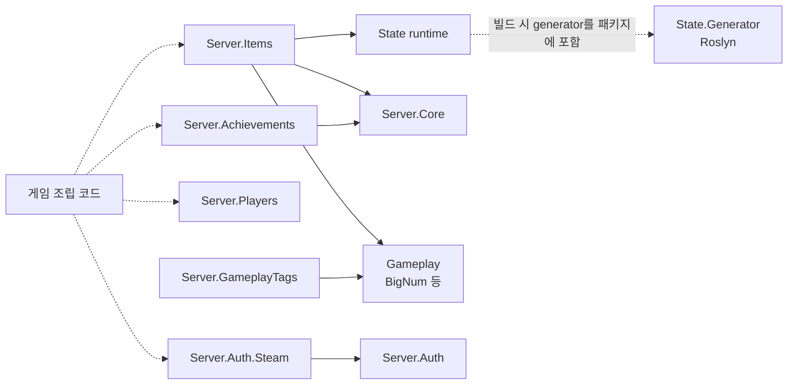

두 번째 그림은 도메인/인증 측 주요 직접 참조다. 외부 NuGet 전체와 Gameplay 내부 참조는 생략했다. `State.Generator`는 소비 프로젝트 빌드 시 실행되고 서버에서 옵션을 변경할 때 Roslyn을 실행하지 않는다.

| 모듈 | 현재 버전 / 대상 | 선택 사용 |
|---|---|---|
| Items | 0.5.0 / netstandard2.1 | Players·DB 없이 인벤토리만 사용 가능 |
| Achievements | 0.4.1 / netstandard2.1 | Items·Players 없이 진행도만 사용 가능 |
| Core | 0.8.0 / netstandard2.1 | 메모리 Transaction은 생성·주입·Begin을 선택 |
| State | 0.1.0 / netstandard2.1 | 추적 runtime. 생성기는 netstandard2.0 |
| Players | 0.7.0 / netstandard2.1 | loader-only / versioned / owned 저장 중 선택 |
| Rpc | 0.7.0 / netstandard2.1 | Google.Protobuf 메시지 사용 |
| Hosting | 0.8.0 / net10.0 | DI와 서버 수명 연결 편의 계층 |
| Ticking | 0.3.0 / netstandard2.1 | TickLoop와 PlayerTicker 연결 |
| GameplayTags | 0.2.0 / net10.0 | 게임플레이 태그 카탈로그 기동 로딩 |

Items와 Achievements는 Core 패키지를 참조하지만, **Transaction 사용 자체는 필수가 아니다.** Players는 Items/Achievements를 참조하지 않는다. 두 모듈을 플레이어에 넣는 것은 게임 조립 코드다. 제품 Players 패키지는 Npgsql이나 특정 ORM에 의존하지 않는다.

근거: 각 모듈의 `.csproj`, [State 패키지 구성](../common/src/Bun3.State/Bun3.State.csproj).

## 03. 객체 수명과 실제 소유 관계

아래 `GamePlayer`의 구성은 권장 조립 예시다. 프레임워크 `Player`에 Inventory/Achievements 필드가 자동 생성되는 것은 아니다.

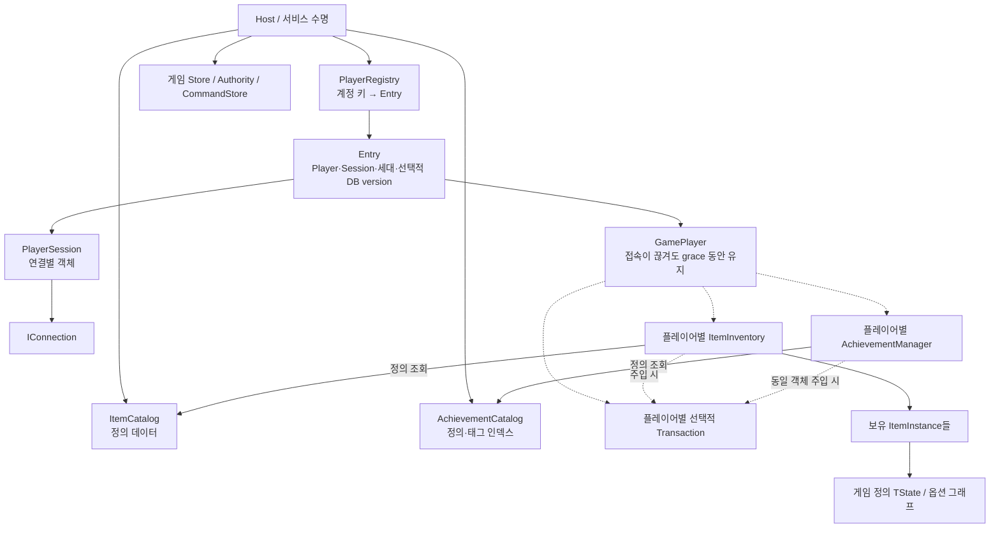

| 객체 | 보통의 수명 | 중요한 성질 |
|---|---|---|
| Catalog | 게임 데이터 로딩 이후 공유 | 정의를 보관. 플레이어별 수량/진행도를 보관하지 않음 |
| Registry / Store | 해당 호스트·소유 범위 | 캐시 및 저장 정책·실행 키 관리 |
| Session | 연결 하나 | 재접속하면 새로운 세션이 될 수 있음 |
| Player | 계정의 현재 캐시 세대 | 기존 캐시 재접속 또는 DB에서 새 세대 로드 |
| Inventory / AchievementManager | 게임이 만든 Player 등에 소속 | 스레드 안전 공유 객체로 가정하지 않음 |
| ItemInstance / State | 보유 아이템 수명 | 생성 추적 시 하나의 소유 그래프 계약 |
| 임시 Player | 오프라인 참여 작업 하나 | 성공/실패 후 release. grace 캐시에 추가하지 않음 |
| StoreScope | DB 작업 하나 | 연결·트랜잭션·기준 행 잠금을 함께 보유 |

게임이 `onDirty: player.MarkDirty`를 연결해야 아이템/업적 변경이 플레이어 저장 대상으로 이어진다. 메모리 Transaction을 공유하려면 참여 모듈에 **동일한 Transaction 객체**를 주입해야 한다.

근거: [Player](../server/src/Bun3.Server.Players/Player.cs), [Registry](../server/src/Bun3.Server.Players/PlayerRegistry.cs), [ItemInventory 생성자](../server/src/Bun3.Server.Items/ItemInventory.cs), [AchievementManager 생성자](../server/src/Bun3.Server.Achievements/AchievementManager.cs).

## 04. 패킷에서 게임 로직까지: 일반 요청과 공동 작업

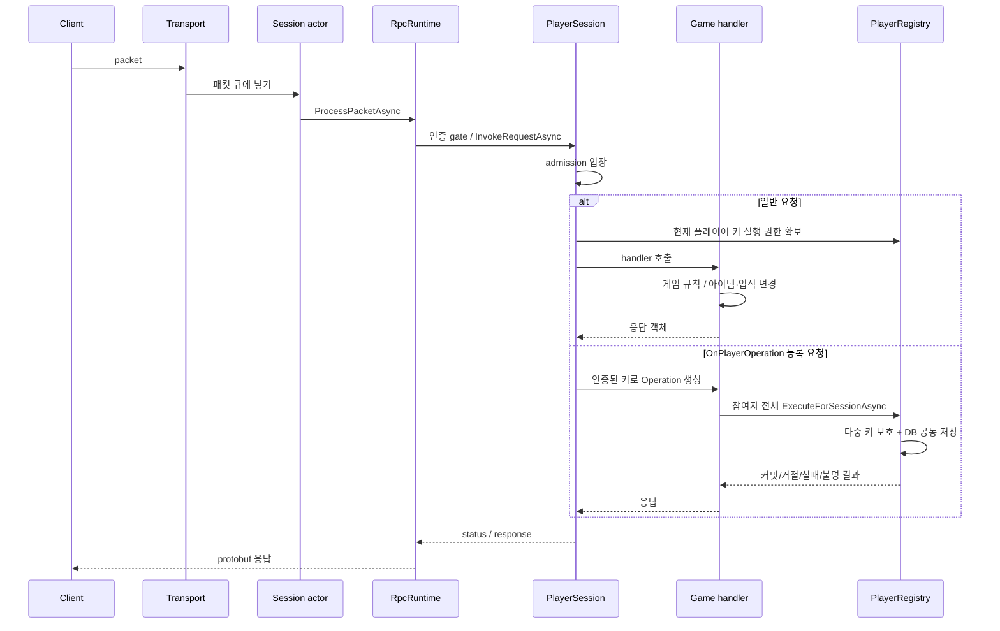

Session의 큐는 연결 안에서 패킷과 `Post` 작업을 순서대로 실행한다. PlayerSession의 키 보호는 **다른 연결/오프라인 작업과 같은 플레이어를 동시에 수정하지 않도록** 추가된다. 세션 큐만으로 여러 세션의 공동 작업을 보호할 수는 없다.

로그인 이전에는 `OnRequestUnauthenticated`로 허용한 요청만 통과한다. 인증 제공자 검사와 DB 계정 연결 정책은 게임이 작성한다. 일반 `OnPlayerOperation`은 인증된 Player actor만 허용하고, Administrator actor는 이 경로로 위장할 수 없다.

일반 handler에서 예외가 발생했다고 앞서 변경한 메모리가 자동으로 rollback되는 것은 아니다. 그 복원이 필요하면 게임이 Core.Transaction으로 묶고, DB 확정과 실패 시 참여자 폐기가 필요하면 PlayerOperation 경로를 선택한다. 일반 handler의 응답 성공과 이후 주기 저장 성공은 서로 다른 시점이다.

근거: [Core.Session](../server/src/Bun3.Server.Core/Session.cs), [RpcRuntime](../server/src/Bun3.Server.Rpc/RpcRuntime.cs), [PlayerSession](../server/src/Bun3.Server.Players/PlayerSession.cs), [PlayersConfig](../server/src/Bun3.Server.Players/PlayersConfig.cs).

## 05. 로그인·재접속·grace·폐기

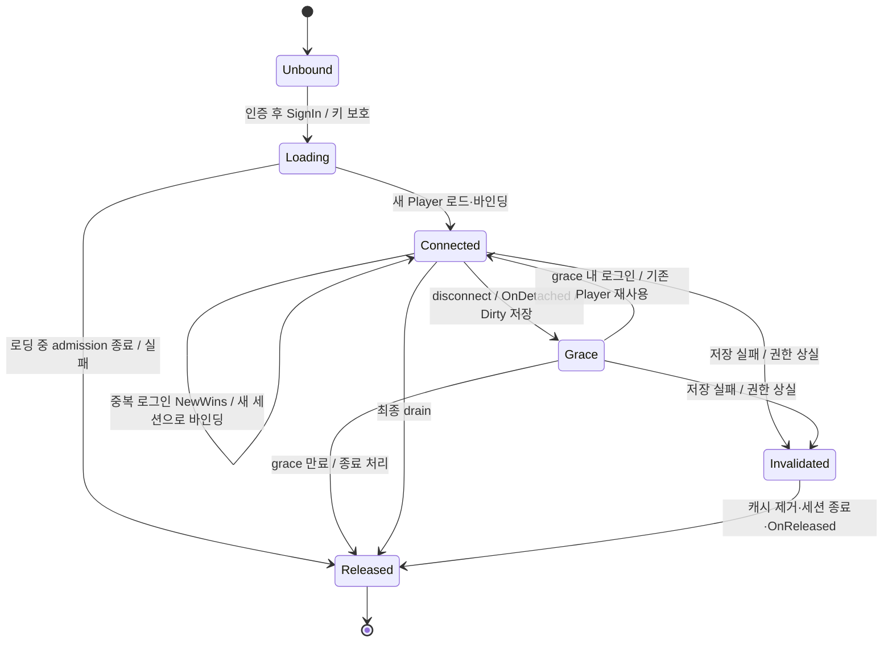

그림의 상태는 객체 수명 설명용이며 단일 enum 구현이 아니다. `GracePeriod <= 0`이면 detach 후 즉시 retirement 경로로 간다. `RejectNew` 정책에서는 중복 로그인을 거절하고, `NewWins`에서는 이전 세션의 바인딩을 제거한 뒤 새 세션에 연결한다.

저장 실패로 무효화된 Player는 `OnReleasedAsync(Invalidated)`로 자원만 정리한다. 해당 객체를 `OnRetiredAsync` 저장 훅으로 다시 저장하지 않는다. 재접속은 확정 DB를 기준으로 새 객체를 로드한다.

| 훅 | loader-only registry | Store 기반 registry |
|---|---|---|
| `OnAttachedAsync` / `OnDetachedAsync` | 게임 수명 처리 | 동일. 플레이어 키 보호 안에서 실행 |
| `OnSaveAsync` | 게임이 DB 저장 구현 | 일반 저장은 Store의 Capture/Write로 처리 |
| `OnRetiredAsync` | 종료 시 게임 저장 지점 | retirement 저장은 Store 경로 사용 |
| `OnReleasedAsync` | 저장 없는 자원 정리 | 저장 없는 자원 정리·실패 폐기 |

근거: [Registry.Lifecycle](../server/src/Bun3.Server.Players/PlayerRegistry.Lifecycle.cs), [Registry.Persistence](../server/src/Bun3.Server.Players/PlayerRegistry.Persistence.cs), [Registry.Execution](../server/src/Bun3.Server.Players/PlayerRegistry.Execution.cs).

## 06. 동시성 보호는 세 단계다

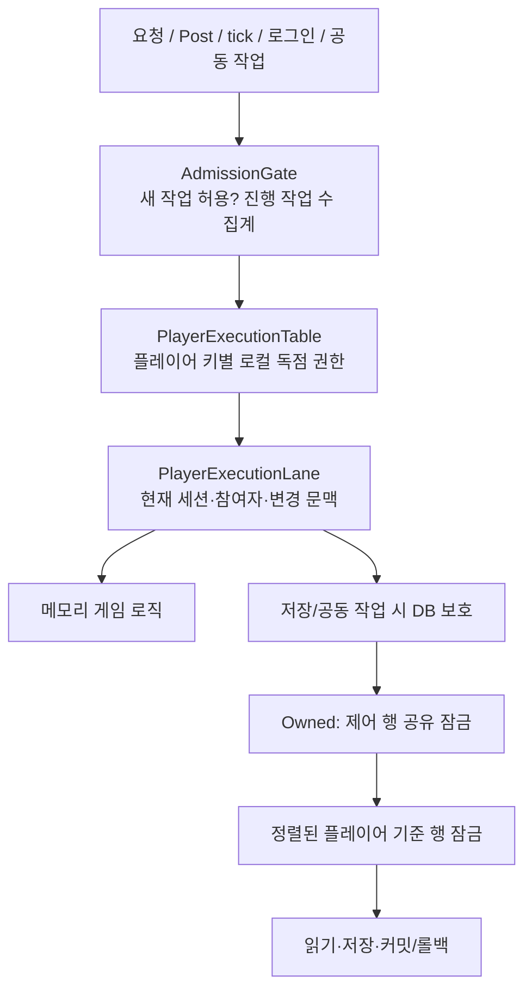

| 장치 | 해결하는 문제 | 해결하지 않는 문제 |
|---|---|---|
| Admission | 종료 후 새 변경이 들어오는 것, 진행 작업 집계 | DB writer 간 경쟁 |
| Session actor | 연결 내 handler/Post 동시 실행 | 다른 세션이나 프로세스의 작업 |
| 실행 키 | 같은 Player의 요청·tick·오프라인 작업 충돌 | 프로세스 밖 writer |
| DB 기준 행 잠금 | 여러 실행기의 같은 플레이어 읽기/쓰기 경쟁 | 계약에 참여하지 않는 캐시 writer의 정합성 |
| Owned 제어 행 | 현재 서버/Offline Admin 권한과 전환 | 다른 범위·다른 DB의 분산 커밋 |

공동 작업은 참여 키를 정렬·중복 제거하고 같은 순서로 잠근다. `PlayerExecutionLane`은 DB 트랜잭션이나 스레드 자체가 아니라 현재 실행의 소유 문맥이다. 이미 실행 키를 가진 handler에서 중첩해서 lifecycle/공동 작업을 호출하는 경로는 자기 대기 교착을 막기 위해 거절한다. 일반 handler에서 여러 상대 세션에 `Post`하고 서로 완료를 기다리는 방식으로 거래를 조립하지 않는다.

근거: [ExecutionTable](../server/src/Bun3.Server.Players/PlayerExecutionTable.cs), [ExecutionLane](../server/src/Bun3.Server.Players/PlayerExecutionLane.cs), [AdmissionGate](../server/src/Bun3.Server.Players/PlayerAdmissionGate.cs).

## 07. 아이템: 정의, 인스턴스, 옵션을 분리한다

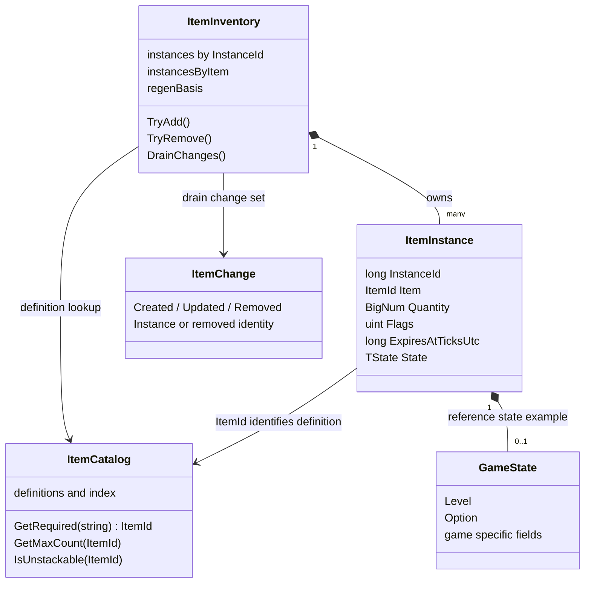

제네릭 인수는 그림을 간결하게 하려고 생략했다. 실제 타입은 `ItemInventory<TState>` / `ItemInstance<TState>` / `ItemChange<TState>`다. `TState`는 값 형식이어도 되며, 그림의 참조 그래프는 장비 옵션을 클래스로 표현한 예시다.

| 이름 | 예시 | 의미 |
|---|---|---|
| 정의의 문자열 ID | `gold`, `sword_001` | 게임 데이터의 정의 이름 |
| `ItemId` | 카탈로그 안의 인덱스 | 실행 중 빠른 정의 참조. 임의의 카탈로그/재구축을 넘나드는 영속 ID로 가정하지 않음 |
| `InstanceId` | 장비 개체 #1001 | 보유 개체 식별. 게임 issuer / DB가 공급 |
| `Quantity` | Gold 500, 검 1 | 스택 수량 또는 개체 수량 |
| `State` | 강화 단계, 랜덤 옵션 | 게임이 정의한 가변 상태 |

스택 가능한 정의는 인벤토리 안에서 기본적으로 singleton 인스턴스 하나에 수량을 보관한다. 비스택 정의는 개체마다 InstanceId/State를 갖는다. `Flags`와 `ExpiresAtTicksUtc`는 프레임워크가 관리하는 개체 속성이다. Catalog는 플레이어의 보유 수량을 보관하지 않는다.

근거: [ItemCatalog](../server/src/Bun3.Server.Items/ItemCatalog.cs), [ItemInstance](../server/src/Bun3.Server.Items/ItemInstance.cs), [ItemInventory](../server/src/Bun3.Server.Items/ItemInventory.cs), [ItemChange](../server/src/Bun3.Server.Items/ItemChange.cs).

## 08. 인벤토리 기능은 같은 변경 경로로 모인다

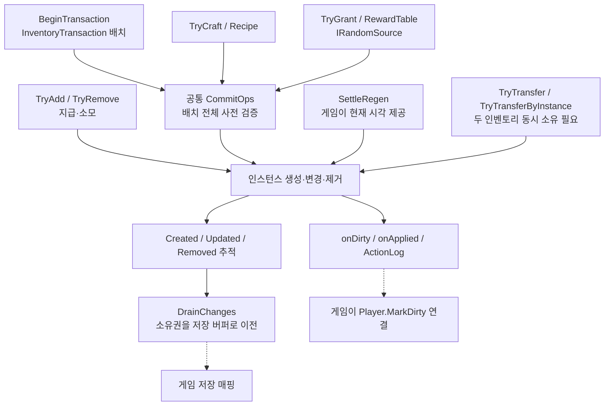

`InventoryTransaction<TState>`는 한 인벤토리의 Add/Remove/RemoveInstance 명령을 모으고 `Commit`에서 검증·적용하는 빌더다. 새 배치를 열면 이전 미커밋 빌더는 사용할 수 없고, 이미 커밋한 빌더 재사용도 거절한다. 예상 가능한 검증 실패는 상태를 바꾸지 않는다. 알림 콜백에서 예외가 났다고 이미 적용된 배치를 다시 실행해서는 안 된다.

`TryTransfer`는 상대 인벤토리까지 바꾼다. **양쪽 인벤토리 중 하나라도 Core 메모리 Transaction이 활성 상태면 거절**한다. 플레이어 간 거래는 두 참여자의 실행 권한과 DB 저장을 `PlayerOperation`으로 묶고, Apply 안에서 필요한 이전을 수행한다.

재생 기준 시각은 `_regenBasis`로 관리되며 저장/로드 매핑에 포함해야 한다. `SettleRegen`이나 `Growth.SettleExp`는 콘텐츠 연산 도구다. 자동으로 TickLoop에 등록되거나 Player의 임의 필드를 변경하지 않는다.

근거: [Operations](../server/src/Bun3.Server.Items/ItemInventory.Operations.cs), [InventoryTransaction](../server/src/Bun3.Server.Items/InventoryTransaction.cs), [Crafting](../server/src/Bun3.Server.Items/ItemInventory.Crafting.cs), [Rewards](../server/src/Bun3.Server.Items/ItemInventory.Rewards.cs), [Transfer](../server/src/Bun3.Server.Items/ItemInventory.Transfer.cs), [Regen](../server/src/Bun3.Server.Items/ItemInventory.Regen.cs).

## 09. 생성 State: 필드를 바꾸면 Undo와 Dirty가 연결된다

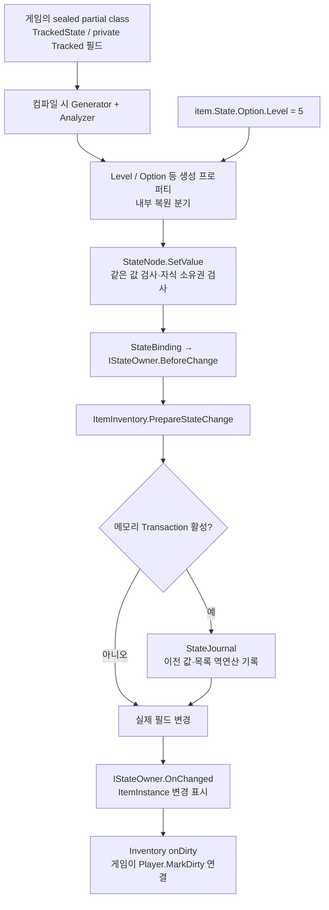

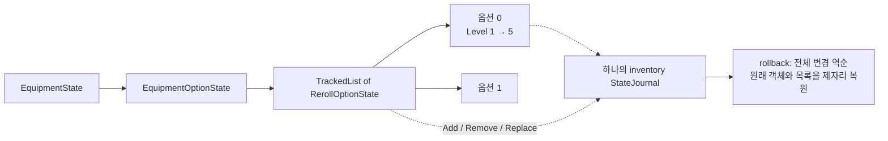

이전 값을 저장하는 타이밍은 **실제 변경 직전**이다. `1 → 5 → 1`이면 두 기록이 남고 rollback은 마지막 기록부터 복원한다. 단순한 프로퍼티별 최초 스냅샷 맵과 다르게 자식 교체·목록 편집·중첩 값 변경의 전체 순서를 유지한다. `Clear`는 제거한 원소별 기록을 남긴다.

`StateJournal`은 논리적으로 역순 Undo 목록이며, 실제 구현은 전체 순서 목록과 타입별 버퍼다. 필드 하나 바꿀 때 전체 옵션 그래프를 복사하지 않는다. 비활성 Transaction에서는 변경은 실행하되 Undo를 기록하지 않는다.

현재 생성 스키마는 namespace 수준의 **비제네릭 sealed partial class**를 요구하고 추적 상속을 지원하지 않는다. 자식 상태 조합과 `TrackedList<T>`를 사용한다. 직접 private 필드 대입/증감/ref 노출은 analyzer가 막는다. 생성 상태 객체를 여러 루트가 공유하거나 소유 그래프에 순환을 만드는 것은 허용되지 않는다.

트랜잭션에서 분리된 자식을 외부 참조로 수정해도 종료 전까지 원래 journal이 추적한다. 다만 현재 아이템에 연결되어 있지 않은 자식 수정만으로 아이템을 Dirty로 표시하지 않는다. 다른 루트로 넘기는 것은 해당 트랜잭션이 끝날 때까지 제한한다.

근거: [Generator](../common/src/Bun3.State.Generator/TrackedStateGenerator.cs), [Analyzer 진단](../common/src/Bun3.State.Generator/StateDiagnostics.cs), [StateNode](../common/src/Bun3.State/StateNode.cs), [StateJournal](../common/src/Bun3.State/StateJournal.cs), [ItemInstance 연결](../server/src/Bun3.Server.Items/ItemInstance.StateTracking.cs).

## 10. Transaction이라는 이름을 구분해서 읽기

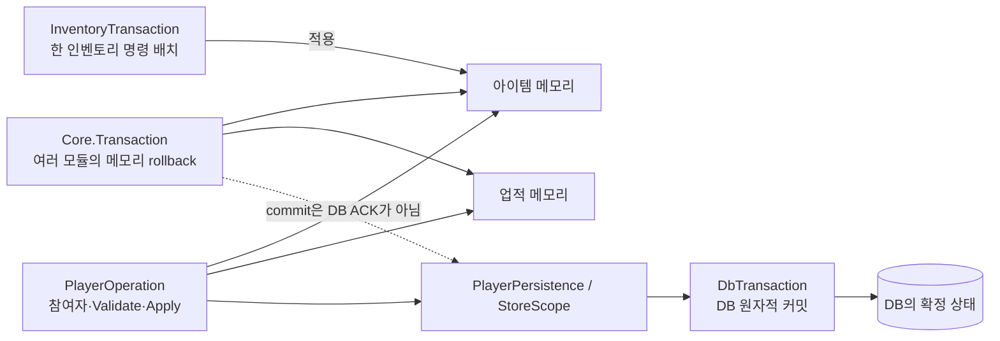

| 개념 | 적용 시점 | 범위 | 되돌리는 기준 |
|---|---|---|---|
| InventoryTransaction | 배치 `Commit`에서 검증 후 적용 | 단일 인벤토리 | 사전 검증 실패 시 미적용 |
| Core.Transaction | API 호출 즉시 실제 객체 변경 | 같은 Transaction을 주입한 모듈 | 메모리에 보관한 이전 값/Undo |
| PlayerOperation | 프레임워크가 보호한 참여자에 Validate → Apply | 한 DB 작업의 플레이어 집합 | DB 실패 시 참여자 메모리 폐기 |
| DbTransaction | SQL 실행 후 COMMIT/ROLLBACK | 같은 연결·트랜잭션의 DB 변경 | DB의 원자적 커밋/롤백 |

`PlayerOperation`이 자동으로 Core.Transaction을 Begin/Commit하지 않는다. 게임이 부분적인 콘텐츠 처리를 메모리에서 되돌리고 싶을 때 별도로 사용한다. 메모리 Transaction은 중첩을 지원하지 않으며, 플레이어 실행 권한 안에서 동기적인 짧은 작업으로 사용한다. DB I/O나 외부 서비스 호출을 기다리는 수명으로 확대하지 않는다.

## 11. 메모리 롤백: 무엇을 보관하고 어떤 순서로 복원하는가

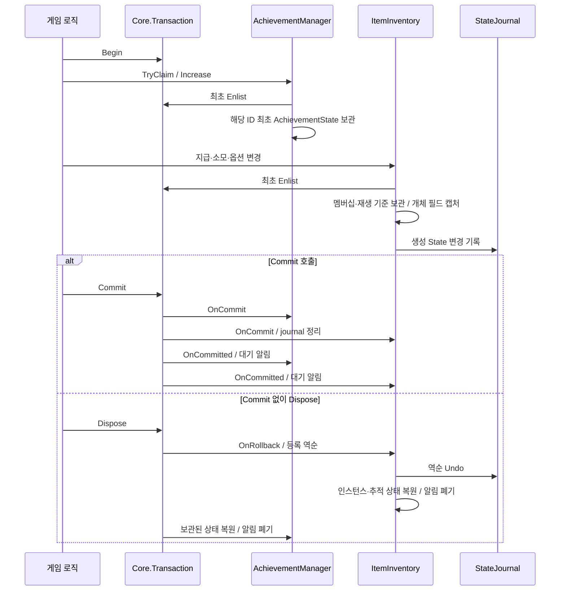

그림은 업적 → 인벤토리 순서로 참가한 예시다. 실제 참가 순서는 첫 변경 순서다. Commit은 **모든 참가자의 내부 확정 `OnCommit`을 먼저 끝내고** `OnCommitted` 알림을 전달한다. 알림 실패 시 이미 확정한 메모리 상태를 자동 rollback하지 않는다. rollback 중 한 참가자에서 오류가 나도 나머지 복원을 시도한 뒤 오류를 전달한다.

| 보관 대상 | 구현 방식 | 비용/주의점 |
|---|---|---|
| 인벤토리 멤버십 | InstanceId → 객체 참조 사전 전체 얕은 복사 | 첫 참가 시 보유 목록 크기에 비례 |
| 재생 기준 | 아이템별 기준 시각 사전 복사 | 첫 참가 시 기준 수에 비례 |
| 인스턴스 공통 필드 | 개체의 최초 변경 전 수량·플래그·만료·추적 표시·State | 해당 개체 최초 캡처 |
| 생성 State | 실제 변경별 타입별 Undo | 변경량에 비례. 전체 그래프 깊은 복사 없음 |
| opaque 가변 State | `BeginStateChange` + 게임 `snapshotState` | 최초 보관 State의 독립 복사 필요 |
| 업적 | 변경 ID별 최초 `AchievementState` 구조체 | 전체 업적 상태 배열을 복사하지 않음 |
| 저장 변경 추적 | 제거 목록 원래 길이, HasChanges 등 | rollback 후 다시 원래 추적 상태 |
| 콜백/ActionLog 첨부 | 메모리 commit까지 대기 | rollback이면 대기분 폐기 |

따라서 **현재 전체 rollback이 모두 변경점만 저장하는 구조는 아니다.** 생성 옵션은 변경점 Undo지만, 인벤토리 목록의 얕은 복사는 남아 있다. 보관소는 활성 트랜잭션에서 필요할 때 만들고 이후 용량을 재사용한다.

한 ItemInstance 수명에서 생성 State 추적과 `BeginStateChange`를 혼용하지 않는다. opaque 상태를 제자리 편집할 때는 scope와 올바른 독립 복사가 필요하다. 단순한 사후 `MarkChanged()` 호출만으로 이미 잃은 이전 값을 복원할 수 없다.

근거: [Core.Transaction](../server/src/Bun3.Server.Core/Transaction.cs), [Inventory rollback](../server/src/Bun3.Server.Items/ItemInventory.Transaction.cs), [Achievement rollback](../server/src/Bun3.Server.Achievements/AchievementManager.Transaction.cs).

## 12. 업적: 상태 배열과 완료/수령 카운터

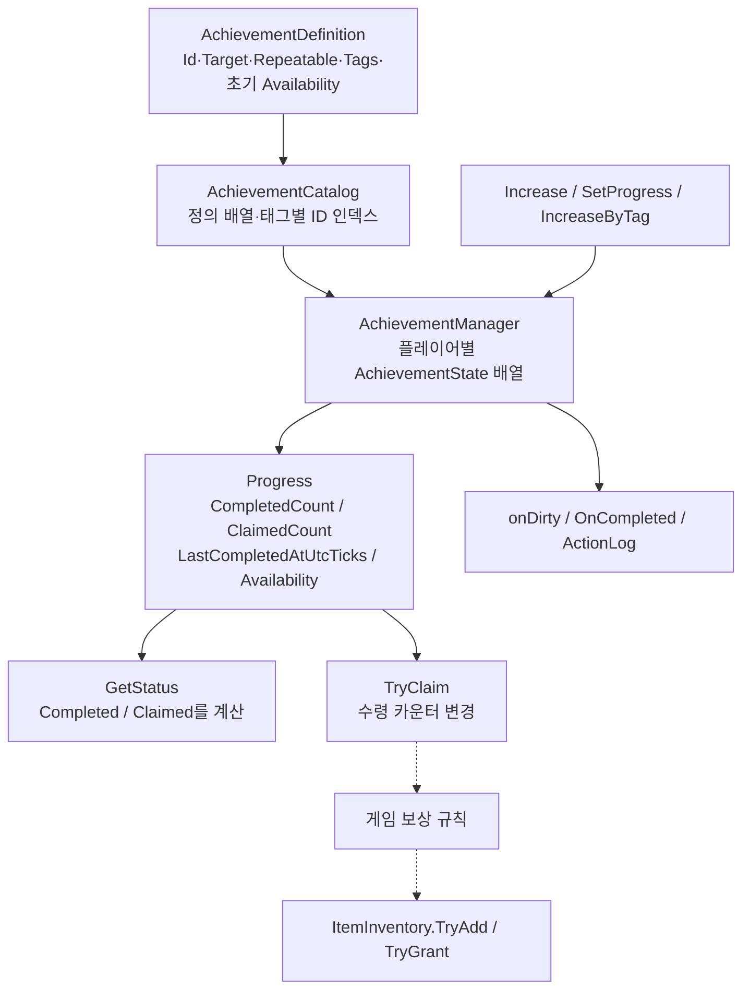

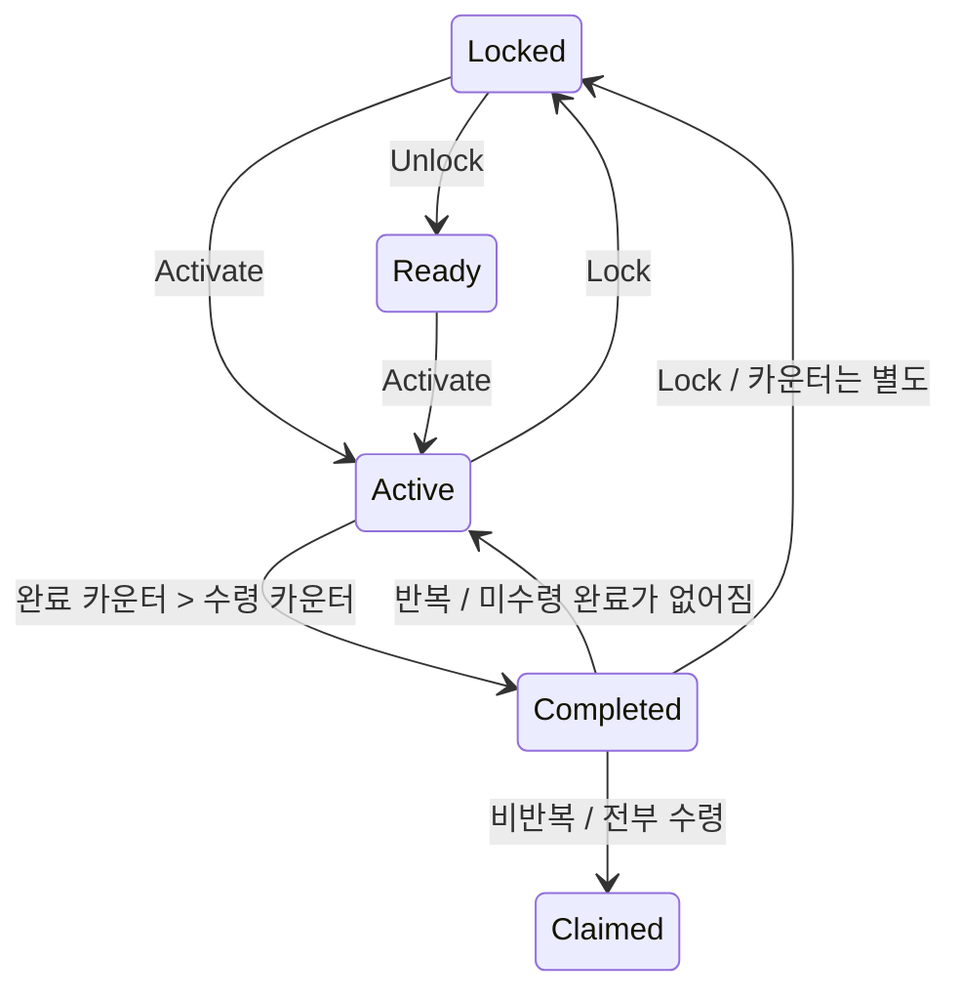

두 번째 그림은 대표적인 표시 상태 흐름이다. DB에 저장하는 `Availability`는 Locked/Ready/Active이고, Completed/Claimed는 카운터에서 계산한다. Locked/Ready에서는 `GetStatus`가 그 Availability를 우선 표시한다. 미수령 완료가 있다면 `TryClaim`은 Availability와 무관하게 정산을 허용한다.

`GetClaimableCount = CompletedCount - ClaimedCount`. 반복 업적은 한 번 수령할 때 Progress에서 Target 하나를 차감한다. `TryClaim`은 **아이템을 지급하지 않는다**. 어떤 보상을 지급할지는 게임이 연결한다. 태그는 여러 업적을 한 이벤트로 증가시키기 위한 카탈로그 인덱스이며 GameplayTags와 자동 연동되는 것은 아니다.

근거: [AchievementDefinition](../server/src/Bun3.Server.Achievements/AchievementDefinition.cs), [AchievementState](../server/src/Bun3.Server.Achievements/AchievementState.cs), [AchievementStatus](../server/src/Bun3.Server.Achievements/AchievementStatus.cs), [AchievementManager](../server/src/Bun3.Server.Achievements/AchievementManager.cs).

## 13. 예시: 업적 보상 수령과 아이템 지급을 함께 처리

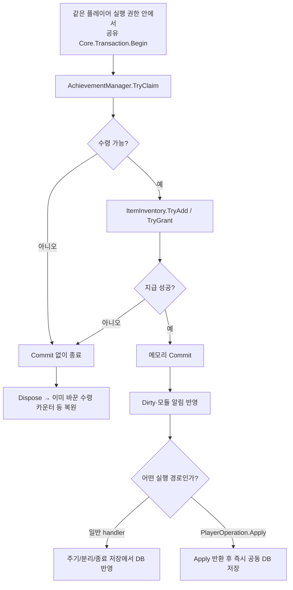

게임 코드의 조립 예시는 아래와 같다. `transaction`, `achievements`, `inventory`는 같은 플레이어가 소유하고 두 모듈에 같은 transaction이 주입되어 있어야 한다.

```csharp
using (var scope = transaction.Begin())
{
    if (!achievements.TryClaim(achievementId))
        return false;
    if (inventory.TryAdd(rewardItem, 1) != InventoryError.None)
        return false;
    scope.Commit();
    return true;
}
```

오류 반환 자체가 자동 rollback 신호는 아니다. 예시에서는 `Commit`을 생략한 채 `Dispose`하므로 복원된다. DB 확정까지 응답 의미를 묶고 싶다면 이 콘텐츠를 PlayerOperation 경로로 조립한다. 이미 메모리 commit한 뒤 DB가 실패하면 메모리 Undo로 복구하는 것이 아니라 해당 참여자의 변경 객체를 버린다.

근거: [OutgameRollbackStorageTests](../server/tests/Bun3.Server.Tests/OutgameRollbackStorageTests.cs), [OutgameLedgerIntegrationTests](../server/tests/Bun3.Server.Tests/OutgameLedgerIntegrationTests.cs).

## 14. Dirty → 저장 데이터 → JSON/protobuf/컬럼

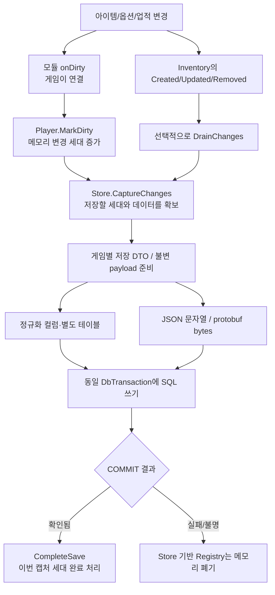

| 개념 | 실제 의미 | 저장 형식과 관계 |
|---|---|---|
| State | 게임이 사용하는 현재 메모리 값/그래프 | DB 컬럼이나 protobuf 형식 그 자체일 필요 없음 |
| 저장 DTO | 저장에 필요한 값을 옮겨 담은 객체 | 게임이 SQL/JSON/protobuf용으로 설계 |
| payload | 특정 저장분에 사용할 직렬화된 문자열/bytes | 해당 저장 시점의 소유권과 내용이 명확해야 함 |
| Dirty 세대 | 마지막 저장 완료 이후 메모리가 변경됐는지 | DB optimistic version과 별개 |
| `ItemChange` | Drain 이후 변경 종류와 대상 | Created/Updated는 살아 있는 Instance 참조를 보유 |

`DrainChanges`는 추적을 비우므로 단순한 읽기 API가 아니다. 버퍼가 변경 집합을 넘겨받으며, **Instance 참조가 깊은 스냅샷이 되는 것은 아니다**. 플레이어 실행 권한 안에서 DTO/bytes 등 저장 데이터를 확정하고, 비동기 저장 도중 변경 가능한 객체를 보호 없이 읽지 않는다. 제거 정보, 재생 기준, 업적 상태 등도 게임 매핑에 포함한다.

독립 Inventory나 loader-only 저장 훅에서 직접 저장 재시도를 구현할 때에는 drain 버퍼를 성공까지 보유한다. Store 기반 Registry는 실패한 Player를 폐기하는 계약이므로 **그 객체에서 다음 tick 재시도를 계속하는 정책과 혼합하지 않는다**. 이전 문서의 모듈 단독 저장 예시와 Registry 저장 정책을 구별해야 한다.

State 전체를 protobuf로 저장할지 일부를 컬럼으로 정규화할지는 게임 매핑의 선택이다. 같은 Player의 여러 테이블 쓰기도 전달된 동일 DB 트랜잭션을 사용한다. 생성 State는 `.proto`나 DB migration을 자동 생성하지 않는다. DTO 스키마 버전과 unknown field 보존도 게임 매핑 책임이다.

근거: [Inventory.Tracking](../server/src/Bun3.Server.Items/ItemInventory.Tracking.cs), [Player Dirty](../server/src/Bun3.Server.Players/Player.cs), [PlayerSaveData](../server/src/Bun3.Server.Players/PlayerSaveData.cs), [Capture 계약](../server/src/Bun3.Server.Players/PlayerPersistence{TPlayer}.cs), [GeneratedOptionMapping 테스트 예제](../server/tests/Bun3.Server.Tests/GeneratedOptionMapping.cs).

## 15. 세 가지 저장 모드와 자동 저장 시점

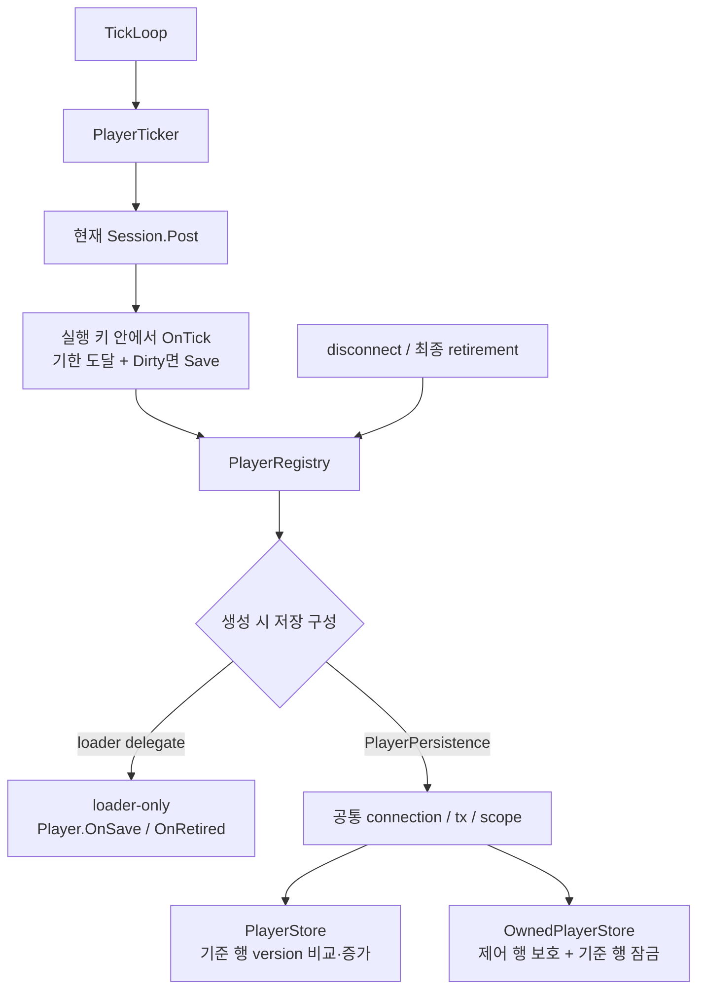

| 모드 | DB transaction 책임 | 공동 PlayerOperation | 영속 Admin 명령 | 동시성 정보 |
|---|---|---|---|---|
| loader-only | 게임 save 훅 | 지원하지 않음 | 지원하지 않음 | 프레임워크의 로컬 실행 권한 + 게임 저장 정책 |
| PlayerStore | 프레임워크 scope + 게임 SQL | 지원 | 현재 Dispatcher 대상 아님 | 기준 행 잠금·expectedVersion |
| OwnedPlayerStore | 프레임워크 scope + 게임 SQL | 지원 | 지원 | scope 제어 행·instance ID·기준 행 잠금 |

자동 PlayerTicker는 연결된 플레이어만 대상으로 하고, tick 작업 자체는 세션에 Post한다. grace 플레이어는 detach 때 저장하고 grace sweep이 만료를 처리한다. 오프라인 Admin registry에는 세션·listener·ticker·grace 캐시가 없다.

어떤 모드에서도 `Player.MarkDirty`의 메모리 세대와 세션 바인딩 세대는 필요하다. Owned 모드가 제거하는 것은 **플레이어별 DB 동시성 version 요구**다. State/DTO 스키마 버전, command 입력 버전, 메모리 세대를 제거하는 것이 아니다.

근거: [PlayerStore](../server/src/Bun3.Server.Players/PlayerStore{TPlayer}.cs), [OwnedPlayerStore](../server/src/Bun3.Server.Players/OwnedPlayerStore{TPlayer}.cs), [PlayerTicker](../server/src/Bun3.Server.Players/PlayerTicker.cs), [Registry.Persistence](../server/src/Bun3.Server.Players/PlayerRegistry.Persistence.cs).

## 16. 다중 플레이어 작업: 접속/미접속을 함께 묶기

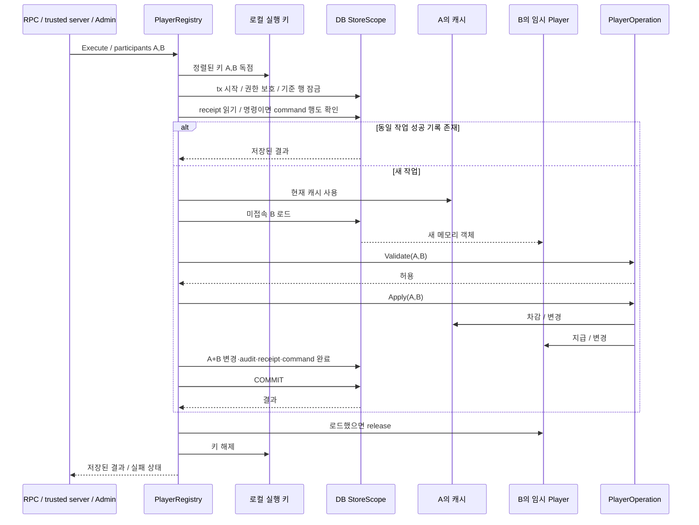

`PlayerOperation`은 고정된 참여 키, actor, ID, 입력 fingerprint, 결과 codec을 갖는다. `Validate`는 읽기 전용으로 쓰고 `Apply`는 동기적으로 참여자의 변경을 끝낸다. Store가 없는 Registry, 참여자가 너무 많은 작업, 중첩 소유 진입은 거절된다.

A 온라인/B 오프라인, 양쪽 온라인, 양쪽 오프라인을 같은 실행기로 처리한다. A/B가 모두 같은 **소유 범위와 DB**에 있어야 한다. A/B와 C/D처럼 참여 키가 겹치지 않으면 병렬 진행할 수 있고, A/B와 B/C는 B에서 직렬화된다.

Apply 이후에는 요청 취소로 저장을 버리지 않는다. 결과 DTO도 codec으로 직렬화하고 다시 복원해, 호출자에게 반환하는 결과와 영속 receipt payload의 소유를 확정한다. 같은 ID에 종류·actor·참여자·fingerprint가 다르면 기존 성공으로 취급하지 않는다.

근거: [PlayerOperation](../server/src/Bun3.Server.Players/PlayerOperation{TPlayer,TResult}.cs), [Registry.Operations](../server/src/Bun3.Server.Players/PlayerRegistry.Operations.cs), [OperationContext](../server/src/Bun3.Server.Players/PlayerOperationContext{TPlayer}.cs), [OperationE2ETests](../server/tests/Bun3.Server.Tests/PlayerOperationE2ETests.cs).

## 17. DB 트랜잭션 하나에 무엇이 들어가는가

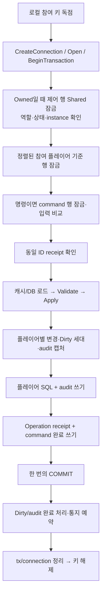

단일 주기 저장은 command/receipt/Validate/Apply 구간 없이 해당 Player의 변경·audit를 저장한다. 명령의 Validate 거절은 Player를 변경하지 않고 Rejected 상태를 별도 결과로 확정한다.

```mermaid
erDiagram
    WRITE_AUTHORITY ||--o{ PLAYERS : guards_scope
    WRITE_AUTHORITY ||--o{ COMMANDS : routes_scope
    WRITE_AUTHORITY ||--o{ TRANSITION_AUDIT : records
    COMMANDS ||--o| OPERATION_RECEIPTS : same_id_when_committed
    PLAYERS ||--o{ PLAYER_AUDITS : participant_key
    WRITE_AUTHORITY {
        string scope_key PK
        enum state
        uuid instance_id
        uuid transition_id
        bytes transition_fingerprint
    }
    PLAYERS {
        string key PK
        string scope_key
        object game_columns_and_blobs
    }
    COMMANDS {
        uuid id PK
        string scope_key
        object actor_kind_and_key
        string kind
        int input_schema
        object participants
        bytes input_fingerprint
        bytes input_payload
        enum status
        bytes result_payload
    }
    OPERATION_RECEIPTS {
        uuid id PK
        object operation_identity
        int result_schema
        bytes result_payload
    }
    PLAYER_AUDITS {
        string player_key
        uuid mutation_id
        string event_name
        bytes payload
    }
    TRANSITION_AUDIT {
        uuid transition_id
        string scope_key
        object operator_and_state_change
    }
```

ER 그림은 **논리적 저장 관계**이며 제품 패키지가 강제 생성하는 SQL 스키마/FK 선언이 아니다. 직접 실행한 PlayerOperation은 command 없이 receipt가 존재할 수 있다. Rejected/Failed 명령에는 성공 receipt가 없을 수 있다. Player별 version 없는 예제이므로 PLAYERS에 version 열이 없다.

게임 어댑터는 전달된 연결/transaction만 사용하고 자체 commit이나 다른 연결의 쓰기를 섞지 않는다. Queue 접수용 연결과 PlayerStore 연결이 같은 물리 DB를 가리키는지도 게임별 배포 검증에 포함한다.

근거: [PlayerPersistence](../server/src/Bun3.Server.Players/PlayerPersistence{TPlayer}.cs), [StoreScope](../server/src/Bun3.Server.Players/PlayerStoreScope{TPlayer}.cs), [PostgreSQL 플레이어 매핑](../server/tests/Bun3.Server.Tests/Helpers/PostgresOwnedPlayerStore.cs), [PostgreSQL 명령 매핑](../server/tests/Bun3.Server.Tests/Helpers/PostgresCommandStore.cs).

## 18. 실패 처리: rollback 확정과 commit 결과 불명

```mermaid
flowchart TB
    Work["Apply / 저장 시도"] --> Outcome{"결과"}
    Outcome -->|"커밋 성공"| Success["캐시 유지·저장 세대 완료<br/>성공 결과·알림"]
    Outcome -->|"rollback 확인"| Drop["참여자 변경 메모리 폐기<br/>캐시 제거·세션 종료"]
    Outcome -->|"commit 응답 유실 / 정리 불명"| Unknown["메모리 폐기 + 복구 대기 표시"]
    Unknown --> Close["기존 DB scope 정리"]
    Close --> Lock["새 DB scope에서 같은 기준 행 보호<br/>이전 writer 종료 장벽"]
    Lock --> Check{"명령의 완료 기록 / receipt?"}
    Check -->|"성공 기록 있음"| Saved["저장된 성공 반환<br/>Apply 반복 없음"]
    Check -->|"확인 완료·성공 없음"| Pending["미완료 명령은 Pending<br/>동일 ID로 추후 재시도"]
    Check -->|"조회/잠금 실패"| U["Unknown 유지"]
    Drop --> Reload["다음 로그인 / 작업에서 DB 재로드"]
    Saved --> Reload
    Pending --> Reload
```

후반의 즉시 command/receipt 확인은 영속 Admin 명령 경로 설명이다. 직접 PlayerOperation은 결과 불명을 반환한 뒤 같은 Operation ID로 재시도하면 receipt 확인을 거친다. 단일 주기 저장에는 Operation receipt가 없으며, 다음 로드/종료 복구에서 기준 행 잠금으로 이전 writer 종료를 확인하고 DB 상태를 사용한다.

명령 실패 기록은 원래 DB scope를 정리한 뒤 새 scope에서 남긴다. 그 사이 다른 worker가 완료한 terminal 결과를 먼저 확인하므로 성공을 실패로 덮어쓰지 않는다. 성공 receipt의 결과 codec을 현재 코드가 해석하지 못해도 영속 성공 자체를 Failed로 바꾸지 않는다.

| 실패 지점 | 메모리/응답의 의미 |
|---|---|
| Validate 거절 | 변경 전에 거절. rollback 복구할 게임 변경이 없음 |
| Apply 일부 실행 후 예외 | DB rollback 처리 + 이미 변경한 참여자 캐시 폐기 |
| SQL 오류, rollback 확인 | DB 변경 미확정. 해당 작업의 변경 메모리 폐기 |
| COMMIT 호출 후 예외 | 실제 DB는 성공했을 수도 있으므로 Unknown |
| 성공 후 알림 전송 실패 | DB 성공 유지. 알림의 정확히 한 번 전달은 별도 문제 |
| 권한 상실/권한 확인 경로 실패 | 서버 새 진입 차단, 키를 해제한 뒤 전체 캐시 폐기 진행 |

근거: [Store 결과 분류](../server/src/Bun3.Server.Players/PlayerStoreScope{TPlayer}.cs), [명령 복구](../server/src/Bun3.Server.Players/PlayerRegistry.Commands.cs), [폐기](../server/src/Bun3.Server.Players/PlayerRegistry.Execution.cs), [권한 상실](../server/src/Bun3.Server.Players/PlayerRegistry.Authority.cs).

## 19. version 없는 방식의 핵심: 수정 권한 상태

```mermaid
stateDiagram-v2
    [*] --> Offline: 설치 시 제어 행 초기화
    Offline --> Starting: Prepare / 새 instance가 소유권 확보
    Starting --> Online: Activate / 로컬 진입 개방
    Online --> Draining: 신규 진입 차단 / BeginDrain
    Draining --> Offline: 모든 writer·캐시·복구 정리 확인
    Starting --> RecoveryRequired: 운영자 복구 절차
    Online --> RecoveryRequired: 운영자 복구 절차
    Draining --> RecoveryRequired: 운영자 복구 절차
    RecoveryRequired --> Offline: 이전 프로세스 종료 확인 + DB 복구 검증
```

| DB 상태 | 허용되는 writer/접근 |
|---|---|
| Offline | OfflineAdministrator의 작업·복구 |
| Starting(instance) | 해당 서버 인스턴스의 로드 접근 |
| Online(instance) | 해당 서버 인스턴스의 정상 접근 |
| Draining(instance) | 해당 서버의 저장·이미 진입한 작업·복구. 신규 일반 진입은 로컬 gate에서 차단 |
| RecoveryRequired | 일반 쓰기 차단, 운영자 확인 복구 |

`instanceId`는 실행할 때 새로 만드는 서버 식별자다. 플레이어 저장 횟수와 다르다. `scopeKey`는 해당 Registry가 맡는 저장 집합이다. 게임의 논리 world ID와 반드시 일치하지 않는다.

상태 조회 `ReadAsync`만으로 쓰기 권한을 획득하지 않는다. 실제 StoreScope의 tx 안에서 제어 행을 잠그고 상태와 인스턴스를 확인한다. 상태 전환은 배타 잠금으로 보호한다. 전환 ID/fingerprint는 응답이 유실된 동일 전환을 확인하고 다른 입력/소유자를 덮어쓰지 않게 한다.

RecoveryRequired는 장애 감지가 자동으로 세팅하는 상태가 아니다. `RecoverAsync`는 호출자가 **이전 프로세스 종료와 자동 재기동 차단을 독립적으로 확인했다는 전제**를 요구한다. 복구 감사와 Offline 전환은 같은 복구 tx에서 확정될 수 있어 중간 상태가 별도 커밋으로 보이지 않을 수 있다.

근거: [PlayerWriteAuthority](../server/src/Bun3.Server.Players/PlayerWriteAuthority.cs), [WriteBinding](../server/src/Bun3.Server.Players/PlayerWriteBinding.cs), [RecoveryConfirmation](../server/src/Bun3.Server.Players/PlayerWriteRecoveryConfirmation.cs).

## 20. 잠금과 성능: 전체 서버를 한 줄로 세우지 않는다

```mermaid
sequenceDiagram
    participant A as A 저장 tx
    participant B as B 저장 tx
    participant C as 제어 행
    participant P as 플레이어 행
    participant S as 기동/종료 전환 tx
    A->>C: FOR SHARE
    B->>C: FOR SHARE / A와 공존
    A->>P: A 기준 행 FOR UPDATE
    B->>P: B 기준 행 FOR UPDATE / A와 공존
    S->>C: FOR UPDATE 요청 / 대기
    A->>A: A 저장 / COMMIT
    B->>B: B 저장 / COMMIT
    C-->>S: 기존 공유 잠금 종료 후 획득
    S->>C: 상태·instance 변경 / COMMIT
```

이 그림은 PostgreSQL 테스트 어댑터의 실제 잠금 매핑이다. 다른 DB를 사용하면 동일한 상호 배제 계약을 제공하는 매핑을 작성해야 한다.

| 동시에 실행하는 일 | 충돌 범위 |
|---|---|
| A 저장 + B 저장 | 다른 행이면 병렬 가능 |
| A/B 거래 + C/D 거래 | 키/행이 겹치지 않으면 병렬 가능 |
| A/B 거래 + B 로그인 | B 로컬 실행 권한/기준 행에서 대기 |
| Offline Admin 저장 + 서버 Prepare | 제어 행 shared/exclusive에서 인계 순서 확정 |
| 오래된 서버 저장 + 새 instance 활성 | instance 검사에서 거절 |
| 다른 서버가 수정하는 공유 클랜 | 현재 플레이어 계약만으로 보장되지 않음 |

처리량을 위해 여러 독립 플레이어를 하나의 거대한 DB 트랜잭션으로 합치지 않아도 된다. 현재 worker는 배치 후보를 찾고 제한된 동시 작업으로 **명령별 트랜잭션**을 실행한다. `BatchSize`는 하나의 DB 커밋에 합치는 플레이어 수가 아니다. 전역 FIFO도 보장하지 않는다.

근거: [PostgreSQL 제어 행 매핑](../server/tests/Bun3.Server.Tests/Helpers/PostgresAuthorityFixture.cs), [PostgresAuthorityTests](../server/tests/Bun3.Server.Tests/PostgresAuthorityTests.cs), [Worker](../server/src/Bun3.Server.Hosting/PlayerCommandWorker{TPlayer}.cs).

## 21. Admin 명령: 접수는 공통, 실행기는 권한에 따라 달라진다

```mermaid
flowchart TB
    Admin["Admin 요청 / 게임의 인증·권한 검사"] --> Env["불변 Envelope<br/>ID·actor·참여자·scope·kind·schema·payload"]
    Env --> Submit["Queue.SubmitAsync<br/>고유 ID 접수 / 동일 입력 비교"]
    Submit --> Pending[("DB Pending 명령")]
    Pending --> SW["WorldServer worker<br/>AddPlayerCommands"]
    Pending --> AW["Offline Admin worker<br/>AddOfflinePlayerCommands"]
    SW --> Filter["Catalog의 지원 kind/schema 후보만 조회"]
    AW --> Filter
    Filter --> Dispatch["Dispatcher<br/>Factory로 PlayerOperation 복원"]
    Dispatch --> Registry["공통 Registry 실행 경로"]
    Registry --> Guard{"DB 권한 검사"}
    Guard -->|"현재 실행기 허용"| Run["Apply + players/audit/receipt/완료 공동 커밋"]
    Guard -->|"전환 중 / 다른 owner"| Wait["미실행 Pending 유지"]
    Wait --> Pending
    Run --> Terminal[("Committed / Rejected / Failed")]
    Admin --> Get["Queue.GetAsync로 상태 확인"]
    Get --> Pending
    Get --> Terminal
```

| 데이터 | 담는 것 | 역할 |
|---|---|---|
| Envelope | 접수 당시 입력과 identity | 이후 mutable 원본이 바뀌어도 명령 입력 보존 |
| Catalog registration | kind + input schema → operation factory | 지원 배포에서 게임 작업 복원 |
| Command record | Pending/terminal 상태, 결과 | 관리 API에서 접수와 처리 상태 조회 |
| Operation receipt | 성공한 작업 identity와 결과 schema/payload | 같은 ID 재실행 시 DB 효과 중복 방지 |

`CommandId = OperationId`로 실행한다. Administrator actor는 대상 플레이어 목록에 들어갈 필요가 없다. Factory가 접수한 ID/actor/대상/입력 fingerprint를 바꾼 Operation을 만들면 실행 전에 거절한다.

미등록 종류, 미지원 입력 버전, offline 지원이 없는 명령은 Pending으로 남는다. worker는 지원 조건을 후보 조회에 전달하며 **LIMIT 전에 필터링**해야 미지원 명령이 배치를 독점하지 않는다. Unknown은 결과를 확인하지 못했다는 응답 상태이며 command 테이블의 확정 terminal 상태로 기록하지 않는다.

서버 timeout만으로 Admin이 새 명령 ID를 만들어 직접 적용하지 않는다. 같은 DB 명령의 상태를 확인하고, DB 제어 행이 허용하는 실행기만 처리한다. 인증/권한 정책 자체를 프레임워크가 대신 결정하지 않는다.

근거: [Envelope](../server/src/Bun3.Server.Players/PlayerCommandEnvelope.cs), [Queue](../server/src/Bun3.Server.Players/PlayerCommandQueue.cs), [Catalog](../server/src/Bun3.Server.Players/PlayerCommandCatalog{TPlayer}.cs), [Dispatcher](../server/src/Bun3.Server.Players/PlayerCommandDispatcher{TPlayer}.cs), [Hosting 등록](../server/src/Bun3.Server.Hosting/PlayerCommandServiceCollectionExtensions.cs).

## 22. 기동·점검·종료: 언제 직접 수정을 허용하는가

```mermaid
flowchart TB
    Start["새 instance ID / 새 owned Registry<br/>일반 admission 닫힘"] --> Prepare["PrepareAsync<br/>Offline → Starting"]
    Prepare --> Activate["ActivateAsync<br/>Starting → Online 확인"]
    Activate --> Open["로컬 admission 개방"]
    Open --> StartServices["listener → tick → command worker 시작"]
    StartServices --> Online["서비스 운영"]
    Online --> Stop["worker intake + 새 변경 진입 차단"]
    Stop --> Begin["BeginDrainAsync<br/>Online → Draining"]
    Begin --> StopServices["tick/listener 중지<br/>worker 완료 대기"]
    StopServices --> Drain["Registry.DrainAsync<br/>작업·저장·캐시·복구·정리 집계"]
    Drain --> Quiet{"IsQuiescent?"}
    Quiet -->|"예"| Offline["Offline 전환 COMMIT 확인<br/>Admin 직접 실행 허용"]
    Quiet -->|"아니오"| Block["Offline 발행 안 함<br/>진단·재확인·운영자 복구"]
```

| Drain 결과 | 의미 |
|---|---|
| `IsQuiescent` | 활성 작업 0, 캐시 없음, sweep/권한 cleanup 완료, unresolved/오류 없음 |
| `DiscardedKeys` | 저장 실패 등으로 변경 메모리를 폐기한 키 |
| `UnresolvedKeys` | 이전 DB writer 종료나 남은 캐시 정리를 확인하지 못한 키 |
| `Errors` | cleanup/release 등 종료 완료를 증명하지 못하는 오류 |
| `OfflineConfirmed` | 로컬 drain뿐 아니라 DB Offline 전환 커밋까지 확인 |

로그인만 차단하거나 tick만 멈춘 상태는 직접 수정 허용 조건이 아니다. 진행 중인 로그인 로딩도 admission에 포함하므로 drain은 그것이 끝나 임시 상태가 정리될 때까지 기다린다. 종료 대기 취소는 이미 Apply한 저장을 버리는 신호가 아니다.

한 번 닫힌 Registry를 다시 열어 재사용하지 않는다. 재개 시 새 Registry와 새 instance ID를 만든다. Hosting의 자동 경로 외에 게임 초기화가 필요하면 Prepare와 Activate 사이에 수동으로 조립한다. 초기화/시작 실패나 강제 종료 뒤의 소유권은 확인 없이 Offline으로 바꾸지 않는다.

근거: [Lifecycle](../server/src/Bun3.Server.Players/PlayerServerLifecycle{TPlayer}.cs), [Shutdown](../server/src/Bun3.Server.Players/PlayerRegistry.Shutdown.cs), [Hosting lifetime](../server/src/Bun3.Server.Hosting/PlayersLifetimeService{TSession,TPlayer,TRequest,TResponse,TUpdate}.cs).

## 23. 알림·감사·로그: 어느 commit을 기다리는가

```mermaid
flowchart TB
    Mutation["게임 변경"] --> Module["아이템/업적 모듈 알림"]
    Module --> Mem{"Core.Transaction 활성?"}
    Mem -->|"예"| MCommit["메모리 commit 뒤 전달<br/>rollback이면 폐기"]
    Mem -->|"아니오"| Immediate["즉시 전달"]
    Mutation --> Audit["Player.RecordAudit<br/>현재 mutation ID + payload 복사"]
    Audit --> DB["플레이어 저장과 같은 DB tx"]
    Mutation --> Push["Player.PushUpdate / PlayerSession.SendUpdate"]
    Push --> Op{"PlayerOperation Apply 안?"}
    Op -->|"예"| Frozen["패킷 bytes 고정·참여자/세션 바인딩 보관"]
    Frozen --> Commit["DB commit 확인 뒤 전달 시작"]
    Op -->|"아니오"| Now["일반 전송 경로"]
    Mutation --> Trace["ILogger 진단<br/>단계·ID·실패 원인"]
    MCommit --> ActionLog["ActionLog 첨부 / 게임 콜백"]
    Immediate --> ActionLog
```

| 채널 | 보장 기준 | 주의점 |
|---|---|---|
| Inventory onDirty/onApplied, 업적 OnCompleted | 메모리 Transaction 종료 | DB ACK와 동일하지 않음 |
| Core.ActionLog | 모듈 변경 설명의 수집·전달 | 자동으로 영속 DB 감사가 되지 않음 |
| Player.RecordAudit | Store 기반 변경 문맥에서 버퍼 → 같은 DB tx | loader-only는 지원하지 않음. 이벤트 payload/매핑은 게임 책임 |
| Operation의 Player 업데이트 | 성공 DB commit 이후 | 전송 성공까지 DB와 원자적으로 묶는 것은 아님 |
| ILogger | 실행 경로 관찰 | 로그만으로 DB 성공을 판정하지 않음 |

Raw connection 전송, 외부 HTTP, 이메일 등은 이 알림 보장 밖이다. 여러 번 전달해도 괜찮은 처리나 별도 outbox가 필요한 외부 효과를 현재 구현의 exactly-once 보장으로 해석하지 않는다.

진단에는 Operation/Command ID, actor kind/key, 참여 키, scope/instance, 저장 시도 ID, 단계, DB 결과 등이 연결된다. 저장소 어댑터는 입력 payload 전문·인증 토큰·연결 비밀번호를 임의로 로그에 넣지 않는다.

근거: [Inventory 알림](../server/src/Bun3.Server.Items/ItemInventory.Notifications.cs), [ActionLog](../server/src/Bun3.Server.Core/ActionLog.cs), [Player 감사](../server/src/Bun3.Server.Players/Player.Diagnostics.cs), [Operation 알림](../server/src/Bun3.Server.Players/PlayerOperationNotifications.cs), [진단 필드](../server/src/Bun3.Server.Players/PlayerOperationDiagnostics.cs).

## 24. 상황별로 어느 경로를 사용해야 하는가

| 상황 | 진입/사용 경로 | 메모리/DB 범위 | 핵심 확인 |
|---|---|---|---|
| 아이템만 쓰는 툴/게임 | ItemInventory 직접 조립 | DB·Player 불필요 | 카탈로그·ID issuer·State factory |
| 업적 진행도만 필요 | AchievementManager | DB·Inventory 불필요 | 정의·상태 restore·onDirty |
| 장비 옵션 변경 | 생성 State 프로퍼티 | 해당 소유 아이템 | 생성 추적/opaque scope 혼용 금지 |
| 업적 수령 + 보상 지급 | 같은 Core.Transaction을 두 모듈에 주입 | 한 플레이어의 메모리 모듈 | 실패 반환 시 Commit 생략 |
| 단일 플레이어 일반 액션 | 일반 RPC handler | 해당 키 실행 권한, 저장은 주기 정책 | 즉시 응답이 DB 저장 확정인지 구분 |
| 즉시 확정이 필요한 액션 | PlayerOperation | 참여자 하나여도 receipt+DB tx | 안정적인 Operation ID |
| 온라인 A ↔ 오프라인 B 거래 | PlayerOperation participants A,B | 같은 DB tx, B 임시 로드 | 같은 scope/DB, 검증 후 Apply |
| PvP 결과의 보상/랭크 반영 | PlayerOperation 또는 별도 공유 모델 | 선언한 참여자 | 공유 랭킹/클랜 행은 별도 일관성 설계 |
| 서버 운영 중 Admin 지급 | Queue 접수 → 서버 worker | 같은 Operation/DB 경로 | 관리 권한 검증·같은 ID 재시도 |
| 정상 종료 중 Admin 지급 | Queue 접수 → Offline worker | 최신 DB 임시 Player | OfflineConfirmed 이후에만 실행 |
| 서버 연락이 안 됨 | 상태 확인/운영자 복구 절차 | 자동 인계 없음 | 프로세스 종료·재기동 차단 확인 |
| 여러 서버/DB에 걸친 거래 | 현재 계약 밖 | 별도 분산 프로토콜 필요 | 단일 scope/DB 보장을 확장해 해석하지 않음 |

현재 구현은 SQL migration, 계정 자동 생성, Admin UI, 게임 명령 권한, 게임별 State/DTO 매핑을 자동 제공하지 않는다. 플레이어 기준 행과 scope 제어 행 설치는 게임 배포 절차에서 준비한다. 실제 외부 게임에 연결된 것으로 간주하지 않는다.

## 25. 코드를 읽는 순서와 검증 근거

| 보고 싶은 내용 | 먼저 볼 파일 | 다음으로 볼 파일/테스트 |
|---|---|---|
| 서버 조립 | [PlayersServiceCollectionExtensions](../server/src/Bun3.Server.Hosting/PlayersServiceCollectionExtensions.cs) | [PlayersLifetimeService](../server/src/Bun3.Server.Hosting/PlayersLifetimeService{TSession,TPlayer,TRequest,TResponse,TUpdate}.cs) |
| 패킷/세션 순차 실행 | [Session](../server/src/Bun3.Server.Core/Session.cs) | [RpcRuntime](../server/src/Bun3.Server.Rpc/RpcRuntime.cs), [PlayerSession](../server/src/Bun3.Server.Players/PlayerSession.cs) |
| 로그인/재접속 | [Registry.Lifecycle](../server/src/Bun3.Server.Players/PlayerRegistry.Lifecycle.cs) | [PlayerExecutionTests](../server/tests/Bun3.Server.Tests/PlayerExecutionTests.cs) |
| 아이템 변경 | [Inventory.Operations](../server/src/Bun3.Server.Items/ItemInventory.Operations.cs) | [Inventory.Tracking](../server/src/Bun3.Server.Items/ItemInventory.Tracking.cs) |
| 아이템 메모리 복원 | [Inventory.Transaction](../server/src/Bun3.Server.Items/ItemInventory.Transaction.cs) | [OutgameRollbackStorageTests](../server/tests/Bun3.Server.Tests/OutgameRollbackStorageTests.cs) |
| 생성 옵션 변경 | [ItemInstance.StateTracking](../server/src/Bun3.Server.Items/ItemInstance.StateTracking.cs) | [StateNode](../common/src/Bun3.State/StateNode.cs), [StateJournal](../common/src/Bun3.State/StateJournal.cs), [GeneratedOptionTransactionTests](../server/tests/Bun3.Server.Tests/GeneratedOptionTransactionTests.cs) |
| 업적 진행/수령 | [AchievementManager](../server/src/Bun3.Server.Achievements/AchievementManager.cs) | [AchievementManager.Transaction](../server/src/Bun3.Server.Achievements/AchievementManager.Transaction.cs) |
| 메모리 commit 순서 | [Core.Transaction](../server/src/Bun3.Server.Core/Transaction.cs) | [OutgameNotificationTests](../server/tests/Bun3.Server.Tests/OutgameNotificationTests.cs) |
| 단일 저장 | [Registry.Persistence](../server/src/Bun3.Server.Players/PlayerRegistry.Persistence.cs) | [PlayerStoreTests](../server/tests/Bun3.Server.Tests/PlayerStoreTests.cs) |
| 공동 저장의 본체 | [Registry.Operations](../server/src/Bun3.Server.Players/PlayerRegistry.Operations.cs) | [OperationRecoveryTests](../server/tests/Bun3.Server.Tests/PlayerOperationRecoveryTests.cs) |
| DB 어댑터 작성 | [PlayerPersistence](../server/src/Bun3.Server.Players/PlayerPersistence{TPlayer}.cs) | [SQLite version 예제](../server/tests/Bun3.Server.Tests/Helpers/SqlitePlayerStore.cs), [PostgreSQL owned 예제](../server/tests/Bun3.Server.Tests/Helpers/PostgresOwnedPlayerStore.cs) |
| Admin 명령 복구 | [Registry.Commands](../server/src/Bun3.Server.Players/PlayerRegistry.Commands.cs) | [PlayerCommandRecoveryTests](../server/tests/Bun3.Server.Tests/PlayerCommandRecoveryTests.cs) |
| 수정 권한과 종료 | [PlayerWriteAuthority](../server/src/Bun3.Server.Players/PlayerWriteAuthority.cs) | [Registry.Shutdown](../server/src/Bun3.Server.Players/PlayerRegistry.Shutdown.cs), [PlayerWriteLifecycleTests](../server/tests/Bun3.Server.Tests/PlayerWriteLifecycleTests.cs) |
| 실제 DB 경쟁 | [PostgresAuthorityTests](../server/tests/Bun3.Server.Tests/PostgresAuthorityTests.cs) | [PostgresCommandTests](../server/tests/Bun3.Server.Tests/PostgresCommandTests.cs) |

이 문서 작성에서는 코드와 다이어그램의 대응, 소스 링크, Mermaid 렌더링을 검증한다. 제품 테스트의 과거 실행 결과와 실제 DB 환경 제약은 [수정 권한 구현 기록](superpowers/plans/2026-10-08-player-write-authority.md)에 별도로 남아 있으며, 문서 생성일에 제품 테스트를 새로 실행했다는 뜻은 아니다.
