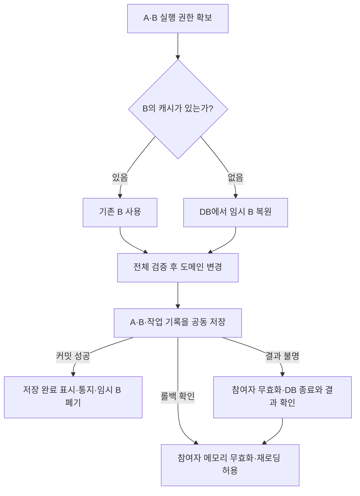

# 온라인·오프라인 플레이어 작업과 공동 저장

2026-10-08 확장: [수정 권한 인계와 version 없는 저장](2026-10-08-player-write-authority-design.md). 아래 2026-10-06 범위와 당시 검증 기록은 유지하며, 기존 version 어댑터도 계속 지원한다.

- 날짜: 2026-10-06
- 상태: 2026-10-06 승인 범위 구현·검증 완료. 서버 테스트 601개 통과, 전체 빌드 경고·오류 0. 커밋·배포 전 작업 트리 상태.
- 범위: 같은 프로세스가 소유하는 플레이어들의 작업 조정, 오프라인 임시 로드, 같은 DB의 공동 저장, 실패 시 상태 폐기.
- 근거: [레거시 저장 조사](../../research/2026-10-03-legacy-save-boundaries.md), [기존 Player 설계](2026-08-06-server-players-design.md), [틱·저장 설계](2026-08-07-server-ticking-design.md), [상태 추적 설계](2026-09-29-generated-option-state-design.md).

## 1. 합의한 목표

사용자는 DB를 최종 기준으로 삼고, 저장 실패 시 변경된 메모리를 버린 뒤 DB의 실제 확정 상태로 다시 구성하는 정책을 선택했다. 성공이 보장되지 않은 행동을 선행 복구 로그에서 반드시 재실행하는 정책은 채택하지 않는다. 주기 저장 전 장애에서는 마지막 저장 이후 진행이 사라질 수 있다.

거래·PvP 정산에는 이 정책을 참여자 전체에 적용한다. 온라인 여부에 따라 게임 규칙을 두 벌 작성하지 않도록 한다. 게임은 규칙·스키마·SQL/직렬화 매핑을 제공하고, 실행 순서·공동 커밋·캐시 수명·실패 처리는 프레임워크가 맡는다.

대화에서 승인된 흐름은 다음과 같다.

1. 참여자들의 작업 권한을 함께 확보한다.
2. 접속 중 또는 재접속 유예 캐시가 있으면 기존 메모리를 사용한다.
3. 캐시에 없는 참여자는 DB에서 임시 게임 상태를 로드한다.
4. 검증·변경 후 관련 상태와 처리 기록을 같은 DB 트랜잭션으로 저장한다.
5. 성공한 뒤 응답·알림을 내보낸다. 임시 상태는 폐기한다.
6. 실패한 저장에 연결된 변경 메모리는 모두 폐기하며, 종료 훅을 통한 재저장을 금지한다.

이 스펙은 위 흐름을 기존 코드에 연결하는 계약을 구체화한다. 기존 미커밋 변경은 보존한다. 외부 게임·운영 DB 변경, 패키지 배포, 커밋은 이 작업에 포함하지 않는다.

## 2. 용어와 보장 범위

| 용어 | 의미 |
|---|---|
| 플레이어 키 | 현재 `AccountKey`와 같은 서버 내부 식별자. 클라이언트의 대상 PlayerId는 게임이 이 키로 해석하고 권한을 검증한다. 비교는 ordinal이며 임의 대소문자 정규화를 하지 않는다. |
| 실행 권한 | 해당 키의 메모리와 수명주기를 독점해서 다룰 권한. 로그인·요청·틱·저장·폐기가 공유한다. |
| 참여자 | 실행 전에 확정한 플레이어 키와 그 키의 기존 또는 임시 상태. 연결된 소켓이 없어도 참여자다. |
| 메모리 트랜잭션 | 기존 `Bun3.Server.Core.Transaction`. 짧은 도메인 변경을 되돌리며 DB 커밋을 의미하지 않는다. |
| DB 트랜잭션 | 같은 connection/transaction으로 실행하는 전체 저장. 참여자의 변경과 작업 처리 기록을 함께 확정한다. |
| 메모리 세대 | 폐기·교체된 객체나 세션의 후속 작업을 거부하기 위한 프레임워크 토큰. |
| 영속 버전 | DB의 플레이어 저장 버전. 메모리의 Dirty 카운터와 다르며 모든 참여자의 버전을 공동 커밋에서 검사·증가한다. |
| 작업 ID | 동일한 거래·경기 정산을 재요청해도 유지되는 ID. RPC 연결별 request ID와 다르다. |
| 재로딩 | DB에서 새 메모리를 만드는 작업. DB에 일부만 확정된 업무를 되돌리는 기능은 아니다. |

첫 구현은 하나의 권위 있는 프로세스와 하나의 관계형 DB를 대상으로 한다. 온라인·유예 캐시·오프라인을 같은 실행 계약으로 다루고, 인원이 겹치지 않는 작업의 병렬 실행을 허용한다.

분산 플레이어 소유권, 여러 DB에 걸친 원자적 커밋, 전체 이벤트 소싱, 관계없는 플레이어 저장을 합치는 성능용 배치는 제외한다. 다른 서버가 소유한 플레이어를 로컬 캐시 부재만으로 오프라인으로 취급하지 않는다. 해당 배포는 별도 소유권 라우팅이 준비되기 전 지원 대상으로 표시하지 않는다.

클랜 등 공유 메모리 객체의 범용 레지스트리는 이번 범위가 아니다. 게임의 관련 DB 행은 같은 트랜잭션에 포함할 수 있지만, 그 행의 조건부 갱신/잠금과 공유 캐시 일관성까지 해결되지 않은 기능을 플레이어 잠금만으로 안전하다고 간주하지 않는다.

## 3. 구현 전 기준과 변경점

| 현재 코드 | 확인한 계약 | 필요한 변경 |
|---|---|---|
| `PlayerRegistry` | 로그인·detach·유예 만료는 계정 해시 기반 256개 stripe 잠금 사용 | 요청과도 공유하는 키별 실행 권한으로 통합. 오프라인 키도 보호 |
| `Session.Post`, `RpcRuntime` | 세션 큐 내부에서는 직렬 실행되지만 다른 세션/로그인과는 별개 | Player의 요청 실행과 posted work에 실행 권한 연결 |
| 중복 로그인 `NewWins` | 기존 세션을 deauthorize하지만 이미 실행 중인 handler는 끝나지 않았을 수 있음 | 실행 중 작업 종료 후 동일 권한 아래 세대 교체 |
| `Player.OnSaveAsync()` | DB 트랜잭션 인자가 없고 게임이 저장 전체를 구현 | 공동 저장 가능한 저장 어댑터 경로 추가 |
| `Player.TrySaveAsync()` | 실패를 삼키고 Dirty를 유지해 다음 주기에 재시도 | 실패 전파·무효화. 같은 변경 메모리의 자동 재저장 중단 |
| `OnRetiredAsync()` | 저장 지점으로 사용 | 정상 종료와 저장 없이 폐기하는 경로 분리 |
| `Transaction.Commit()` | Undo를 비우고 도메인 알림을 실행. 알림이 추가 변경을 만들 수 있음 | 도메인 반응까지 끝낸 뒤 저장분 준비. 외부 통지는 DB 커밋 이후 |
| `DrainChanges()` | 활성 메모리 트랜잭션에서 호출 불가. 호출 시 변경 추적 소비 | 메모리 작업 종료 후 호출. 소비한 저장분은 DB 결과 확인까지 소유 |
| `ActionLog` | scope 종료 시 sink 호출. 영속화·재전송 보장 없음 | 처리 단계 로그와 DB에 함께 저장할 감사 데이터를 구분 |

## 4. 모듈과 게임의 책임

신규 공용 기능은 `server/src/Bun3.Server.Players/`에 둔다. 저장 어댑터도 Player 수명주기와 직접 결합된 역할이므로 첫 구현에서 별도 패키지로 나누지 않는다. DB 제공자 라이브러리는 추가하지 않고 BCL의 `DbConnection`/`DbTransaction`을 사용한다.

| 위치 | 책임 |
|---|---|
| `Bun3.Server.Core` | posted work를 감싸는 수명 확장 지점, 저장 실패 연결 종료 사유. 일반 Session의 기존 동작은 유지 |
| `Bun3.Server.Rpc` | 역직렬화된 요청의 실행을 감싸는 확장 지점. Player를 참조하지 않음 |
| `Bun3.Server.Players` | 키별 실행 권한, 참여자 확보, 임시 로드, 작업 실행, 공통 DB 트랜잭션 수명, 무효화, 관측 |
| `Bun3.Server.Hosting` | 저장 어댑터 등록, 종료 시 새 작업 차단과 실행 중 작업 정리 |
| 게임 어댑터 | 키 해석·권한 검증, 게임 상태 생성/로드, 변경을 SQL/JSON/protobuf로 매핑, 영속 버전·작업 기록 테이블 매핑 |
| 게임 도메인 | 최신 참여자 상태에 대한 검증, 재화/아이템/점수 변경, 결과·감사 데이터 |

`ItemInventory`와 `AchievementManager`의 단독 사용 및 메모리 Transaction의 선택적 사용은 유지한다. Players에서 이 패키지들을 필수 참조하지 않는다. DB 저장 어댑터를 설정하지 않은 서버에 다인 영속 작업이 조용히 메모리 전용으로 동작하는 fallback은 제공하지 않는다.

## 5. 실행 권한과 요청 진입

### 5.1 키별 권한

키마다 하나의 공통 권한을 사용한다. 키를 중복 제거하고 ordinal 순서로 정렬한 후 같은 순서로 확보한다. 권한 객체의 수명은 현재 보유자와 대기자가 모두 사라질 때까지 유지한다. 객체를 먼저 사전에서 제거해서 같은 키에 두 개의 잠금이 생기지 않아야 한다.

일반 요청과 tick/save는 한 키를 확보한다. 다인 작업은 참여 키를 전부 확보한 뒤 메모리에 접근한다. A-B와 B-C는 순서대로, A-B와 C-D는 병렬로 실행할 수 있다. 플레이어가 없는 키도 동일한 권한으로 로그인·임시 로딩·다른 오프라인 변경을 보호한다.

`TryGet`이나 `Players` 열거로 얻은 참조는 실행 권한을 뜻하지 않는다. 다른 플레이어의 게임 상태를 읽거나 변경하는 코드는 실행기를 통과한다. 브로드캐스트 대상/접속 상태 조회와 mutable 도메인 상태 접근을 구분한다. scope 밖에 참조를 보관하거나 Task.Run/fire-and-forget으로 변경하는 사용은 지원하지 않는다.

기존 단일 플레이어 권한을 가진 상태에서 다인 권한을 추가 획득하는 확장은 금지하고 즉시 오류로 처리한다. 사용자 콜백에서 중첩 `ExecuteAsync`, 로그인/폐기 재진입, 다른 세션 큐의 실행 완료 대기를 허용하지 않는다.

### 5.2 RPC와 posted work

일반 인증 요청은 역직렬화 후 handler 호출 전에 현재 플레이어 권한을 확보한다. 대기 후 세션 연결·플레이어 객체·세대를 재검사한다. stale 요청은 handler를 실행하지 않는다. `config.Rpc`를 통한 등록도 PlayerSession의 공통 진입을 우회하지 못한다.

다인 요청은 별도 등록 경로를 제공한다. 등록된 factory는 인증된 발신자 키와 요청 데이터만으로 참여 키·작업 ID·입력 fingerprint·작업 객체를 만든다. 이 단계에서는 Player 상태를 읽거나 변경하지 않는다. 요청 dispatch가 발신자의 단일 권한을 먼저 잡지 않고, 작업 실행기에 전체 키 집합을 넘긴다. 권한/대상 존재/게임 규칙은 확보 후 검증한다.

`Session.Post`의 실행에도 확장 지점을 추가한다. PlayerSession은 현재 바인딩을 재검사하고 한 키 권한 안에서 posted work를 실행한다. tick은 이 경로를 재사용하고 이중 획득하지 않는다. 과거 세션의 posted work는 새 플레이어에 적용하지 않는다. 다인 background 작업은 session.Post가 아닌 같은 작업 실행기로 직접 진입한다.

비인증 로그인 handler는 인증과 SignIn 호출·응답 생성만 맡는다. SignIn 내부의 로드·바인딩·`OnAttachedAsync`는 키 권한 아래 실행한다. 로그인 hook의 상태 변경을 handler 밖 fire-and-forget 작업으로 넘기지 않는다. 연결 제어용 Ping은 플레이어 상태 접근 없이 기존 경로를 유지한다.

### 5.3 공개 interface의 방향

중심 타입은 `PlayerOperation<TPlayer, TResult>`, `PlayerOperationContext<TPlayer>`, `PlayerOperationResult<TResult>`, `PlayerStore<TPlayer>`로 한다. `PlayerRegistry<TPlayer>.ExecuteAsync<TResult>(operation, cancellationToken)`가 외부 작업의 공통 진입점이다. RPC 등록은 이 메서드를 이용한다.

작업은 불변 메타데이터(종류·ID·발신자·참여 키·fingerprint), 읽기 전용 `Validate`, 동기적인 `Apply`를 제공한다. Validate는 성공 또는 게임의 거절 코드, Apply는 저장할 결과를 반환한다. Context는 선언된 참여자만 제공하고, 작업 밖으로 Player/Context 참조를 보관하지 않는다. 작업 중 외부 I/O를 await하지 않으며 필요한 콘텐츠 데이터는 미리 준비한다.

첫 구현은 참여자 수 상한을 설정 가능하게 하고 기본값은 16으로 둔다. 빈 키·빈 작업 ID·상한 초과는 상태 접근 전 거절한다. 메타데이터의 키 중복은 제거하지만 자기 자신과의 거래 허용 여부는 도메인 검증이다. 정확한 제네릭 등록 시그니처와 파일별 interface는 승인된 스펙을 구현 계획으로 옮길 때 고정한다.

## 6. 온라인·유예·오프라인 확보

1. 필요한 모든 키 권한을 확보하고 진행 중이던 작업·저장 종료를 확인한다.
2. 그 안에서 캐시를 조회한다. 사전 조회 결과나 `IsConnected`만으로 오프라인을 결정하지 않는다.
3. connected/grace 객체가 있으면 같은 인스턴스를 사용한다. 미저장 변경도 보존한다.
4. 없으면 저장 어댑터의 동일 데이터 로더로 임시 Player와 영속 버전을 읽는다.
5. 전체 로드·검증이 끝나기 전 어느 참여자도 변경하지 않는다. 없는 대상은 생성하지 않고 거절한다.

임시 Player에는 정상 Player와 같은 Items/Achievements 등 도메인 모듈을 구성한다. Session, tick, 접속 보상, `OnAttachedAsync`, 로그인 알림은 실행하지 않는다. 로더는 데이터 복원만 수행한다. 첫 구현에서 부분 로딩은 하지 않으므로, 읽지 않은 하위 상태가 빈 값으로 전체 저장되는 문제를 만들지 않는다.

임시 객체를 일반 연결 캐시·브로드캐스트·tick 목록에 등록하지 않는다. 커밋 결과 확정과 자원 정리가 끝날 때까지 키 권한을 유지한다. 성공 후 임시 객체는 폐기하며, 이후 로그인은 DB에서 새로 로드한다. grace 객체는 성공 시 기존 참조를 유지하고 기존 유예 만료 정책을 따른다.

로그인이 먼저 권한을 얻으면 작업은 로그인 완료 후 기존 Player를 사용한다. 작업이 먼저 얻으면 로그인은 작업 완료 후 확정 DB 상태를 로드한다. 유예 만료·NewWins 바인딩도 같은 순서를 따른다. 새 로그인은 실행 중인 이전 handler를 추월하지 않는다.

위 도표의 결과 불명 경로에서는 DB 확인 결과에 따라 커밋된 상태 또는 롤백된 상태를 로드한다. 단순히 오류 이전 상태로 돌아간다고 가정하지 않는다. 검증 거절과 초기 로드 실패는 변경 없이 종료하는 별도 경로다.

## 7. 저장 계약과 DB 어댑터

### 7.1 공통 저장 경로

`PlayerStore<TPlayer>`는 DB 연결 생성, 데이터 로드·쓰기, 영속 버전 및 작업 기록 매핑을 게임이 구현하는 adapter다. BEGIN/COMMIT/ROLLBACK/DISPOSE 순서와 결과 분류는 프레임워크가 소유한다. 게임 콜백이 성공을 반환했다고 DB 커밋으로 간주하지 않는다.

게임의 쓰기 콜백은 프레임워크가 전달한 동일 `DbConnection`과 `DbTransaction`만 사용한다. 별도 연결/트랜잭션 생성, 내부 commit, 예외를 잡고 성공 반환은 계약 위반이다. row/blob 직렬화는 게임 스키마에 맞게 구성하고, 프레임워크가 특정 ORM/DB 제공자를 강제하지 않는다.

어댑터를 설정한 registry는 로그인·임시 로딩·주기 저장·정상 detach·정상 종료·다인 저장에 같은 저장 경로를 사용한다. 기존 인자 없는 `OnSaveAsync`를 여러 번 호출해 공동 트랜잭션처럼 취급하지 않는다. 각 저장은 참여자들의 실행 권한 안에서 끝나므로 오래된 비동기 저장이 뒤늦게 결과를 덮어쓰지 않는다.

### 7.2 버전 검사와 DB 작업 종료 확인

게임 스키마는 플레이어별 영속 버전 행을 제공한다. 모든 쓰기는 같은 순서로 버전 행을 보호하고 기대 버전을 조건으로 검사한다. 갱신 수가 기대와 다르면 전체 저장을 충돌로 실패시킨다. 버전 증가는 상태·감사 기록·작업 기록과 같은 트랜잭션 안에 있다. 이는 외부 쓰기 경로에도 필요한 계약이며 별도 관리자 SQL이 무조건 덮어쓰는 경우까지 보장하지 않는다.

버전 행은 미확정인 이전 DB 작업의 종료를 확인하는 기준으로도 사용한다. 복구 로더는 동일 행에 대한 DB 잠금을 얻는 등 이전 writer가 더는 변경할 수 없음을 확인한 뒤 일관된 상태와 버전을 읽는다. 단순히 새 연결에서 SELECT한 첫 결과만으로 이전 커밋이 끝났다고 판단하지 않는다. 다중 SELECT 로드는 일관된 읽기 또는 버전 재확인을 사용한다.

행 잠금 SQL/버전 컬럼의 매핑은 adapter 책임이다. 프레임워크가 해당 단계의 실행을 강제하고, mapping 실패는 전파한다. DB 제공자별 실제 잠금·연결 장애 보장은 해당 제공자를 선택한 뒤 integration 검증해야 한다.

### 7.3 메모리 확정과 저장분 준비

Validate의 게임 규칙 거절은 상태 변경 없이 종료한다. Apply에서는 기존 짧은 메모리 Transaction을 선택적으로 사용할 수 있다. Apply가 반환할 때 해당 scope와 그 도메인 반응은 모두 끝나 있어야 한다. 여러 플레이어의 Transaction을 동일 객체로 억지로 합치거나 비동기 DB I/O 동안 유지하지 않는다.

`OnApplied`/업적 완료처럼 후속 게임 변경을 발생시키는 콜백은 저장분 준비 전에 완료한다. Apply/메모리 commit/도메인 반응에서 예외가 나면 전체 변경을 증명 가능하게 되돌렸다고 가정하지 않고 참여자 메모리를 폐기한다. 임의 일반 필드까지 Undo가 자동 지원된다고 주장하지 않는다.

그다음 `DrainChanges` 등으로 각 참여자의 이번 저장분을 준비한다. 데이터는 잠금 중 직렬화하거나 저장 완료까지 소유한다. 가변 State 참조를 실행 권한 밖의 background 작업에 넘기지 않는다. 외부 응답, 푸시, 채팅, 이메일은 도메인 반응에서 직접 보내지 않는다.

전체 참여자의 기존 미저장 변경과 이번 Apply 변경을 함께 저장한다. 이 정책에서 실패 후 폐기되는 진행은 이번 액션만이 아니라 마지막 성공 저장 이후 진행을 포함한다. Dirty/saved version과 감사 버퍼의 저장 완료 표시는 DB 커밋 성공 이후에만 전진한다.

### 7.4 작업 기록과 재요청

작업 기록에는 ID, 종류, 발신자, 정렬된 참여 키, 입력 fingerprint, 결과 스키마 버전과 직렬화된 결과를 둔다. 작업 ID에는 DB 유일성 제약이 필요하다. 입력에 포함된 ID를 신뢰해 다른 사용자의 결과를 반환하지 않도록 소유자·종류·참여자·fingerprint를 함께 비교한다.

기존 성공 기록이 일치하면 Apply 없이 같은 결과를 반환한다. ID가 같고 입력이 다르면 충돌로 거절한다. 실제 변경·버전·감사 기록·작업 결과는 한 트랜잭션에서 저장한다. 영속 결과는 게임 도메인 결과이며 연결별 RPC request ID를 포함하지 않는다. RPC 응답 envelope는 현재 요청에 맞게 새로 만든다.

작업 결과 codec은 등록 단위로 제공하며 protobuf 응답용 공통 codec을 제공한다. 결제·거래·MatchId 기록을 일반 로그 보관 정책으로 자동 삭제하지 않는다. 첫 구현에서 자동 TTL/삭제를 하지 않고, 이후 유지 기간을 정할 때 재요청 허용 기간과 함께 결정한다.

결과 직렬화는 DB 커밋 전에 완료하며 저장한 결과와 최초/재요청 응답이 동일한 도메인 내용을 가져야 한다. 커밋 후 원래 가변 결과 객체를 다시 직렬화해서 서로 다른 응답을 만들지 않는다. 결과 codec 실패는 저장 준비 실패로 처리한다.

기록 확정 전에는 성공 응답을 보내지 않는다. 이 기록은 게임 저장과 동시에 확정하므로 선행 복구 로그가 아니다. 결과를 외부 시스템에 반드시 전달해야 하는 기능은 같은 트랜잭션에 전송 대기 행을 매핑하고 별도 전달 처리를 사용한다. 범용 외부 전달 worker는 이번 범위에 포함하지 않는다.

## 8. 실패·연결 종료·취소

| 상황 | 메모리/연결 처리 | DB/재시도 처리 |
|---|---|---|
| 권한 대기 중 취소, 임시 로드 실패, Validate 거절 | 기존 참여자 상태 유지, 만들어진 임시 객체만 정리 | 액션 미실행. 필요 시 새 요청 가능 |
| Apply 또는 저장분 준비 예외 | 선언된 참여자의 변경 가능 메모리를 모두 무효화 | 저장하지 않음. 장애 기록 남김 |
| SQL 실패 + rollback 확인 | 같은 저장에 참여한 기존 메모리 무효화, 임시 객체 폐기 | rollback 확인을 기록. 이전 상태 객체로 재저장 금지 |
| commit 중 연결 끊김 등 결과 불명 | 메모리 무효화, 해당 키의 재사용을 복구 완료 전 차단 | 작업 기록·버전 행으로 종료/결과 확인. 맹목적 Apply 재시도 금지 |
| commit 성공 후 응답·알림 실패 | 확정 상태 유지. 네트워크 문제로 세션만 종료될 수 있음 | DB 실패로 바꾸지 않음. 동일 작업 ID로 결과 재조회 |
| 정리 콜백 실패 | 다른 참여자 정리도 계속 수행 | 이미 확인한 커밋 결과 유지. 별도 정리 오류 기록 |

무효화는 현재 세대의 요청/tick/저장 차단, 세션 deauthorize, registry 캐시 제거, 저장분/알림 버퍼 폐기, 저장 없는 자원 정리를 포함한다. `OnSaveAsync`, 기존 저장용 `OnRetiredAsync`, 정상 detach 저장을 호출하지 않는다. 연결 종료는 이 상태 표시 이후 best effort로 수행하며 그 완료를 참여자 권한 아래에서 기다리지 않는다.

결과가 불명확하면 객체를 제거해도 키의 복구 필요 표시를 유지한다. 새 로그인/작업은 복구 로더를 통과해야 한다. DB가 여전히 불가용하면 정상 Player를 반환하지 않고 재시도 가능한 실패로 끝낸다. timeout/cancellation 자체는 이전 DB 쓰기가 중지됐다는 증거가 아니다. 프레임워크 소유 작업을 관찰 없이 남겨둔 채 권한을 해제하지 않는다.

요청 취소는 Apply 시작 전까지 수용한다. Apply 이후에는 클라이언트 연결과 별개인 저장/정리 수명으로 진행하고 DB의 최종 결과를 확인한다. 강제 종료 시점에 완료를 보장할 수 없다면 성공으로 기록하지 않는다. 재시작 시 로더의 DB 종료 확인 계약과 작업 기록을 사용한다.

연결이 끊겨도 이미 시작한 정산은 끝까지 확정/실패 처리한다. 연결 종료 callback은 해당 작업 뒤에서 정상 detach 또는 이미 무효화된 세대의 no-op 정리를 수행한다. 서버 종료는 새 로그인·새 작업 admission을 먼저 닫고, 실행 중 작업을 정리한 후 유효한 캐시만 정상 저장한다.

## 9. 알림·감사·장애 기록

`ActionLog`는 행동 설명/구조화된 도메인 변경을 모으는 역할을 유지한다. 그 sink 호출을 DB 커밋으로 해석하지 않는다. 게임이 payload 매핑을 제공하고 공통 수집기가 저장 대기 감사 데이터를 소유한다. span이나 가변 객체를 보관하지 않도록 sink 수신 시 불변 값으로 복사/직렬화한다. rollback한 메모리 Transaction에서 발생한 변경 알림은 기존 계약대로 감사 데이터에 들어가지 않는다.

도메인 반응과 외부 통지는 구분한다. 프레임워크의 `Player.PushUpdateAsync`/PlayerSession update 경로는 다인 작업 중 전송을 보류하고 메시지를 즉시 고정해 보관한다. DB 커밋 성공 후 대상과 세대를 다시 확인해서 전달한다. 실패하면 버린다. raw `Connection.SendAsync`나 외부 HTTP 호출은 이 보류를 우회하므로 작업 Apply/도메인 반응에서 사용하지 않는 계약을 명시한다.

활성 작업과 통지 버퍼는 발신 세션 하나에만 연결하지 않고 모든 참여자 상태에 연결한다. B의 인벤토리 콜백에서 B에게 보내는 update도 같은 저장 결과를 기다려야 한다. 순서는 키 권한 아래 전송 큐에 넣는 단계까지 보장하고 실제 네트워크 완료를 권한 아래에서 기다리지 않는다.

프레임워크는 구조화된 `ILogger` 이벤트를 남긴다. 최소 필드는 작업 ID·종류, 저장 시도 ID, 참여 키/온라인·grace·temporary 구분, 메모리 세대, 기대/확정 DB 버전, 단계, 소요 시간, 오류 종류/DB 오류 코드다. 게임은 비용·보상·실제 뽑기/옵션 결과를 감사 데이터로 추가한다. 생성 State의 Undo 기록이 자동으로 영구 변경 이력이 된다고 표현하지 않는다.

단계는 `Waiting`, `Loaded`, `Rejected`, `MemoryApplied`, `Saving`, `Committed`, `RolledBack`, `CommitUnknown`, `Invalidated`, `Reloaded`, `DeliveryFailed`로 구분한다. 확정된 변경 감사 데이터는 게임 상태와 같은 트랜잭션에 저장하고, 장애 과정은 그 트랜잭션 밖의 logger로 남긴다. 진단 sink 예외가 커밋 결과를 바꾸거나 참여자 정리를 중단시키지 않아야 한다. 감사 데이터 저장 실패는 전체 DB 저장 실패다.

고빈도 단일 요청/tick에서 추가 문자열 포맷·키 배열·클로저를 만들지 않는다. 실행 권한의 비경합 경로와 다인/DB 경로를 따로 계측한다. 다인 작업과 실패에는 상관관계 기록을 항상 남기고, 외부 수집기의 실제 보관 보장은 호스트 설정에 속한다. logger 호출만으로 장애 로그 무손실을 주장하지 않는다.

## 10. 호환성과 패키지 변경

- 기존 loader 기반 registry 생성과 단일 플레이어 사용은 유지한다. 저장 어댑터가 없으면 다인 영속 작업 등록은 시작 시 오류로 처리한다.
- 저장 어댑터 경로는 별도 생성/DI 등록으로 선택한다. 이 경로에서는 기존 게임의 `OnSaveAsync`/저장용 `OnRetiredAsync`를 병행 호출하지 않는다. 정상·임시·무효화 정리 사유를 받는 저장 없는 수명 hook을 제공한다.
- 기존 loader 경로도 저장 실패 후 동일 메모리 재시도를 중단하고 무효화하도록 바꾼다. 다만 기존 단일 저장 hook이 실제 원자적인 DB 저장과 종료 확인을 보장하는지는 게임 계약이다. 여러 hook을 묶는 다인 보장을 제공하지 않는다.
- 기존 `OnAttachedAsync`/`OnDetachedAsync`에서 상태 변경 중 예외가 나면 성공 바인딩처럼 계속 사용하지 않는다. 해당 상태를 무효화하고 다른 참여자의 정리도 완료한다.
- `ItemInventory`/`AchievementManager`/생성 State의 독립 사용과 기존 Undo 구조를 변경하지 않는다. 기존 `Transaction`의 single-session 표현은 단일 배타 실행 문맥을 뜻하도록 문서를 정리한다.
- 제품 변경 시 Core `0.7.0 → 0.8.0`, Rpc `0.6.0 → 0.7.0`, Players `0.5.0 → 0.6.0`, Hosting `0.6.0 → 0.7.0`으로 올린다. 현재 버전은 이 스펙 작성 시 작업 트리 기준이다. 별도 패키지를 추가하지 않는다.
- Core/Rpc/Players는 netstandard2.1, C# 9, 블록 namespace와 영어 XML 문서를 유지한다. Hosting의 기존 net10.0 타깃은 유지한다. 라이브러리 await에 `ConfigureAwait(false)`를 사용한다.

## 11. 검증 기준

동시성 검증은 고정 sleep의 타이밍 기대 대신 controllable loader/store와 barrier를 사용한다. 제품 interface를 통해 상태와 결과를 관찰한다.

1. 온라인 A + 오프라인 B: 같은 규칙 실행, 한 transaction에 쓰기, B 로그인/tick hook 미호출, 성공 후 임시 객체 제거.
2. grace B: 재로드하지 않고 같은 객체와 미저장 상태 사용. 커밋 후 재접속은 그 객체 사용.
3. B 로드 중 로그인 / 로그인 로드 중 작업: 순서별 loader 횟수와 최종 객체·버전 일치.
4. A-B와 B-C는 비중첩, A-B와 C-D는 병렬. 입력 순서 역전·키 중복에도 deadlock 없음.
5. 요청/tick/posted work/주기 저장/유예 만료/NewWins가 진행 중인 작업을 추월하지 않음.
6. 이전 세션 handler 실행 중 NewWins 대기. 이전 세대의 큐 작업이 새 상태를 수정하지 않음.
7. 임시 로드/Validate 실패는 기존 미저장 상태를 보존. Apply/도메인 반응 예외는 참여자 전부 무효화.
8. 두 번째 참여자 SQL 실패: 첫 쓰기도 rollback, 기존 참여자 재사용·종료 재저장 없음. temp 자원 정리.
9. Commit 적용 후 ACK 유실 / Commit 전 연결 실패: 결과를 섞지 않고, DB 종료 확인 전 로그인 차단.
10. 요청 취소·disconnect·shutdown 도중 DB 저장: stale writer 부재, 성공 오기록 없음, 무효화된 객체의 최종 저장 없음.
11. 영속 버전 충돌: 다른 writer의 변경을 덮어쓰지 않고 전체 실패. Dirty 버전과 DB 버전 혼동 없음.
12. 같은 작업 재요청은 재차감·재지급 없이 동일 결과. 같은 ID의 다른 입력/소유자는 거절.
13. 메모리 commit의 업적 등 후속 변경까지 같은 저장에 포함. 활성 Transaction에서 Drain하지 않음.
14. 커밋 전 update 전송 없음. 가변 메시지 고정·실패 폐기·전송 실패 후 DB 결과 유지 검증.
15. 로그의 참여자/작업/저장 시도 연결, rollback/unknown 구분, sink 오류에도 정리 완료 검증.
16. 현재 Players/Rpc/Core/Hosting 회귀와 Items/Achievements/생성 State 선택적 Transaction 사용 검증.
17. 빈/중복/상한 초과 키, 중첩 실행, 일반 handler에서 다인 권한 확장: 부분 변경 없이 거절하고 보유 권한을 누수하지 않음.

공통 DB 실행기는 rollback/commit/cleanup 실패를 주입 가능한 fake `DbConnection`/`DbTransaction`으로 검증한다. 실제 관계형 제공자 한 종류를 사용한 원자 저장·동시 접근 테스트도 구현 검증에 포함한다. 운영 DB에는 연결하지 않으며, 테스트용 제공자의 성공을 다른 DB의 잠금/네트워크 장애 보장으로 확대하지 않는다. 실제 게임이 선택한 제공자에 대해서는 해당 adapter의 계약 검증이 필요하다.

## 12. 설계 검토 결과와 다음 단계

같은 플레이어를 여러 세션/오프라인 작업에서 동시에 로드하는 경로, 키 잠금 교착, 이전 비동기 저장, 부분 DB 저장, commit 결과 불명, 종료 중 재저장, 메모리 commit 알림의 조기 외부 전송을 각각 계약과 검증 항목에 연결했다.

재사용할 핵심은 idlez의 참여자 조정 + 공동 SQL transaction이라는 구조다. 기존 구현을 그대로 복사하지 않으며, 참여자 전체 무효화와 저장/알림 순서는 위 계약으로 보완한다. growninja/growdaemon의 행별 저장을 두 번 호출하는 방식으로 다인 원자성을 구현하지 않는다.

승인된 [구현 계획](../plans/2026-10-06-player-operations-and-persistence.md)에 따라 여섯 작업과 작업별 리뷰를 완료했다. [사용 문서](../../player-operations-and-persistence.md)에 등록·어댑터·이체·오프라인 PvP·실패 복구 예제를 연결했다. 최종 전체 리뷰의 네 가지 지적도 수정했으며, 회귀 테스트 6개의 수정 전 실패와 수정 후 통과를 확인했다. 최종 서버 테스트 601개와 경고를 오류로 처리하는 solution 빌드가 통과했다.

전체 리뷰 이후 작업자 실행 한도로 마지막 수정은 직접 수행하고 자체 재검토했다. 마지막 수정에 대한 별도 독립 리뷰는 수행하지 못했다. 초기 Task 6의 실패 기록은 fixture/기대값 오류였으므로 구현 전 RED 증거로 간주하지 않는다. SQLite 이외 운영 제공자의 잠금·네트워크 장애 검증과 외부 게임 적용·배포는 이번 완료 범위에 포함하지 않는다.
