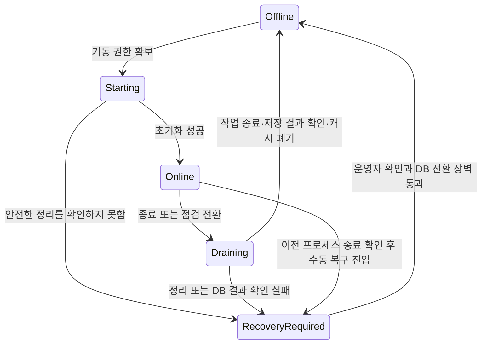

# 수정 권한 인계와 version 없는 플레이어 저장

- 날짜: 2026-10-08
- 상태: 2026-10-08 사용자 승인 후 구현 반영. 최종 검증 결과와 환경 제약은 [구현 계획](../plans/2026-10-08-player-write-authority.md), 실제 API와 사용 예제는 [사용 문서](../../player-write-authority.md)에 기록한다.
- 적용 대상: 하나의 관계형 DB에 저장하는 플레이어 집합과 이를 담당하는 하나의 활성 게임 서버, 별도 Admin 프로세스.
- 기존 계약: [플레이어 작업·공동 저장 설계](2026-10-06-player-operations-and-persistence-design.md). 이 문서는 수정 권한 기반 저장과 Admin 실행 경로를 추가하는 계약이다.
- 근거: [idlez Admin 저장 경로 조사](../../research/2026-10-08-idlez-admin-write-paths.md).

## 1. 목표와 선택

사용자는 idlez의 Admin 직접 DB 저장을 바탕으로, WorldServer가 운영 중이면 명령을 그 서버에서 실행하고 종료·점검 전환을 완료했으면 Admin 쪽에서 실행하는 구조를 원한다. 플레이어별 영속 version 컬럼을 요구하지 않는 것이 목표다. 장애·통신 단절을 근거로 자동 인계하지 않고, 정상 종료 또는 점검 전환이 확인된 경우부터 지원하기로 했다.

| 접근 | 특성 | 선택 |
|---|---|---|
| 항상 WorldServer로 큐잉 | 실행 주체가 단순하지만 서버 복귀 전에는 변경 불가 | 요구하는 종료 중 수정을 충족하지 못함 |
| 명시적인 종료·점검 인계 후 Admin 실행 | 서버 기동과 직접 수정을 상호 배제하고 종료 중에도 처리 가능 | 이번 설계 |
| 장애 감지 후 자동 인계 | 장애 중 처리 지속 가능성이 커지지만 오판·이전 서버 차단·복구 정책이 추가로 필요 | 제외 |

프레임워크는 수정 권한 전환, 플레이어 실행 순서, DB 트랜잭션, 명령 중복 방지, 실패 시 메모리 폐기를 맡는다. 게임은 인증·권한 정책, 명령 종류와 도메인 처리, DB 스키마·SQL·직렬화 매핑을 제공한다. 별도 Admin UI, 외부 게임 수정, 운영 DB 접속, 커밋·배포는 포함하지 않는다.

## 2. 보장 범위와 불변 조건

1. 하나의 소유 범위에는 한 시점에 하나의 활성 WorldServer 인스턴스만 존재한다. 운영 중에는 미접속 플레이어의 변경도 그 서버를 거친다.
2. 직접 수정이 허용된 동안에는 WorldServer가 해당 범위의 캐시를 사용하거나 저장하지 않는다. 새 서버는 직접 수정과 기동을 조정한 뒤 DB에서 새로 로드한다.
3. 같은 플레이어의 작업은 프로세스 내부 실행 권한과 DB의 플레이어별 잠금으로 직렬화한다. 서로 다른 플레이어의 작업은 병렬 실행할 수 있다.
4. 수정 권한의 DB 확인과 보호는 실제 읽기·쓰기 트랜잭션 안에서 수행하며 커밋/롤백까지 유지한다. 사전 상태 조회나 ping 결과는 실행 권한이 아니다.
5. 모든 플레이어 저장 경로가 이 계약에 참여한다. 주기 저장, 로그인 관련 쓰기, 종료 저장, Admin, 배치가 별도 연결로 우회 쓰기하면 보장하지 않는다.
6. 명령의 성공 표시, 성공 결과, 성공 감사 기록은 플레이어 변경과 같은 DB 트랜잭션으로 확정한다. 통신 timeout을 새로운 명령으로 바꾸어 직접 실행하지 않는다.
7. DB 커밋 실패·불명 시 변경 메모리를 버리는 기존 정책을 유지한다. 영속 version 제거와 메모리 Dirty 카운터·세션 세대 제거는 별개다.

소유 범위는 PlayerRegistry가 담당하는 저장 집합이다. idlez의 `world_id`와 동일하다고 가정하지 않는다. 한 프로세스가 여러 논리 월드를 처리하면 그 집합을 하나의 범위로 지정할 수 있다. 첫 구현은 한 작업이 하나의 소유 범위와 DB 안에서 끝나도록 제한한다.

클랜 등 공유 데이터가 이 범위 밖의 다른 writer와 겹치면 별도의 행 잠금·조건부 갱신 및 캐시 일관성 계약이 필요하다. 이 설계만으로 서로 다른 서버의 공유 객체나 여러 DB의 원자적 커밋을 지원한다고 주장하지 않는다.

## 3. 수정 권한 상태와 전환

DB에 범위별 제어 행을 둔다. 필수 의미는 범위 키, 상태, 현재 서버 실행 인스턴스 ID다. 실행 인스턴스 ID는 기동마다 새로 생성하며 재사용하지 않는다. 플레이어 저장 횟수를 나타내는 version은 아니다. 테이블·컬럼 이름은 어댑터가 정한다.

| 상태 | WorldServer | Admin의 직접 수정 |
|---|---|---|
| `Offline` | 기동 권한 획득만 가능 | 가능. 트랜잭션마다 상태 보호와 대상 잠금 필요 |
| `Starting(instance)` | 해당 인스턴스의 초기화·로드만 가능 | 대기 |
| `Online(instance)` | 해당 인스턴스가 로그인·요청·틱·명령·저장 처리 | 금지. 명령 접수만 가능 |
| `Draining(instance)` | 새 작업을 차단하고 기존 작업 정리·최종 저장 | 대기 |
| `RecoveryRequired` | 정상 서비스 금지 | 대기. 운영자 확인 필요 |

통신 불명은 관측 상태다. ping 실패·heartbeat 만료·프로세스 조회 실패로 DB의 상태를 `Offline`으로 바꾸지 않는다. 강제 종료되면 DB에는 이전 `Online` 또는 전환 상태가 남을 수 있고, 그 상태에서도 직접 수정은 금지된다. 제어 DB 자체가 불통이면 로컬 진입을 닫고 기존 DB 상태를 유지한다.

### 정상 종료·점검

1. 명령 실행기와 registry의 새 작업 진입을 닫는다. 기존 세션의 후속 요청·posted work·tick도 새 변경을 시작하지 못하게 한다.
2. 제어 행을 현재 인스턴스의 `Draining`으로 전환한다. 이미 시작한 도메인 변경의 저장과 최종 flush는 같은 인스턴스에 한해 허용한다.
3. 진행 중 작업을 끝내고 유효한 캐시를 저장·폐기한다. 실패한 메모리는 기존 정책대로 저장 없이 폐기한다. 기존 세션을 종료하고 백그라운드 writer를 모두 정지한다.
4. DB 결과가 확정되고 이전 writer가 종료했음을 확인한 뒤 제어 행을 배타적으로 확보하여 `Offline`으로 전환한다.

점검 공지나 신규 로그인 차단만으로는 이 절차가 끝난 것이 아니다. 관리자가 게임에 접속해 있거나 tick/save가 계속 동작하면 여전히 직접 수정을 허용하지 않는다. 프로세스가 켜져 있어도 서비스·캐시·writer를 모두 정리했다면 `Offline`일 수 있다. 재개 시에는 새 registry와 새로운 실행 인스턴스 ID를 사용한다.

롤백이 확정된 저장 실패는 메모리를 폐기하고 실패를 기록한 뒤 종료를 완료할 수 있다. 미저장 진행이 사라지는 기존 정책은 유지한다. 커밋 불명·미종료 작업·취소로 안전한 정리를 확인하지 못하면 `Offline`을 발행하지 않는다. `RetireAllAsync` 반환만으로 성공을 판단하지 않고 종료 결과를 집계해야 한다.

### 기동

1. 제어 행을 배타적으로 확보하고 `Offline`인지 확인한다. 이미 진행 중인 Admin 수정 트랜잭션이 끝나기까지 기다린다.
2. 새로운 인스턴스 ID로 `Starting`을 커밋한다. 이후 새 직접 수정은 대기한다.
3. 이전 캐시를 재사용하지 않고 초기화한다. 새 플레이어 로드는 권한 확인과 플레이어 잠금 아래 최신 DB 상태를 읽는다.
4. 초기화 성공 후 같은 인스턴스의 `Online`으로 전환하고 서비스 진입과 명령 실행을 연다.

전환 트랜잭션을 연 채 로컬 작업 종료나 서버 초기화를 기다리지 않는다. 짧은 상태 전환과 비동기 정리 단계를 분리한다. 동시에 두 서버가 기동을 시도해도 하나만 `Starting`을 획득한다. 전환 응답이 유실되면 같은 인스턴스 ID와 DB 상태를 확인하며, 다른 소유자를 덮어쓰지 않는다.

### 비정상 종료 후 수동 복구

운영자가 이전 프로세스 종료와 자동 재기동 차단을 확인한 뒤 복구 경로를 실행한다. 제어 행의 배타 잠금으로 이전 저장 트랜잭션의 종료를 확인하고, 남은 명령 처리 결과를 DB에서 확인한다. 이 장벽이나 확인이 실패하면 대기 상태를 유지한다. 확인자·사유·이전 인스턴스·결과를 기록한 뒤 `Offline`으로 전환한다. 단순한 Admin 상태 토글로 제공하지 않는다.

## 4. DB 잠금과 version 없는 저장

기존 버전 검사 방식은 유지하고, 명시적으로 선택하는 수정 권한 기반 저장 방식을 추가한다. 기존 저장 어댑터는 기본적으로 기존 버전 계약을 따른다. version 없는 방식은 제어 행 보호와 플레이어 잠금 매핑이 모두 설정되어야 시작할 수 있다. version 검사를 끄는 boolean이나 가짜 고정 버전을 허용하지 않는다.

권한 기반 방식의 기본 순서는 다음과 같다.

1. 온라인 실행기는 기존 키별 메모리 실행 권한을 정렬된 순서로 확보한다. Admin 실행기도 같은 프로세스 안에서는 이 순서를 사용한다.
2. DB 트랜잭션을 열고 제어 행을 공유 잠금으로 읽는다. 실행 역할·상태·인스턴스 ID를 검사한다.
3. 참여 플레이어의 기준 행을 키 순서로 잠근다. 기준 행은 기존 players/accounts의 PK 행을 매핑할 수 있다. 잠금을 위한 플레이어별 version 컬럼은 필요하지 않다.
4. 명령을 실행하는 경우 해당 명령 행을 잠그고 접수 정보·완료 여부를 재확인한다.
5. 상태 로드, 검증, 변경, 저장, 처리 결과·감사 기록을 같은 DB 트랜잭션으로 처리한다.
6. 커밋/롤백과 자원 정리가 끝난 뒤 실행 권한을 해제한다.

온라인 캐시는 기존 객체를 사용한다. 이 객체가 최신이라는 근거는 캐시 수명 전체에 걸쳐 다른 수정 주체가 없고, 같은 키의 모든 메모리 변경이 직렬화된다는 계약이다. 저장 시 행 잠금만 추가해서 오래된 캐시 문제를 해결했다고 간주하지 않는다.

Admin 쪽은 잠금을 얻은 뒤 상태를 로드하고 결과 처리 후 항상 폐기한다. 플레이어가 없어도 version이 없다는 이유로 존재한다고 간주하지 않는다. 기준 행 존재 여부와 선택적 영속 버전을 별도로 표현하도록 저장 계약을 나눈다. 삭제·신규 생성은 별도 게임 기능이며 이 명령 실행기가 누락 플레이어를 자동 생성하지 않는다.

PostgreSQL 매핑에서는 제어 행을 `SELECT ... FOR SHARE`로 보호하고 전환은 `SELECT ... FOR UPDATE`로 처리할 수 있다. 공유 잠금끼리는 동시에 가능하고, 상태 갱신과는 충돌하며 트랜잭션 종료까지 유지된다. 이것은 설계 제안이며 현재 패키지에 구현된 SQL이 아니다. [PostgreSQL 공식 잠금 문서](https://www.postgresql.org/docs/current/explicit-locking.html#LOCKING-ROWS)

실행과 전환이 모두 같은 제어 행을 잠가야 한다. 별도 연결에서 상태만 확인하고 원래 연결로 저장하는 방식, 전용 연결에만 소유 잠금을 두고 실제 쓰기 연결은 검사하지 않는 방식은 사용하지 않는다. 권한 거절 시 해당 서버의 진입을 닫고 캐시·세션을 무효화하며, 이후 재저장을 금지한다.

DB 접근은 패킷마다 추가하지 않고 로드·저장·명령 실행의 DB 트랜잭션에 통합한다. 제어 행 잠금을 독점 잠금으로 구현해 범위 전체 저장을 직렬화하지 않는다. 명령 없이 수행하는 일반 저장도 제어 행 → 플레이어 행 순서를 따른다.

## 5. Admin 명령 접수와 실행

Admin 요청은 PlayerModel 전체 덮어쓰기 대신 명시적인 명령으로 표현한다. 예를 들면 아이템 지급은 대상·아이템 종류·수량을 입력으로 받고, 온라인과 종료 중 실행이 같은 도메인 검증·변경 코드를 사용한다. 서버 실시간 상태가 반드시 필요한 명령은 등록 시 오프라인 실행 불가로 선언한다.

명령은 같은 DB의 접수표에 먼저 저장한다. 최소 의미는 고유 CommandId, 소유 범위, 인증된 관리자 식별자, 명령 종류, 입력 스키마 버전과 payload, 정렬된 참여 키, 입력 fingerprint, 접수 시각 및 처리 상태다. ID와 불변 입력을 함께 비교하며 같은 ID에 다른 내용을 넣으면 충돌로 거절한다. 관리자 요청자와 변경 대상 플레이어는 별도 개념이다.

현재 `PlayerOperation`과 `PlayerOperationRecord`는 ActorKey가 참여 플레이어에 포함되어야 한다. 이 계약을 확장해 요청자의 종류와 ID를 표현하고, Admin 요청자를 가짜 플레이어로 로드하지 않는다. 일반 게임 RPC는 여전히 인증된 플레이어를 요청자로 고정하고 참여자 포함을 검증한다. Admin 요청자 생성은 인증·권한 검증을 마친 서버 내부 경로로만 가능하다. 처리 결과 비교와 감사 기록에도 요청자 종류·ID를 포함한다. 기존 receipt의 요청자는 Player 종류로 해석하도록 어댑터와 데이터 이행을 맞추며, 관리자 ID와 플레이어 키가 같은 문자열이어도 동일 요청자로 취급하지 않는다.

프레임워크의 명령 실행기는 게임이 등록한 종류·입력 codec·작업 factory만 사용한다. 온라인에서는 현재 registry에, `Offline`에서는 캐시·세션·tick 없는 임시 실행기에 전달한다. Admin 프로세스에서도 공용 도메인 조립과 저장 어댑터를 사용한다. 게임 규칙을 SQL로 별도 복제하지 않는다.

두 실행기는 상태를 보고 후보 명령을 발견할 수 있지만, 실제 실행 권한과 완료 여부는 4장의 트랜잭션 안에서 다시 확인한다. 후보 조회는 실행 소유권을 부여하지 않는다. 사전 조회한 참여 키는 불변 접수 정보와 일치해야 한다. 중복 후보 발견은 플레이어 잠금과 명령 행 잠금으로 조정한다. 행 잠금은 실행 동안 유지하므로 lease 만료에 의한 자동 명령 인계는 필요하지 않다.

접수 완료는 변경 완료와 다르다. 응답은 CommandId와 대기/성공/거절/확정 실패/결과 확인 중 상태를 구분한다. 게임 규칙 거절은 상태 변경 없이 사유를 영속화한다. 적용 후 롤백이 확정된 실패는 실패 기록을 별도 트랜잭션으로 확정하되, 동일 명령 잠금과 결과 확인을 통과해야 한다. 다른 실행기가 먼저 확정한 성공·거절·실패를 덮어쓰지 않고 해당 결과를 사용한다. 서버 crash로 접수 상태만 남으면 같은 ID의 결과를 확인하고 새로 로드한 상태에서 다시 처리할 수 있다.

성공 시 CommandId를 OperationId로 사용하고 플레이어 변경·성공 receipt·명령 완료 표시·감사 기록을 한 번에 커밋한다. 현재 ExecuteAsync가 반환한 뒤 별도 트랜잭션에서만 성공 표시를 쓰지 않도록 프레임워크의 저장 완료 경로에 연결한다. 명령 접수표와 처리 기록은 논리 역할이며 어댑터가 물리 테이블을 합칠 수 있다.

커밋 응답이 유실되면 변경 메모리를 버리고, 같은 잠금 순서를 확보한 뒤 기록을 조회한다. 성공이 있으면 저장된 결과를 반환하고 Apply를 반복하지 않는다. 이전 DB 작업 종료를 확인하기 전에는 rollback이나 재실행을 확정하지 않는다. 실패 확정 기록 이전에 프로세스가 종료되는 경우도 같은 명령 ID와 잠금으로 중복 DB 효과를 막는다.

Admin 명령이 대기 중이면 서버와 Admin 실행기 중 현재 허용된 쪽이 이어서 처리한다. 대기 명령끼리의 전역 FIFO는 보장하지 않는다. 같은 플레이어의 실행은 겹치지 않으며 순서 의존 규칙은 최신 상태에서 검증한다. 영속 명령 접수는 Admin 요청에 한정하며 모든 게임 액션을 선행 로그로 재생하는 이벤트 소싱으로 확대하지 않는다. 외부 알림의 정확히 한 번 전달은 보장 범위가 아니다.

## 6. 기존 모듈과의 연결

| 영역 | 설계 변경 |
|---|---|
| `Bun3.Server.Players`의 저장 어댑터·scope | 기준 행 존재/잠금과 선택적 버전을 분리. 권한 기반 방식에서 모든 로드·저장 scope의 제어 행 보호를 강제 |
| registry의 로드·저장·공동 작업 | 기존 버전 방식 유지. 권한 방식은 버전 증가 없이 저장 완료 처리. Dirty·세션 세대·키별 실행 권한·복구 장벽 유지 |
| 작업 요청자·receipt | 플레이어와 Admin 요청자 구분, 일반 RPC 인증 계약 유지, 동일 ID 결과 비교 확장 |
| 공용 명령 실행 | 영속 접수, 등록된 명령 복원, 권한별 실행, 처리 결과를 공동 커밋에 연결 |
| `Bun3.Server.Hosting` | 서비스 시작 전에 수정 권한 확보. 새 변경 차단·모든 writer drain·캐시 폐기·DB 결과 확인 뒤 직접 수정 허용. 종료 결과 집계 |
| 게임 어댑터·호스트 | 명령 권한 정책, 도메인 코드, 제어 행·플레이어 행·명령/감사 기록 SQL 매핑, 관리 API와 운영자 복구 진입 |

권한 조정과 명령 실행의 재사용 부분은 Players, 호스트 시작/종료 연결은 Hosting에 둔다. 패키지는 특정 DB 제공자나 Admin 웹 프레임워크를 필수 참조하지 않는다. 정확한 공개 타입·시그니처 및 파일 분할은 이 계약을 구현 계획으로 옮길 때 고정한다.

Items/Achievements의 단독 사용, 메모리 Transaction 선택 사용, 기존 loader 기반 등록은 유지한다. loader만 설정한 registry에 이 영속 Admin 경로를 자동 활성화하지 않는다. 기존 버전 어댑터를 권한 기반으로 이행할 때에는 모든 writer를 먼저 새 경로로 연결하고 일관된 모드로 재기동한다. 같은 소유 범위에서 이전의 무보호 writer와 혼용하지 않는다.

## 7. 관측과 검증

로그와 감사 기록은 소유 범위, 인스턴스 ID, 전환 요청 식별자, 관리자 식별자, CommandId/OperationId, 참여 키, 저장 시도 ID, 처리 단계, 커밋 결과, 거절·실패 원인을 연결한다. 권한 방식에서 존재하지 않는 영속 version을 0으로 꾸며 기록하지 않는다. 입력 전문이나 인증 토큰을 진단 로그에 자동으로 남기지 않는다.

전환 성공 기록은 제어 행 변경과 함께 확정한다. 명령 성공 감사는 플레이어 변경과 함께 확정한다. 일반 진단 로그는 실패 단계 추적용이며 단독으로 명령 성공을 증명하지 않는다.

| 검증 상황 | 기대 결과 |
|---|---|
| version 컬럼이 없는 플레이어 테이블 | 로드·주기 저장·온라인/오프라인 공동 작업 성공 |
| 기존 version 어댑터 | stale version 거절과 기존 회귀 유지 |
| 서버 운영 중 미접속 플레이어에게 Admin 명령 | 서버가 임시 로드하며 동시 로그인과 직렬 실행 |
| 종료 중 직접 수정 | 허용되지 않고 대기 |
| 로그인만 막고 tick·세션 유지 | 직접 수정 상태로 전환 불가 |
| Admin 수정 중 서버 기동 | 기동 전환이 해당 DB 트랜잭션 종료까지 대기하고 최신 상태 사용 |
| 서버 두 개의 동시 기동 | 한 인스턴스만 서비스 시작 |
| 재기동 후 이전 인스턴스의 지연 저장 | 거절, 이전 캐시 무효화, 새 상태 덮어쓰기 없음 |
| 서버 timeout·heartbeat 만료 | 자동 Offline 전환·직접 수정 없음 |
| 종료 취소·미종료 writer·커밋 불명 | 직접 수정 허용 상태를 발행하지 않음 |
| 여러 Admin 프로세스의 동일 플레이어/동일 명령 처리 | DB 잠금으로 직렬화, 동일 명령의 중복 DB 효과 없음 |
| 성공 후 응답 유실·프로세스 종료 | 같은 ID로 확정 결과 조회, Apply 재실행 없음 |
| 공동 작업 중 일부 저장 실패 | 전체 rollback과 참여자 메모리 폐기, 종료 훅 재저장 없음 |
| 일반 게임 RPC로 Admin 요청자 위조 | 실행 전 거절 |
| 인원이 겹치지 않는 여러 저장 | 공유 제어 잠금 아래 병렬 진행 |
| 제어 행 상태 확인 후 전환 경쟁 | 저장이 커밋될 때까지 전환 대기, 상태 확인과 쓰기 사이 틈 없음 |

단위 테스트는 상태 전환·거절·결과 분류를 검증한다. DB 잠금 보장은 서로 다른 연결을 사용한 PostgreSQL 통합 검증으로 확인한다. 기존 SQLite 테스트 통과만으로 공유/배타 행 잠금 보장을 주장하지 않는다. 테스트용 격리 DB만 사용하며 운영 DB는 사용하지 않는다.

## 8. 검토 상태

대화에서 선택된 범위는 명시적 종료·점검 인계다. 이 문서는 그 범위에 대한 승인된 설계다. 현재 필수 영속 version 계약, Admin 요청자와 참여자의 차이, 종료 함수 반환만으로는 부족한 완료 판정을 확인하고 변경 대상으로 명시했다.

Players 0.7.0 / Hosting 0.8.0에 구현했으며 기존 2026-10-06 설계와 사용 문서에 확장 링크를 반영했다. 실행 작업자 한도로 독립 리뷰를 수행하지 못해 작업별 diff 자체 검토와 테스트로 검증했다. Docker engine을 사용할 수 없어 실제 DB 검증은 격리된 네이티브 PostgreSQL 18.6으로 수행했으며 Docker 실행기 자체는 미검증이다.

구현 상세에서 두 조건을 명시한다. worker는 등록된 종류·입력 버전과 오프라인 지원 여부를 기준으로 **배치 제한 전에** 후보를 필터링해 미지원 Pending 명령이 정상 명령을 가로막지 않게 한다. 역할과 scope는 프레임워크가 검사하지만 Queue와 PlayerStore 연결 팩토리의 물리 DB 동일성은 제공자별 배포 검증 대상이다. 두 팩토리의 동일 DB 매핑 없이 이 계약을 사용할 수 없다.
